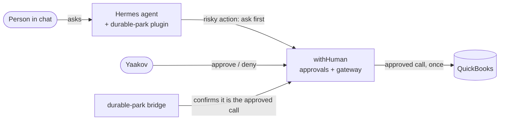

# TapDash Agents

Code for TapDash's AI agents and the safety layer around them.

## In plain English

TapDash is building AI assistants that work inside chat (Telegram today, Microsoft Teams next). Some of what they
do touches money, like recording a payment or creating a bill in QuickBooks. **Before any of that happens, a
person has to approve it.**

That is what `durable-park` does. When an assistant tries something risky, it is stopped and the exact request is
saved. Yaakov gets an approval request and can take minutes or days to decide. If he approves, that exact request
runs once, and the assistant reports back in the same chat. If he denies it, nothing happens. Restarts and crashes
can't lose a request or make it run twice. If anything is unclear, it stops and asks a person instead of guessing.

**Where it stands:** working and tested on a test server with a QuickBooks **sandbox** (fake books) since
October 2026. It is not connected to real books yet. That needs the security steps in the
[runbook](durable-park/docs/runbook.md#rotate-secrets-before-production) first.

## What is in this repo

| Path | What it is |
|---|---|
| [`durable-park/`](durable-park/) | The approval layer: a Hermes plugin plus two small services ([README](durable-park/README.md)) |
| [`tools/docs_check/`](tools/docs_check/) | The check that keeps docs and diagrams in step with the code |
| [`.github/`](.github/) | CI (tests, docs check, diagram check), pull request template, the docs map |
| [`AGENTS.md`](AGENTS.md) | Rules for AI coding agents (and people) working in this repo |
| [`CONTRIBUTING.md`](CONTRIBUTING.md) | How to make a change: tests, docs, review |

## How it fits together



Full detail, with every arrow labeled: [durable-park/docs/architecture.md](durable-park/docs/architecture.md).

## For developers

```sh
git clone git@github.com:TapDashPayments/TapDash-Agents.git && cd TapDash-Agents
git config core.hooksPath .githooks            # refuse pushes whose code changes skip their docs
cd durable-park && python3 -m venv .venv && .venv/bin/pip install -r requirements-dev.txt
.venv/bin/pytest -q -W error
```

The live system runs on the test VM; how to operate it is in the
[runbook](durable-park/docs/runbook.md).

## The one rule

**Change code, change its docs - in the same commit or pull request.** That covers READMEs, the architecture
diagrams, the runbook and the setup guides. `.github/docs-map.json` says which docs belong to which code, and the
pre-push hook and CI enforce it. Details: [CONTRIBUTING.md](CONTRIBUTING.md).
