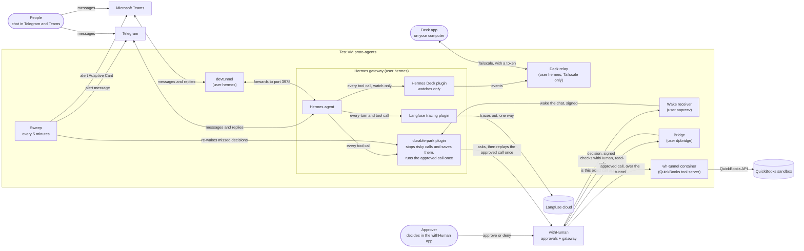

# TapDash Agents

Code for TapDash's AI agents and the safety layer around them.

## In plain English

TapDash is building AI assistants that work inside chat (Telegram and Microsoft Teams). Some of what they
do touches money, like recording a payment or creating a bill in QuickBooks. **Before any of that happens, a
person has to approve it.**

That is what `durable-park` does. When an assistant tries something risky, it is stopped and the exact request is
saved. An approver gets an approval request and can take minutes or days to decide. If they approve, that exact
request runs once, and the assistant reports back in the same chat. If they deny it, nothing happens. Restarts and crashes
can't lose a request or make it run twice. If anything is unclear, it stops and asks a person instead of guessing.

If something goes wrong, an alert goes to Telegram and to Teams.

Every chat message, model call and tool call (with its full content) is also copied to Langfuse Cloud (US), a third
company, so people can review what the assistant did; on the free plan it can be read there for 30 days. TapDash's own patched
copy of the tracing plugin (live since 2026-10-22) names each trace by platform, records who sent the message, and
tags every trace that mentions an approval id, so everything about one approval can be found with one filter.

**Where it stands:** working and tested on a test server with a QuickBooks **sandbox** (fake books) since
October 2026. It is not connected to real books yet. First the secrets need rotating, and a short list of
safety items needs finishing: [what is left](durable-park/docs/backlog.md#before-real-books).

## Who does what

| Role | Does | Needs |
|---|---|---|
| **Approver** | Approves or denies each risky action in the withHuman app | A withHuman account on the approvers' escalation path |
| **Admin** | Runs the system: health checks, deploys, alerts, secrets, root steps on the VM, withHuman settings | Root on the VM (`tailscale ssh`), admin in withHuman, write access to this repo |
| **Developer** (person or AI agent) | Changes code and its docs | This repo; AI agents also follow [`AGENTS.md`](AGENTS.md) |

**Admins start here:** [runbook](durable-park/docs/runbook.md) (health check, deploy, alerts, troubleshooting,
secrets, rollback) and [architecture](durable-park/docs/architecture.md) (what runs where).

**Agent dashboard:** <https://proto-agents.taila95862.ts.net:8443/> (web UI of the Hermes agent on `proto-agents`). Reachable only
from a device signed in to our Tailscale network (not on the public internet); asks for a login. Details in the
[runbook](durable-park/docs/runbook.md#access-and-ground-rules).

## Built on

durable-park is a thin layer of our own code between open-source and third-party pieces. Versions are the ones
running on the test VM.

**Third-party and open-source**

| Component | What it does here | Version | License | Link |
|---|---|---|---|---|
| Hermes Agent (Nous Research) | The AI agent framework. Runs the chat bots; our plugin hooks into it | v0.22.3 | MIT | [github](https://github.com/NousResearch/hermes-agent) |
| Langfuse plugin for Hermes (Nous Research, official catalog plugin; TapDash patched copy in [`tracing/tapdash_langfuse`](tracing/tapdash_langfuse), see its [PATCHES.md](tracing/tapdash_langfuse/PATCHES.md)) | Sends one trace per message turn to Langfuse: the model calls (system prompt + last 12 messages in, answer out), every tool call and subagent, with full content. Hooks only, no tools. If Langfuse is down or the keys are missing it does nothing, and the turn still runs (traces can be lost). **Live** on the test VM since 2026-10-22 04:37 UTC as the unpatched catalog plugin. The patched copy (plugin name `tapdash-langfuse`) adds the chat sender id as the trace `userId`, trace names by platform (`telegram-turn`) and trace tags from patterns (`HERMES_LANGFUSE_TAG_PATTERNS`, for example `park:P-...`); it is built and tested, **not deployed yet** ([runbook](durable-park/docs/runbook.md#tracing-langfuse)) | v2.0.0 @ commit `c2a9596` (upstream; the patched copy is based on it) | MIT | [github](https://github.com/NousResearch/hermes-official-plugins/tree/main/langfuse) |
| Langfuse Cloud | Where the traces are stored and read: the hosted service, US region (`us.cloud.langfuse.com`), free Hobby plan (30 days of data; about 50k units a month on [Langfuse's pricing page](https://langfuse.com/pricing)). **Live** since 2026-10-22. It holds the full text of chats and tool calls. Its Python SDK `langfuse` runs inside the plugin | hosted ([langfuse.com](https://langfuse.com)); SDK 4.15.2 | service is Langfuse's; SDK MIT | [site](https://langfuse.com) · [sdk](https://github.com/langfuse/langfuse-python) |
| Hermes Deck (Hermes-Deck) | The desktop app and its Hermes plugin and relay that show what the agent is doing; watch only. [Runbook](durable-park/docs/runbook.md#hermes-deck-desktop-app) | 1.0.0 (`2b2b2b7`) | not stated (no LICENSE file in the repo) | [github](https://github.com/Hermes-Deck/hermes-deck) |
| withHuman | Approvals: pipeline rules, the approval app, escalation paths, the MCP gateway in front of QuickBooks | hosted ([app.withhuman.ai](https://app.withhuman.ai)) | Elastic License 2.0 (source-available) | [github](https://github.com/withHumanAI/withhuman) |
| AAP - Agent Approval Protocol | The open protocol and Python SDK (`agentapprovalprotocol`) we use to open approval requests, use an approval once, and verify signed webhooks | SDK 0.3.3 | Apache-2.0 | [github](https://github.com/agentapprovalprotocol/agentapprovalprotocol) · [site](https://agentapprovalprotocol.io) |
| withHuman tunnel | Container that connects the QuickBooks and Maverick servers on the VM to the withHuman gateway | `quay.io/withhuman/tunnel:0.0.369` | withHuman's | [withHuman](https://withhuman.ai) |
| QuickBooks Online MCP server (Intuit) | The QuickBooks tools (create bill, payment, ...). Built into the tunnel image | commit `31a1dd5` | Apache-2.0 | [github](https://github.com/intuit/quickbooks-online-mcp-server) |
| Maverick MCP server (TapDash, `maverick-mcp`) | The 42 Maverick Payments tools (lookups, boarding, vault, ACH, disputes, tickets, refunds). Built into the tunnel image from root's read-only checkout `/opt/maverick-mcp-src`, pinned in [`maverick-mcp.sha`](durable-park/deploy/tunnel/maverick-mcp.sha); its Python packages come only from its hashed lock file. Live since 2026-10-25 with **placeholder settings** until Maverick gives sandbox access ([gateway setup](durable-park/docs/gateway-setup.md#maverick-server-source)) | commit `e4a2b10036a260808c2c18c6a75fdbeaed16b8b2` (`e4a2b10`) | private (TapDash) | [github](https://github.com/TapDashPayments/maverick-mcp) (private) |
| MCP - Model Context Protocol | The standard the agent uses to call tools through the gateway | - | open standard | [site](https://modelcontextprotocol.io) |
| Starlette + uvicorn | Web framework and server for the bridge and the receiver | 1.9.0 / 0.54.0 | BSD-3-Clause | [starlette](https://github.com/encode/starlette) · [uvicorn](https://github.com/encode/uvicorn) |
| httpx | HTTP client used by one-time provisioning | 0.28.1 | BSD-3-Clause | [github](https://github.com/encode/httpx) |
| fastjsonschema | Checks a call's arguments against the tool's rules (copied into the plugin, pinned) | 2.22.2 | BSD-3-Clause | [github](https://github.com/horejsek/python-fastjsonschema) |
| SQLite | The ledger: every parked call and its state | system | public domain | [site](https://sqlite.org) |
| Tailscale (+ Funnel) | Admin access to the VM; Funnel gives withHuman a public HTTPS address for the receiver and bridge | system | client BSD-3-Clause; service is Tailscale's | [site](https://tailscale.com) |
| Bitwarden Secrets Manager + `bws` CLI | Holds the agent's Teams, Telegram and Langfuse keys; Hermes pulls them at every start ([runbook](durable-park/docs/runbook.md#secrets-bitwarden)). `bws` is installed by Hermes's package manager | `bws` 2.0.0 | Bitwarden SDK License (source-available; read from GitHub's license note, not checked in full) | [github](https://github.com/bitwarden/sdk-sm) · [site](https://bitwarden.com/products/secrets-manager/) |
| Docker | Runs the tunnel container | system | Apache-2.0 | [site](https://www.docker.com) |
| systemd | Runs the gateway, receiver, bridge and their restarts | system | LGPL-2.1 | [site](https://systemd.io) |
| Telegram | Where people chat with the test bot, and where alerts go (they also go to Teams) | - | Telegram's service | [site](https://telegram.org) |
| Microsoft Teams + Dev Tunnels (`devtunnel`) | Where people chat with the "TapDash Agent" bot, served by the same Hermes gateway. The devtunnel `proto-agents-bot` (runs as the user `hermes`) forwards Teams to the gateway. Alerts also arrive here as an Adaptive Card, through a Power Automate flow | - | Microsoft's services | [dev tunnels](https://learn.microsoft.com/en-us/azure/developer/dev-tunnels/overview) |
| GitHub CLI (`gh`) | Opens pull requests from the VM; installed with apt and signed in as the admin user `ubuntu` only, not as `hermes` ([runbook](durable-park/docs/runbook.md#open-a-pull-request-from-the-vm)) | 2.46.0 | MIT | [github](https://github.com/cli/cli) |
| pytest; Mermaid + jsdom | Tests; diagram check in CI | 9.1.1; 11.17.2 + 25.0.1 | MIT | [pytest](https://pytest.org) · [mermaid](https://mermaid.js.org) |

**Ours (in this repo)**

| Component | What it does | Where |
|---|---|---|
| durable-park plugin | Stops risky calls, checks their form, saves them in the ledger, opens the approval, wakes the chat, runs the approved call once | [`durable-park/plugin/`](durable-park/plugin/) |
| Bridge | Our custom service that withHuman's pipeline calls: "is this exactly the approved call?" It checks in withHuman itself (no ledger, no state), answers yes once, else asks a person | [`durable-park/bridge/`](durable-park/bridge/) |
| Receiver | Takes withHuman's signed "decision made" webhook and wakes the plugin; also does one-time provisioning | [`durable-park/receiver/`](durable-park/receiver/) |
| Sweep | Runs every 5 minutes: safety net for stuck rows, and the alerts | [`durable-park/scripts/`](durable-park/scripts/) |
| Tool lockdown and deploy | The v1 lockdown that limits what the agent can call (re-applied on proto-agents 2026-10-21 03:16 UTC as a stopgap); systemd units; tunnel image build | [`durable-park/deploy/`](durable-park/deploy/) |
| Docs check | Keeps docs and diagrams in step with code (pre-push hook and CI) | [`tools/docs_check/`](tools/docs_check/) |

## What is in this repo

| Path | What it is |
|---|---|
| [`durable-park/`](durable-park/) | The approval layer: a Hermes plugin plus two small services ([README](durable-park/README.md)) |
| [`docs/`](docs/README.md) | Every spec and plan of the repo, with its status |
| [`tools/docs_check/`](tools/docs_check/) | The check that keeps docs and diagrams in step with the code |
| [`.github/`](.github/) | CI (tests, docs check, diagram check), the Docs Keeper trigger (asks Kilo to check each new pull request's docs), pull request template, the docs map |
| [`AGENTS.md`](AGENTS.md) | Rules for AI coding agents (and people) working in this repo |
| [`CONTRIBUTING.md`](CONTRIBUTING.md) | How to make a change: tests, docs, review |

## How it fits together

The map below shows who does what. Plain version: people chat with the agent in Telegram or Teams. The agent's
durable-park plugin stops every risky request and asks withHuman. An approver says yes or no in the withHuman app.
After a yes, the saved request runs once, through withHuman's gateway and a small tunnel container, into the
QuickBooks sandbox.



What does what:

- **Hermes agent** (Linux user `hermes`): the AI. It talks to people and tries to use tools.
- **durable-park plugin**: sits between the agent and every tool. Risky calls are stopped, saved and sent to withHuman.
- **withHuman**: a hosted service. It holds the approval requests, the rules, and the gateway to QuickBooks.
- **Wake receiver**: hears withHuman's "decided" message and wakes the chat so the agent can finish the job.
- **Bridge** (own Linux user `dpbridge`): answers withHuman's question "was this exact call approved?" It checks withHuman itself and keeps no records.
- **wh-tunnel**: a container that holds the QuickBooks tool server and dials out to withHuman. The agent never holds QuickBooks keys.
- **Sweep**: every 5 minutes it catches anything missed and sends alerts to Telegram and Teams.
- **devtunnel**: gives Teams a way in to the agent on the VM.
- **Langfuse**: a hosted service that stores a copy of every chat, model call and tool call so people can review them.

Full detail, with every arrow labeled: [durable-park/docs/architecture.md](durable-park/docs/architecture.md).

## For developers

```sh
git clone git@github.com:TapDashPayments/TapDash-Agents.git && cd TapDash-Agents
git config core.hooksPath .githooks            # refuse pushes whose code changes skip their docs
cd durable-park && python3 -m venv .venv && .venv/bin/pip install -r requirements-dev.txt
.venv/bin/pytest -q -W error
```

The live system runs on the test VM; admins operate it with the [runbook](durable-park/docs/runbook.md).

## The one rule

**Change code, change its docs - in the same commit or pull request.** That covers READMEs, the architecture
diagrams, the runbook and the setup guides. `.github/docs-map.json` says which docs belong to which code, and the
pre-push hook and CI enforce it. Details: [CONTRIBUTING.md](CONTRIBUTING.md).
