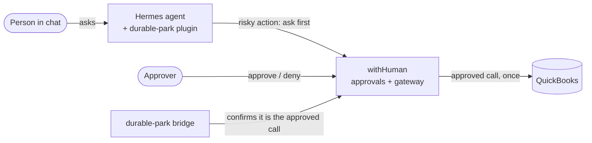

# TapDash Agents

Code for TapDash's AI agents and the safety layer around them.

## In plain English

TapDash is building AI assistants that work inside chat (Telegram today, Microsoft Teams next). Some of what they
do touches money, like recording a payment or creating a bill in QuickBooks. **Before any of that happens, a
person has to approve it.**

That is what `durable-park` does. When an assistant tries something risky, it is stopped and the exact request is
saved. An approver gets an approval request and can take minutes or days to decide. If they approve, that exact
request runs once, and the assistant reports back in the same chat. If they deny it, nothing happens. Restarts and crashes
can't lose a request or make it run twice. If anything is unclear, it stops and asks a person instead of guessing.

**Where it stands:** working and tested on a test server with a QuickBooks **sandbox** (fake books) since
October 2026. It is not connected to real books yet. First the secrets need rotating, and a short list of
safety items needs finishing: [what is left](durable-park/docs/backlog.md#before-real-books).

## Who does what

| Role | Does | Needs |
|---|---|---|
| **Approver** | Approves or denies each risky action in the withHuman app | A withHuman account on the approvers' escalation path |
| **Admin** | Runs the system: health checks, deploys, alerts, secrets, root steps on the VM, withHuman settings | Root on the VM (`tailscale ssh`), admin in withHuman, write access to this repo |
| **Developer** (person or AI agent) | Changes code and its docs | This repo; AI agents also follow [`AGENTS.md`](AGENTS.md) |

**Admins start here:** [runbook](durable-park/docs/runbook.md) (health check, deploy, alerts, troubleshooting,
secrets, rollback) and [architecture](durable-park/docs/architecture.md) (what runs where).

## Built on

durable-park is a thin layer of our own code between open-source and third-party pieces. Versions are the ones
running on the test VM.

**Third-party and open-source**

| Component | What it does here | Version | License | Link |
|---|---|---|---|---|
| Hermes Agent (Nous Research) | The AI agent framework. Runs the chat bots; our plugin hooks into it | v0.22.2 | MIT | [github](https://github.com/NousResearch/hermes-agent) |
| withHuman | Approvals: pipeline rules, the approval app, escalation paths, the MCP gateway in front of QuickBooks | hosted ([app.withhuman.ai](https://app.withhuman.ai)) | Elastic License 2.0 (source-available) | [github](https://github.com/withHumanAI/withhuman) |
| AAP - Agent Approval Protocol | The open protocol and Python SDK (`agentapprovalprotocol`) we use to open approval requests, use an approval once, and verify signed webhooks | SDK 0.3.3 | Apache-2.0 | [github](https://github.com/agentapprovalprotocol/agentapprovalprotocol) · [site](https://agentapprovalprotocol.io) |
| withHuman tunnel | Container that connects the QuickBooks server on the VM to the withHuman gateway | `quay.io/withhuman/tunnel:0.0.369` | withHuman's | [withHuman](https://withhuman.ai) |
| QuickBooks Online MCP server (Intuit) | The QuickBooks tools (create bill, payment, ...). Built into the tunnel image | commit `31a1dd5` | Apache-2.0 | [github](https://github.com/intuit/quickbooks-online-mcp-server) |
| MCP - Model Context Protocol | The standard the agent uses to call tools through the gateway | - | open standard | [site](https://modelcontextprotocol.io) |
| Starlette + uvicorn | Web framework and server for the bridge and the receiver | 1.9.0 / 0.54.0 | BSD-3-Clause | [starlette](https://github.com/encode/starlette) · [uvicorn](https://github.com/encode/uvicorn) |
| httpx | HTTP client used by one-time provisioning | 0.28.1 | BSD-3-Clause | [github](https://github.com/encode/httpx) |
| fastjsonschema | Checks a call's arguments against the tool's rules (copied into the plugin, pinned) | 2.22.2 | BSD-3-Clause | [github](https://github.com/horejsek/python-fastjsonschema) |
| SQLite | The ledger: every parked call and its state | system | public domain | [site](https://sqlite.org) |
| Tailscale (+ Funnel) | Admin access to the VM; Funnel gives withHuman a public HTTPS address for the receiver and bridge | system | client BSD-3-Clause; service is Tailscale's | [site](https://tailscale.com) |
| Docker | Runs the tunnel container | system | Apache-2.0 | [site](https://www.docker.com) |
| systemd | Runs the gateway, receiver, bridge and their restarts | system | LGPL-2.1 | [site](https://systemd.io) |
| Telegram | Where people chat with the test bot, and where alerts go today (Teams next) | - | Telegram's service | [site](https://telegram.org) |
| pytest; Mermaid + jsdom | Tests; diagram check in CI | 9.1.1; 11.17.2 + 25.0.1 | MIT | [pytest](https://pytest.org) · [mermaid](https://mermaid.js.org) |

**Ours (in this repo)**

| Component | What it does | Where |
|---|---|---|
| durable-park plugin | Stops risky calls, checks their form, saves them in the ledger, opens the approval, wakes the chat, runs the approved call once | [`durable-park/plugin/`](durable-park/plugin/) |
| Bridge | Our custom service that withHuman's pipeline calls: "is this exactly the approved call?" Answers yes once, else asks a person | [`durable-park/bridge/`](durable-park/bridge/) |
| Receiver | Takes withHuman's signed "decision made" webhook and wakes the plugin; also does one-time provisioning | [`durable-park/receiver/`](durable-park/receiver/) |
| Sweep | Runs every 5 minutes: safety net for stuck rows, and the alerts | [`durable-park/scripts/`](durable-park/scripts/) |
| Tool lockdown and deploy | Limits what the agent can call; systemd units; tunnel image build | [`durable-park/deploy/`](durable-park/deploy/) |
| Docs check | Keeps docs and diagrams in step with code (pre-push hook and CI) | [`tools/docs_check/`](tools/docs_check/) |

## What is in this repo

| Path | What it is |
|---|---|
| [`durable-park/`](durable-park/) | The approval layer: a Hermes plugin plus two small services ([README](durable-park/README.md)) |
| [`tools/docs_check/`](tools/docs_check/) | The check that keeps docs and diagrams in step with the code |
| [`.github/`](.github/) | CI (tests, docs check, diagram check), pull request template, the docs map |
| [`AGENTS.md`](AGENTS.md) | Rules for AI coding agents (and people) working in this repo |
| [`CONTRIBUTING.md`](CONTRIBUTING.md) | How to make a change: tests, docs, review |

## How it fits together



Full detail, with every arrow labeled: [durable-park/docs/architecture.md](durable-park/docs/architecture.md).

## For developers

```sh
git clone git@github.com:TapDashPayments/TapDash-Agents.git && cd TapDash-Agents
git config core.hooksPath .githooks            # refuse pushes whose code changes skip their docs
cd durable-park && python3 -m venv .venv && .venv/bin/pip install -r requirements-dev.txt
.venv/bin/pytest -q -W error
```

The live system runs on the test VM; admins operate it with the [runbook](durable-park/docs/runbook.md).

## The one rule

**Change code, change its docs - in the same commit or pull request.** That covers READMEs, the architecture
diagrams, the runbook and the setup guides. `.github/docs-map.json` says which docs belong to which code, and the
pre-push hook and CI enforce it. Details: [CONTRIBUTING.md](CONTRIBUTING.md).
