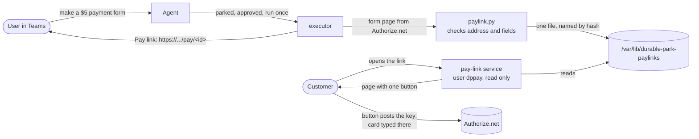

# Pay links for Authorize.net forms (TAP2-82), 2026-10-26

## The problem

Authorize.net opens a hosted card form only when a page POSTs the form key to it. There is no plain link. So the
connector (`authorizenet-mcp`) answers with a small page, `launcher_html`, and the agent could only paste it into
the chat as text. Nobody can click that, and a customer certainly can't.

Yaakov chose a short link served by our own machine ("option 1").

## What it does

1. An approved `authnet_create_payment_form` or `authnet_create_profile_form` runs (unchanged: it is a money server
   tool, so a person always approves it first).
2. The executor reads the post address and hidden fields out of `launcher_html`. Each part must match a fixed list:
   Authorize.net's hosted page addresses (sandbox and production), the fields `token`, `paymentProfileId`,
   `shippingAddressId`, each with a fixed shape. Anything else: no link, and the chat is told why.
3. It saves `{post_url, fields, expires_at, amount}` in one file named by the SHA-256 of a random 32-character link
   id. The link works for the form's 15 minutes less one.
4. The model gets only the link and is told to give it to the user. It never sees the form key. The outcome line
   (posted straight into the chat, no model) shows the link as well.
5. The pay-link service answers `GET /pay/<id>` with its own page: one "Continue to payment" button that posts the
   key to Authorize.net. No script runs, so link previews and mail scanners that open the link send nothing on.
   Unknown, expired or tampered links all get "This payment link has expired".

## Safety choices

- **The page is ours, not the connector's.** The service builds it from checked parts and escapes every value. The
  Funnel address also serves the Proto-Agents connector's sign-in pages, so no outside HTML may be served there.
- **Strict headers:** `Content-Security-Policy` with no script, styles by hash only, `form-action` limited to
  Authorize.net, no framing; `Cache-Control: no-store`, `Referrer-Policy: no-referrer`, `X-Robots-Tag: noindex`.
- **Least privilege:** the service runs as `dppay`, reads the folder only (`2750 hermes:dppay`, files `0640`), and has
  no access to the ledger, the secrets or the home folders. Its systemd unit is locked down like the receiver's.
- **The link is a short-lived bearer link**, the same as the form key itself: whoever has it can open that one form for
  that amount until it expires. It cannot charge another amount, refund or read anything.
- **Never silent:** if no link can be made, the model is told to say so, the outcome line says why, and the gateway
  log has an error.

## Not done (on purpose)

- The ledger keeps the connector's raw answer (with the form key) like every other result, so an admin can see what
  ran. The key stops working after 15 minutes, so the stored copy is useless after that.
- A form tool approved instantly by withHuman (no park) would run the normal way and the model would see the page.
  Today the entry pipeline sends both form tools to a person every time, so that path is not used.

- No click tracking or one-time links: Teams and mail previews open links, and a one-time link would be used up by
  them before the customer ever saw it.
- Production Authorize.net is allowed by the address list but not tested (sandbox only today).
