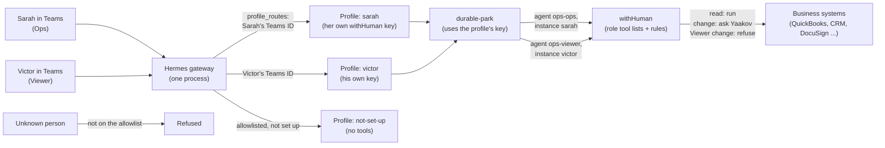

# Per-person roles for the Ops agent (design)

Date: 2026-10-26. Linear: TAP2-27 (identity and per-user permissions). Status: design approved in chat by Yaakov,
written spec waiting for his review. Builder: tab.bot, after this spec and the implementation plan are approved.

In plain English: today everyone who talks to the bot is treated the same, and withHuman sees only one "agent".
This design gives each person a **role** (Admin, Ops or Viewer). The role decides which tools the person can use.
withHuman keeps making every decision, and now it also knows **who** asked.

## 1. Decisions (Yaakov, 2026-10-26)

| # | Question | Decision |
|---|---|---|
| 1 | Who uses the Ops agent? | Several people with different rights. |
| 2 | How are rights set? | **By role.** Per-person changes on top of a role come later: GitHub #79 (Linear TAP2-179). |
| 3 | Which roles? | **Admin, Ops, Viewer** (table in section 2). |
| 4 | Where do roles and rights live? | **In withHuman.** One withHuman agent per role, one instance (copy) of it per person. Hermes sends each person to their own profile. |
| 5 | Who approves? | **Unchanged:** Yaakov approves everything, including his own requests, through the existing escalation path `notify-yaakov-yehuda`. "The asker must not approve their own request" stays an open item of TAP2-83, not part of this design. withHuman can already name different approvers per rule (escalation paths); no build is needed for that later. |
| 6 | Which chat apps? | **Teams only.** Telegram stays Yaakov's own admin line (the default profile). WhatsApp later (TAP2-66). |
| 7 | Where does this design live? | Here, in TapDash-Agents, for the client now; written so the hermes-withhuman-kit can reuse it later. |
| 8 | Recurring tasks (TAP2-31) | Native Hermes scheduling, **left off for now** (it is off today). Event triggers later: GitHub #80. Not part of this design, except that a person's future scheduled jobs run in that person's profile. |

## 2. Roles

| Role | withHuman agent | Can do |
|---|---|---|
| **Admin** | `ops-admin` | Everything. Changes people's roles. The only role that can use Hermes admin chat commands (`/update`, `/restart`, `/model` and so on). |
| **Ops** | `ops-ops` | Reads in every system. Can ask for changes and money moves; withHuman still asks an approver for each one, exactly as today. |
| **Viewer** | `ops-viewer` | Lookups only. A change is refused before it reaches any system. |

## 3. Project map (what does what)

| Piece | Where | What it does |
|---|---|---|
| Role agents | withHuman: `ops-admin`, `ops-ops`, `ops-viewer` | Each has its own tool list (grants per gateway server). Rules test the role with `/agent/slug`. |
| People | withHuman: one instance of the role agent per person, named after them, each with its own key | withHuman's records name the person. Changing a role = moving the person to another role agent (new instance, old one disabled). |
| Routing | Hermes: one profile per person (`~/.hermes/profiles/<name>/`) and one `gateway.profile_routes` entry (Teams user ID + TapDash tenant ID → profile) | One gateway serves every profile (`gateway.multiplex_profiles`, on by default). Each profile has its own `mcp_servers.wh` with the person's own key; Hermes never shares keys between profiles. |
| Strangers | Hermes: `TEAMS_ALLOWED_USERS` (allowlist) plus a catch-all Teams route to the profile `not-set-up`, which has no tools | Unknown people are refused. Allowlisted people with no route of their own can do nothing and are told to ask an admin. |
| Admin commands | Hermes: `platforms.teams.extra.allow_admin_from` = the Admins' Teams user IDs (`gateway/slash_access.py`) | Everyone else can run only `/help` and `/whoami`. Today the list is empty, so anyone allowed to chat can run every command. |
| Approvals | withHuman, unchanged | Yaakov approves everything that asks a person. |

Facts these rows rely on (checked 2026-10-26 against Hermes v0.22.3 code and docs):
- The Teams adapter sets a message's `user_id` to the sender's Entra (Azure AD) object ID and `guild_id` to the
  tenant ID (`plugins/platforms/teams/adapter.py:522-529`). Routes match both.
- Hermes: "Sender routing selects a profile; it is not deny-by-default authorization." Authorization is decided by
  the receiving bot's profile, so the allowlist stays on. A route to a profile the gateway does not serve is
  rejected, never sent to the default profile. Profiles "do not sandbox the agent" (they share the machine), which
  is why the agent keeps no file or terminal tools.
- withHuman rules can only see the tool, server, arguments, the agent's slug and name, and earlier blocks' metadata.
  They cannot see which chat user typed. That is why the role is carried by the agent itself.

## 4. What happens when someone asks for something

1. Sarah (Ops) writes in Teams. Hermes matches her Teams user ID and tenant to the route for profile `sarah`.
2. The turn runs in Sarah's profile. Its `wh` connection uses Sarah's instance key, so withHuman lists only the
   tools granted to `ops-ops`. (A Viewer's profile never sees change tools.)
3. Before each tool call, durable-park asks withHuman, also with Sarah's key. The rules see agent `ops-ops` and
   decide: run, refuse, or ask a person.
4. If a person must decide, Yaakov approves in withHuman as today. The parked call runs once and the result is
   posted in Sarah's chat. The ledger row records the profile `sarah`.

## 5. Changes

### 5.1 durable-park (TapDash-Agents `durable-park/`)

| Change | Detail |
|---|---|
| Key per profile | Read the profile from the turn (Hermes session keys look like `agent:<profile>:...`; the spike confirms where the profile is available to the plugin). Use `/etc/durable-park/instances/<profile>.token`, with the same owner and permissions as `/etc/durable-park/instance_token` today. The default profile keeps `/etc/durable-park/instance_token`. |
| No key, no tools | A routed profile with no key file: every tool call in it is refused, and the sweep alerts in Teams. Never fall back to another profile's key. |
| Ledger | One ledger at a fixed path, as today (Hermes gives each profile its own home, so the spike checks where plugin data lands and the path is pinned in config); each row also stores the profile. Wake and resume go to that profile's session. |
| Start checks | `tool_policy_check.sh` checks every profile's `config.yaml` (lockdown, toolsets) and refuses to start when a profile's key is missing or two profiles share a key. |
| Docs | architecture, runbook, gateway-setup, README project maps. |

### 5.2 withHuman

- Create agents `ops-admin`, `ops-ops`, `ops-viewer` (kind `service`).
- Tool grants per gateway server: `ops-admin` and `ops-ops` get what `proto-agents` has today; `ops-viewer` gets only
  the read tools (the read lists already in the rules).
- Pipeline (new revision, saved by Yaakov in the app or from `deploy/withhuman/entry-pipeline.json`): every
  `/agent/slug equals proto-agents` condition becomes "slug is one of `proto-agents`, `ops-admin`, `ops-ops`"; a new
  rule refuses every `ops-viewer` call that is not on a read list (second lock, besides the tool list; its exact place
  in the pipeline is set in the plan, before any rule that could approve or ask about a change). `proto-agents` stays
  until the default profile moves, then is removed in a later revision.

### 5.3 Hermes configuration (default profile `~/.hermes/config.yaml`)

- `gateway.profile_routes`: one route per person (platform `teams`, `user_id`, `guild_id` = TapDash tenant), then a
  catch-all Teams route to `not-set-up` declared last.
- `TEAMS_ALLOWED_USERS`: everyone who may talk to the bot.
- `platforms.teams.extra.allow_admin_from`: the Admins' Teams user IDs.
- Each person's profile is created **blank** (never cloned: cloning copies `.env` keys) from a template that applies
  the same lockdown and plugin set as today.

### 5.4 New admin command `durable-park/deploy/people.sh`

| Command | What it does |
|---|---|
| `people.sh add <name> <teams-user-id> <role>` | Creates the withHuman instance of the role agent (with that role agent's provisioner token, kept in a root-only file) (key shown once, written straight to the root-only file, never printed), creates the blank profile from the template, adds the route and the allowlist entry, then restarts the gateway only when no ledger row is `parked`, `approved` or `executing` (else it waits and says so). |
| `people.sh move <name> <role>` | New instance under the new role agent, old instance disabled, key file replaced. |
| `people.sh remove <name>` | Disables the instance, removes the route and allowlist entry, keeps the profile's history for the retention period. |
| `people.sh list` | Name, role, Teams ID, last seen. |

Every step is checked; on any failure it undoes what it did and says what failed. No one is left half set up.

## 6. When things go wrong (never silent)

| Problem | Result |
|---|---|
| A profile has no key, or two profiles share one | Gateway does not start; Teams alert names the profile. |
| A person's key cannot be read at run time | Their tool calls are refused; Teams alert. |
| Not on the allowlist | Refused by Hermes. |
| Allowlisted, no route | Lands on `not-set-up`: no tools, reply "you're not set up yet, ask an admin". |
| withHuman down | Everything refused (existing breaker), as today. |
| `people.sh` fails midway | Undoes its steps, prints what failed, exit code not 0. |

## 7. Tests

**Spike first (answers what the Hermes docs leave open, before any build):**
1. Does durable-park load and fire `pre_tool_call` for turns of a routed profile in the one gateway, and can it tell
   which profile the turn belongs to?
2. Does each profile's `wh` connection use its own key (withHuman shows the right instance)?
3. What does a real Teams user ID look like, and does a route with `user_id` + `guild_id` match it?
4. Does park → approve → run once work for a routed profile, with the result in that person's chat?

**Acceptance (sandbox accounts only):**
- A Viewer's change is refused (tool not listed, and the rule refuses it).
- An Ops person's change asks Yaakov; after approval it runs once.
- Two people at the same time: withHuman shows each under their own instance; each result lands in the right chat.
- A stranger is refused; an allowlisted person with no route can do nothing.
- A non-admin's `/restart` is refused; an Admin's works.
- A gateway restart during a pending approval still finishes in the right person's chat.
- `people.sh move` changes what the person can do on their next message.
- Results go in a new acceptance record in `durable-park/docs/`.

## 8. Order of work

1. Spike (section 7).
2. withHuman: role agents, grants and the new rules (old `proto-agents` rules kept).
3. durable-park changes (PR, tests first).
4. `people.sh` (PR).
5. Yaakov as Admin, one test Ops and one test Viewer person (a second Teams account is needed); run acceptance.
6. Add the client's people (Yaakov gives each person's role).

## 9. Out of scope (tracked elsewhere)

- Per-person rights on top of a role: GitHub #79.
- Event-started tasks: GitHub #80. Turning on the scheduler: TAP2-31.
- "The asker must not approve their own request": TAP2-83.
- Teams Approve/Deny buttons: TAP2-29 (handed to tab.bot).
- WhatsApp: TAP2-66.

## 10. References

- Hermes multi-profile gateways: https://hermes-agent.nousresearch.com/docs/user-guide/multi-profile-gateways
- Hermes profiles: https://hermes-agent.nousresearch.com/docs/user-guide/profiles
- Hermes code v0.22.3: `gateway/profile_routing.py`, `gateway/slash_access.py`, `plugins/platforms/teams/adapter.py`
- withHuman condition fields: the management MCP's `read_reference` topic `conditions`
