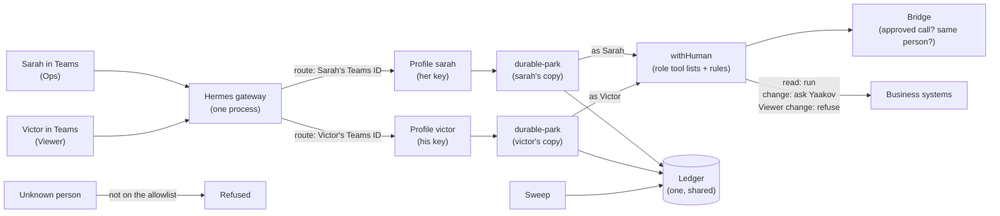

# Per-person roles for the Ops agent (design)

Date: 2026-10-26 (revised the same day after an independent review). Linear: TAP2-27. Status: design approved in
chat by Yaakov; written spec waiting for his review. Builder: tab.bot, after this spec and the implementation plan
are approved.

In plain English: today everyone who talks to the bot is treated the same, and withHuman sees only one "agent".
This design gives each person a **role** (Admin, Ops or Viewer). The role decides which tools the person can use.
withHuman keeps making every decision, and now it also knows **who** asked.

## Words used here

| Word | Meaning |
|---|---|
| Profile | A separate Hermes "home" folder with its own settings, keys and chat history. We make one per person. |
| Route (`profile_routes`) | A line in Hermes's settings: "messages from this Teams person go to that profile". |
| Teams user ID | The hidden ID Microsoft gives each Teams account (an Entra object ID, like `1b2c...`), not the email. |
| Tenant ID (`guild_id` in Hermes) | The ID of the company's Microsoft account (TapDash.co). |
| withHuman agent | withHuman's record for an AI agent. Its tool list and rules apply to it. Here: one per role (or per person, see section 4). |
| Instance | One copy of a withHuman agent, with its own key. |
| Provisioner token | A withHuman key that can only create new instances of one agent. |
| durable-park | Our Hermes plugin: asks withHuman about every tool call, holds ("parks") risky ones until a person approves, then runs the exact call once. |
| Bridge | Our small service that tells withHuman's gateway "this call was already approved" so the approved call is not asked about twice. |
| Ledger | durable-park's record of every parked call. |
| Sweep | durable-park's 5-minute safety check that re-sends missed messages and posts alerts to Teams. |

## 1. Decisions (Yaakov, 2026-10-26)

| # | Question | Decision |
|---|---|---|
| 1 | Who uses the Ops agent? | Several people with different rights. |
| 2 | How are rights set? | **By role.** Per-person changes on top of a role come later: GitHub #79 (Linear TAP2-179). |
| 3 | Which roles? | **Admin, Ops, Viewer** (section 2). |
| 4 | Where do roles and rights live? | **In withHuman** (tool lists and rules per role). Hermes sends each person to their own profile with their own key. |
| 5 | Who approves? | **Unchanged:** Yaakov approves everything, including his own requests, through the escalation path `notify-yaakov-yehuda`. "The asker must not approve their own request" stays an open item of TAP2-83. withHuman can already name different approvers per rule, so that needs no build later. |
| 6 | Which chat apps? | **Teams only.** Telegram stays Yaakov's own admin line (the default profile). WhatsApp later (TAP2-66). |
| 7 | Where does this design live? | Here, for the client now; written so the hermes-withhuman-kit can reuse it later. |
| 8 | Recurring tasks (TAP2-31) | Native Hermes scheduling, **left off for now**. Event triggers later: GitHub #80. |

## 2. Roles

| Role | Can do in the systems (withHuman) | Can do in the chat (Hermes) |
|---|---|---|
| **Admin** | Same as Ops. | Every chat command (`/update`, `/restart`, `/model` ...). Role changes are made with `people.sh` on the server (section 6.4), not by chat. |
| **Ops** | Everything the agent can do today, **with today's rules**: reads run; money moves and most changes ask Yaakov; the changes today's rules already let run on their own still do (Maverick drafts and notes or tickets that tell nobody, accept.blue customers and draft invoices, Authorize.net customer profiles; see `durable-park/docs/architecture.md`). | `/help`, `/whoami` only. |
| **Viewer** | Only the tools on the Viewer read list (section 6.2). Everything else is refused, never asked about. | `/help`, `/whoami` only. |

## 3. Project map (what does what)



| Piece | Where | What it does |
|---|---|---|
| Roles | withHuman | Tool lists (grants per gateway server) and rules per role. |
| People | withHuman + Hermes | Each person has their own withHuman key and their own Hermes profile; withHuman's records name the person. |
| Routing | Hermes `gateway.profile_routes` in the default profile's `config.yaml` | Teams user ID + tenant ID → that person's profile. One gateway serves all profiles (`gateway.multiplex_profiles`, on by default). |
| Strangers | Hermes `TEAMS_ALLOWED_USERS` | Only people added with `people.sh` are on it; `people.sh` adds the route and the allowlist entry together. A catch-all route to an empty profile `not-set-up` is a second lock (section 6.3). |
| Admin commands | Hermes `platforms.teams.extra.allow_admin_from` (direct messages) **and** `group_allow_admin_from` (group chats and channels) | Both lists = the Admins' Teams IDs. The two lists are separate in Hermes (`gateway/slash_access.py`); an empty one means no gating in that kind of chat. |
| Approvals | withHuman, unchanged | Yaakov approves everything that asks a person. |

Facts these rows rely on (checked 2026-10-26 against Hermes v0.22.3 code and docs, and by the independent review):
- Teams messages carry `user_id` = the sender's Entra object ID and `guild_id` = the tenant ID
  (`plugins/platforms/teams/adapter.py:521-529`); a route with both matches. If Teams sends no tenant, Hermes fills
  in the configured one, so the tenant check is weak; the user ID alone is unique, so the risk is low.
- Routes are chosen by how specific they are, not by order (`gateway/profile_routing.py`). A route to a profile the
  gateway does not serve is rejected.
- Hermes: "Sender routing selects a profile; it is not deny-by-default authorization." So the allowlist stays on.
- Hermes keeps one plugin manager per profile and loads durable-park separately for each profile
  (`hermes_cli/plugins.py:1589-1592`). Each profile has its own MCP connections.
- withHuman rules can see only the tool, server, arguments, the agent's slug and name, and earlier blocks' results.
  They cannot see which chat user typed. That is why the role travels with the agent.
- **Keys are for knowing who asked, not for walls between people.** All profiles run in one process as the `hermes`
  user, so that process can read every key file. The agent itself has no file or terminal tools, which is what keeps
  a person from using another's key.

## 4. One withHuman agent per role, or per person? (decided by the spike)

The bridge must tell people apart: an approval for Sarah's call must never let Tom's identical call through.

- **Option R (role agents):** agents `ops-admin`, `ops-ops`, `ops-viewer`; one instance per person. Works only if
  withHuman's gateway webhook tells the bridge **which instance** made the call. The spike checks this.
- **Option P (person agents), fallback:** one agent per person whose **slug** (withHuman's fixed ID, not the
  editable display name) starts with the role, for example `ops-ops--sarah`, `ops-viewer--victor` (the spike checks
  that withHuman accepts `--` in a slug; else a single `-`). Rules match the role with `starts_with` on `/agent/slug`;
  the bridge tells people apart by slug. `people.sh` copies the role's tool list to each new person agent, and
  `people.sh sync-role <role>` re-copies it to every person in that role after a role's list changes. The start
  check compares each person agent's grants with its role and refuses to start on a difference.

Everything else in this design is the same for both. The plan picks one after the spike.

## 5. What happens when someone asks for something

1. Sarah (Ops) writes in Teams. Hermes matches her Teams user ID and tenant to her route and runs the turn in
   profile `sarah`.
2. Sarah's profile reaches withHuman with Sarah's key, so withHuman lists only the tools her role has.
3. Before each tool call, Sarah's copy of durable-park asks withHuman with Sarah's key. The rules decide: run,
   refuse, or ask Yaakov.
4. If Yaakov must decide, he approves in withHuman. The decision is read **with Sarah's key** (the key of the
   ledger row's profile), the parked call runs once in Sarah's profile, the bridge checks it is the same person's
   approved call, and the result is posted in Sarah's chat.

## 6. Changes

### 6.1 Bridge (`durable-park/bridge/`)

| Today | Change |
|---|---|
| Trusts one agent: `DEFAULT_EXPECTED_AGENT = "proto-agents"`; any other agent goes to a person (`app.py:54, 155-156`). | Trusts a list of agents (the role or person agents). |
| Looks up approved parks by agent only (`app.py:171`). | Also requires the park and the gateway call to come from **the same person** (same instance in option R, same agent in option P). |

### 6.2 withHuman

- Agents and keys as in section 4. **Each person's key lives in one place:** the key file
  `/etc/durable-park/instances/<profile>.token`, owner `root`, group `hermes`, mode 640 (exactly like
  `/etc/durable-park/instance_token` today). Both users of the key read that one file: durable-park (its
  `token_file` setting) and the agent's `wh` gateway connection, which gets `DURABLE_PARK_WH_TOKEN` from Hermes's
  secrets command when the profile starts (today: `/opt/durable-park/libexec/hermes-secrets`, which reads
  `instance_token`; each person's profile runs the same helper with its profile name, so it reads that person's
  file). The key is never copied into `config.yaml` or `.env`, as today. Nothing prints keys. Provisioner tokens
  and the withHuman admin key `people.sh` uses are root-only.
- **Ops and Admin grants:** what `proto-agents` has today (several servers are granted as "all tools", which also
  covers future tools).
- **Viewer read list (new, written by hand per server):** today's rules have no clean read lists. QuickBooks reads
  are a name pattern; the Maverick, accept.blue and Authorize.net "auto" lists mix reads with changes (for example
  `create_customer`, `create_invoice`, `save_vault_customer`); the Hermes "read" rule includes `memory` and
  `image_generate`. So the plan lists the Viewer's exact read tools per server, and the Viewer gets only those
  (grant mode "selected"). The Hermes list for Viewers leaves out `memory` and `image_generate`.
  Every call is decided twice, so each Viewer list is written in **both spellings**: at park time (server
  `park:<server>`, tool `mcp__wh__<server>__<tool>`) and at the gateway (server `<server>`, tool `<tool>` or
  `<server>__<tool>`), the way today's read rules do (for example `pa-park-monday-read` and `gw-monday-read`). It
  also lists the Hermes helper tools a Viewer needs just to answer (the Tool Search tools `tool_search`,
  `tool_describe`, `tool_call`, and `clarify`).
- **Rules (new pipeline revision, saved by Yaakov):**
  1. **First block:** a Viewer call on the Viewer read list is approved.
  2. **Second block:** every other Viewer call is refused. Both sit before every other rule, including "Money server:
     always a person". (This order needs no "not" condition, which withHuman's rules do not have.)
  3. Every `slug equals proto-agents` condition also accepts the Ops and Admin agents. Ops therefore keeps today's
     auto-approved changes (section 2). `proto-agents` stays until the default profile moves, then a later
     revision removes it.

### 6.3 Hermes configuration

- Default profile `config.yaml`: `gateway.profile_routes` (one route per person: platform `teams`, `user_id`,
  `guild_id` = TapDash tenant ID; plus one Teams catch-all route to `not-set-up`), `TEAMS_ALLOWED_USERS`, and both
  `allow_admin_from` and `group_allow_admin_from` under `platforms.teams.extra`. Example route:

  ```yaml
  gateway:
    profile_routes:
      - name: sarah
        platform: teams
        user_id: "1b2c3d4e-0000-0000-0000-000000000000"
        guild_id: "<TapDash tenant ID>"
        profile: sarah
  ```

- Each person's profile is created **blank** from a template (never cloned: cloning copies keys). The template
  sets today's lockdown, the plugin set, `plugins.entries.durable-park.settings.token_file` (an existing
  durable-park setting) pointing at that person's key file, and `secrets.command.enabled: true`,
  `secrets.command.override_existing: true` and `secrets.command.command` =
  `/opt/durable-park/libexec/hermes-secrets <profile>` (the switch is off by default in Hermes, and without the
  override a key already in the environment would win). Key files follow one naming rule: `/etc/durable-park/instances/<profile>.token` (the default
  profile keeps `/etc/durable-park/instance_token`).
- `not-set-up`: same lockdown and plugin, no tools, and a short persona that answers "you're not set up yet, ask an
  admin". It still runs the model (a small cost) and its reply depends on the model following the persona; it can
  never do anything, which is what matters.

### 6.4 durable-park (`durable-park/`)

| Topic | Change |
|---|---|
| One copy per profile | Hermes loads durable-park once per profile. Each copy uses its own profile's `token_file`. |
| Files | **Shared:** the ledger (one fixed path for every profile). **Per profile:** the status files that sit next to the ledger today (load proof, tool policy load, breaker, lift status, form check), so one profile's copy never overwrites another's. The sweep reads every profile's status files. |
| Who asked | Already there: ledger rows store `profile` and `user_id` (`ledger.py:55-56`, filled from `HERMES_SESSION_PROFILE` in `park_hook.py:157-163`). Use them. |
| Decisions and wakes | Wakes arrive at the default profile's copy. It reads the decision with the key of the **row's** profile, found by the naming rule (`/etc/durable-park/instances/<profile>.token`), and the call resumes in that profile's session. The sweep and the start check use the same rule. A missing key file: the row is not resumed and the sweep alerts. |
| Start checks | `tool_policy_check.sh` checks every profile, `not-set-up` included. A profile with tools but no key file, a profile whose secrets command does not name itself, or two profiles sharing a key: the check fails, the gateway still starts (so alerts keep working, as today) but **every** copy of durable-park refuses every tool call, and the sweep's Teams alert names the profile. `not-set-up` needs no key: the check requires it to have no tools at all. |

### 6.5 New admin command `durable-park/deploy/people.sh` (run by an admin with `sudo`)

It runs as root, because it reads the provisioner tokens (root-only) and writes the key files, and it edits
Hermes's files as the `hermes` user.

| Command | What it does |
|---|---|
| `people.sh add <name> <teams-user-id> <role>` | Creates the person's withHuman key (written straight to its key file, root:hermes 640, never printed), the blank profile from the template, the route and the allowlist entry. Restarts the gateway only when no ledger row is `parked`, `approved` or `executing`: it waits up to 10 minutes, saying so; on time-out it undoes everything and exits with an error. |
| `people.sh move <name> <role>` | Refused while that person has a row `parked`, `approved` or `executing` (the old key must finish them). Then: new key under the new role, written to both places, old key disabled, and a gateway restart under the same rule as `add` (the gateway connection reads its key only when it connects). Until the restart the person's calls are refused (their old key is disabled), with a Teams alert. |
| `people.sh remove <name>` | Same refusal while rows are active. Then: key disabled, route and allowlist entry removed, gateway restart under the same rule as `add`, chat history kept for the retention period. |
| `people.sh sync-role <role>` | Option P only: re-copies the role's tool list to every person in that role. |
| `people.sh list` | Name, role, Teams ID, last seen. |

Every step is checked; on any failure it undoes what it did, says what failed, and exits with an error.

## 7. When things go wrong (never silent)

| Problem | Result |
|---|---|
| A profile with tools has no key file, its secrets command names another profile, or two profiles share a key | The gateway starts but every tool call is refused in every profile; Teams alert names the profile. |
| A person's key cannot be read at run time | Their tool calls are refused; Teams alert. |
| An approved call shows up from a different person | The bridge sends it to a person; nothing runs on someone else's approval. |
| Not on the allowlist | Refused by Hermes. |
| Allowlisted, no route | Lands on `not-set-up`: no tools. |
| A non-admin sends `/restart` or `/update` (direct or group chat) | Refused. |
| withHuman down | Everything refused (existing breaker), as today. |
| `move` or `remove` with active rows | Refused with the list of rows to finish first. |
| `people.sh` fails midway | Undoes its steps, says what failed, exit code not 0. |

## 8. Tests

**Spike first (before any build):**
1. Does withHuman's gateway webhook tell the bridge which instance made the call? (Decides option R or P.)
2. Does each profile's copy of durable-park load, use its own `token_file`, and record its profile?
3. Can the default profile's copy find a row's key by the naming rule, read the decision with it, and resume the
   call in the routed profile's session (including the sweep's re-send)?
4. What does a real Teams user ID look like, and does a route with `user_id` + `guild_id` match it?
5. Park → approve → run once in a routed profile, result in that person's chat.
6. Option P only: does withHuman accept `--` in an agent slug?
7. Does each routed profile's copy of durable-park load when the gateway starts, or only on that profile's first
   message? (Decides what the start check waits for.)
8. How does a routed profile get the AI model's key without also getting the Teams and Telegram bot keys?

**Acceptance (sandbox accounts only):**
- Viewer: one lookup **per server** runs without asking (both decision steps pass); a change is refused without
  paging Yaakov.
- Ops: a change asks Yaakov; after approval it runs once. A change on today's auto list runs on its own.
- **Approval used by a different person:** Tom sends the exact call Sarah got approved; it does not run on her
  approval.
- Two people at the same time: each shows up under their own name in withHuman; each result lands in the right chat.
- A stranger is refused; an allowlisted person with no route can do nothing.
- A non-admin's `/restart` is refused in a direct chat **and** in a group chat; an Admin's works.
- A gateway restart during a pending approval still finishes in the right person's chat.
- `people.sh move` is refused with an active row; after it ends, the move works and the person's next message
  (after the restart) has the new role's tools.
- Results go in a new acceptance record in `durable-park/docs/`.

## 9. Order of work

1. Spike (section 8).
2. Viewer read lists per server (with Yaakov).
3. Bridge change, then durable-park changes (PRs, tests first).
4. withHuman: agents, grants, the new rules (old `proto-agents` rules kept).
5. `people.sh` (PR).
6. Yaakov as Admin, one test Ops and one test Viewer person (a second Teams account is needed); run acceptance.
7. Add the client's people (Yaakov gives each person's role).

## 10. Out of scope (tracked elsewhere)

- Per-person rights on top of a role: GitHub #79.
- Event-started tasks: GitHub #80. Turning on the scheduler: TAP2-31.
- "The asker must not approve their own request": TAP2-83.
- Teams Approve/Deny buttons: TAP2-29. Note for that work: Hermes's own Teams approval cards accept a click from
  anyone on `TEAMS_ALLOWED_USERS` (`adapter.py:661-671`), Viewers included; the buttons must check the role.
- WhatsApp: TAP2-66.

## 11. References

- Hermes multi-profile gateways: https://hermes-agent.nousresearch.com/docs/user-guide/multi-profile-gateways
- Hermes profiles: https://hermes-agent.nousresearch.com/docs/user-guide/profiles
- Hermes code v0.22.3: `gateway/profile_routing.py`, `gateway/slash_access.py`, `plugins/platforms/teams/adapter.py`,
  `hermes_cli/plugins.py`
- durable-park: `bridge/app.py`, `plugin/durable_park/ledger.py`, `park_hook.py`, `wake.py`
- withHuman condition fields: the management MCP's `read_reference` topic `conditions`
