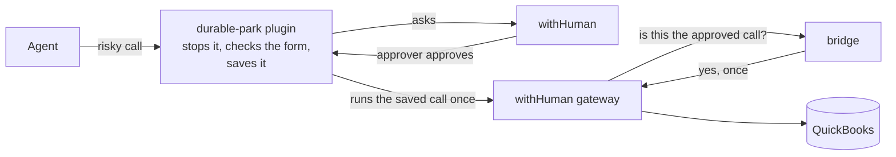

# durable-park

A [Hermes Agent](https://hermes-agent.nousresearch.com) plugin, plus two small services, that make an AI agent
**ask a person before it does anything risky**. When the agent tries to move money in QuickBooks, the call is
stopped and saved, an approver approves or denies it in [withHuman](https://withhuman.ai) - minutes or days
later - and then the exact saved call runs once, in the same chat. It survives restarts and never retries on its own.

Status: **v1 accepted on 2026-10-20**, QuickBooks **sandbox** only, on the test VM `proto-agents`
([acceptance results](docs/acceptance-2026-10-20.md)).

## How it works



1. The agent calls a risky tool (create, update or delete of 12 money types in QuickBooks).
2. The plugin checks the call against the tool's rules, saves it in a ledger and opens an approval request.
   The agent is told it is waiting.
3. An approver approves in withHuman. A signed webhook wakes the plugin, which tells the original chat.
4. The agent runs `parked_action_execute`; the plugin uses the approval once and replays the saved call.
5. The withHuman gateway asks the bridge whether this exact call was approved; the bridge says yes once.
6. QuickBooks gets the call. The ledger records the result.

The full picture - every component, arrow, state and failure path: **[docs/architecture.md](docs/architecture.md)**.
The open-source and third-party pieces it is built on (versions, licenses, links):
[Built on](../README.md#built-on).

## Folder layout

| Path | What is in it |
|---|---|
| `plugin/durable_park/` | The Hermes plugin: park hook, form check, ledger, wake handler, executor. Loaded by Hermes from this folder. |
| `bridge/` | The gateway bridge service (withHuman's pipeline asks it "is this call approved?"). |
| `receiver/` | The webhook receiver (withHuman tells it a decision was made) and one-time provisioning. |
| `scripts/` | The 5-minute sweep (safety net and alerts), run by Hermes cron. |
| `deploy/` | Deploy script, systemd units, the agent's tool lockdown, the QuickBooks tunnel container. |
| `tests/` | Unit tests (no network). `tests/live/` holds manual tests for the VM. |
| `docs/` | Architecture, runbook and setup guides (below). |

## Run the tests

```sh
cd durable-park
python3 -m venv .venv && .venv/bin/pip install -r requirements-dev.txt
.venv/bin/pytest -q -W error
```

The unit tests never reach the network and never read real credentials (`tests/conftest.py` enforces both).
Live checks against the sandbox run only on the VM: `DURABLE_PARK_LIVE=1 .venv/bin/pytest -q tests/live`.

## Docs

| Doc | Read it to |
|---|---|
| [architecture.md](docs/architecture.md) | Understand how the pieces connect (diagrams, states, failure paths, where everything runs) |
| [runbook.md](docs/runbook.md) | Check health, deploy a change, act on an alert, troubleshoot, rotate secrets |
| [form-check.md](docs/form-check.md) | Understand the check that runs before anyone is asked |
| [gateway-setup.md](docs/gateway-setup.md) | Set up QuickBooks behind the withHuman gateway, the bridge and the pipeline rules |
| [receiver-setup.md](docs/receiver-setup.md) | Set up the receiver, provisioning and the agent's tool lockdown |
| [backlog.md](docs/backlog.md) | See what is still open, and what must be done before real books |
| [acceptance-2026-10-20.md](docs/acceptance-2026-10-20.md) | See what was tested for v1 (the record) |
| [plans/](docs/plans/) | The original build plan (historical) |

Changing code? Update the docs and diagrams it affects in the same change - see [CONTRIBUTING.md](../CONTRIBUTING.md).
