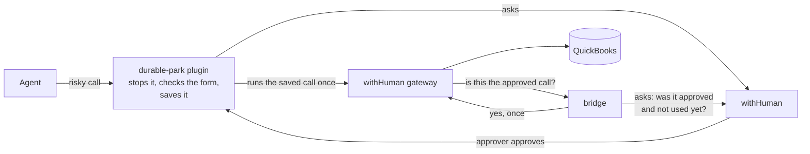

# durable-park

A [Hermes Agent](https://hermes-agent.nousresearch.com) plugin, plus two small services, that make an AI agent
**ask a person before it does anything risky**. When the agent tries to move money in QuickBooks, the call is
stopped and saved, an approver approves or denies it in [withHuman](https://withhuman.ai) - minutes or days
later - and then the exact saved call runs once, in the same chat. It survives restarts and never retries on its own.

Status: **v1 accepted on 2026-10-20**, QuickBooks **sandbox** only, on the test VM `proto-agents`
([acceptance results](docs/acceptance-2026-10-20.md)). The agent reaches only `clarify`, `parked_action_execute` and
`mcp__wh__quickbooks__*`, plus the three Tool Search bridge tools (`tool_search`, `tool_describe`, `tool_call`) while
Tool Search is on (the v1 tool lockdown, re-applied 2026-10-21 03:16 UTC; Tool Search is on since 2026-10-21 19:59 UTC,
[record](docs/acceptance-2026-10-21-tool-search.md), [runbook](docs/runbook.md#turn-on-tool-search)). durable-park asks
withHuman about every tool call except `parked_action_execute`, `clarify` and the read-only Tool Search catalog tools
(`tool_search`, `tool_describe`), and withHuman's pipeline decides which ones need a person
([spec](../docs/specs/2026-10-21-all-tools-withhuman-design.md)).

**How safe is it today?** Not a full security boundary yet. `hermes`, the agent's own Linux user, no longer has sudo
(Clean Setup Phase 1, done 2026-10-22), but it still owns the ledger (Phase 2 is open), so file, terminal and code
tools stay off and only QuickBooks sandbox books are connected. The one canonical statement, with what an agent could
still do, is [architecture section 0](docs/architecture.md#0-how-strong-is-it-today). What must be done before real
books: the [backlog](docs/backlog.md#before-real-books). Before you re-run `configure_hermes.sh`, follow
[Before you run the configure script](docs/runbook.md#before-you-run-the-configure-script).

## How it works



1. The agent calls a risky tool: create, update or delete of one of 12 QuickBooks money types. Those are the calls
   the pipeline sends to a person. (The form check also knows six DocuSign writes, but no DocuSign server is
   connected today.)
2. The plugin checks the call against the tool's rules, saves it in a ledger and opens an approval request.
   The agent is told it is waiting.
3. An approver approves in withHuman. A signed webhook wakes the plugin, which tells the original chat.
4. The agent runs `parked_action_execute`; the plugin uses the approval once and replays the saved call.
5. The withHuman gateway asks the bridge whether this exact call was approved; the bridge checks in withHuman (not the ledger) and says yes once.
6. QuickBooks gets the call. The ledger records the result.

The full picture - every component, arrow, state and failure path: **[docs/architecture.md](docs/architecture.md)**.

Settings (`exempt_tools`, `form_checked_tools`, `observer_hooks`, `aap_base_url`, `token_file`, `audit_key_file`,
`audit_base_url`, `ledger_path`)
live in `plugins.entries.durable-park.settings` in Hermes's `config.yaml`: [table](docs/architecture.md#plugin-settings),
[how to change them](docs/runbook.md#plugin-settings). The old `risky_tools` setting is ignored with a warning. If
anything else registers a `pre_tool_call` callback (another plugin, a `config.yaml` shell hook or outbound webhook) or
`tool_request` / `tool_execution` middleware,
every tool call is refused until an admin reviews it and lists it in `observer_hooks`. A setting of the wrong type
also refuses every call (never fails open).
The open-source and third-party pieces it is built on (versions, licenses, links):
[Built on](../README.md#built-on).

## Folder layout

| Path | What is in it |
|---|---|
| `plugin/durable_park/` | The Hermes plugin: park hook, form check, ledger, wake handler, executor. Loaded by Hermes from this folder. |
| `bridge/` | The gateway bridge service (withHuman's pipeline asks it "is this call approved?"). |
| `receiver/` | The webhook receiver (withHuman tells it a decision was made) and one-time provisioning. |
| `scripts/` | The 5-minute sweep (safety net and alerts), run by Hermes cron. |
| `deploy/` | Deploy script, systemd units, the v1 tool lockdown (re-applied on proto-agents 2026-10-21 03:16 UTC as a stopgap), the QuickBooks tunnel container. |
| `tests/` | Unit tests (no network). `tests/live/` holds manual tests for the VM. |
| `docs/` | Architecture, runbook and setup guides (below). |

## Run the tests

```sh
cd durable-park
python3 -m venv .venv && .venv/bin/pip install -r requirements-dev.txt
.venv/bin/pytest -q -W error
```

The unit tests never reach the network and never read real credentials (`tests/conftest.py` enforces both).
Live checks against the sandbox run only on the VM: `DURABLE_PARK_LIVE=1 .venv/bin/pytest -q tests/live`.
`tests/test_hermes_integration.py` runs the real Hermes functions the plugin leans on; it is skipped where Hermes is
not importable (CI) and run on the VM ([runbook](docs/runbook.md#check-durable-park-against-the-real-hermes)).

## Docs

| Doc | Read it to |
|---|---|
| [architecture.md](docs/architecture.md) | Understand how the pieces connect (diagrams, states, failure paths, where everything runs) |
| [runbook.md](docs/runbook.md) | Check health, deploy a change, act on an alert, troubleshoot, rotate secrets |
| [form-check.md](docs/form-check.md) | Understand the check that runs before anyone is asked |
| [gateway-setup.md](docs/gateway-setup.md) | Set up QuickBooks behind the withHuman gateway, the bridge and the pipeline rules |
| [receiver-setup.md](docs/receiver-setup.md) | Set up the receiver, provisioning and the v1 tool lockdown |
| [backlog.md](docs/backlog.md) | See what is still open, and what must be done before real books |
| [tool-rollout.md](docs/tool-rollout.md) | See which groups of Hermes tools have a pipeline rule, and which do not yet |
| [acceptance-2026-10-20.md](docs/acceptance-2026-10-20.md) | See what was tested for v1 (the record) |
| [acceptance-2026-10-21-ask-every-call.md](docs/acceptance-2026-10-21-ask-every-call.md) | See what was tested for "ask every call" (the record) |
| [acceptance-2026-10-21-hermes-0.22.3.md](docs/acceptance-2026-10-21-hermes-0.22.3.md) | See what was tested when Hermes v0.22.3 became the tested version (the record) |
| [acceptance-2026-10-21-tool-search.md](docs/acceptance-2026-10-21-tool-search.md) | See what was verified when Hermes Tool Search was switched on, and the other live settings changed that day (the record) |
| [acceptance-2026-10-22-langfuse.md](docs/acceptance-2026-10-22-langfuse.md) | See what was tested and audited when Langfuse tracing was switched on (the record) |
| [acceptance-2026-10-25-maverick-remote.md](docs/acceptance-2026-10-25-maverick-remote.md) | See what was tested when Maverick, Supabase, Monday and DocuSign were connected (the record) |
| [acceptance-2026-10-25-acceptblue-authnet.md](docs/acceptance-2026-10-25-acceptblue-authnet.md) | See what was tested when accept.blue and Authorize.net were switched on (the record) |
| [plans/](docs/plans/) | The original build plan (historical) |
| [../docs/README.md](../docs/README.md) | Every spec and plan of the repo, with its status |

Changing code? Update the docs and diagrams it affects in the same change - see [CONTRIBUTING.md](../CONTRIBUTING.md).
