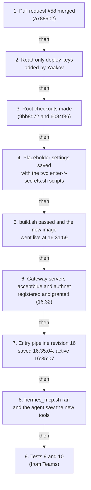
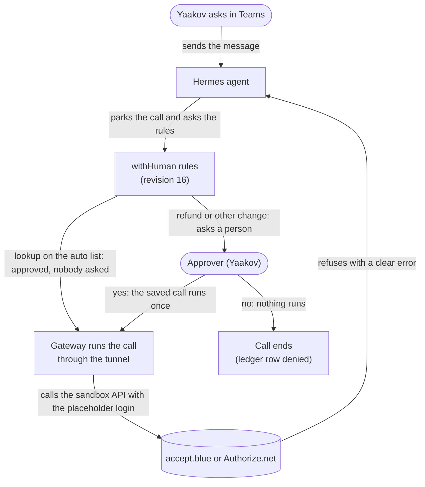

# durable-park: acceptance record, accept.blue and Authorize.net switched on (2026-10-25)

**Result: PASSED.** The Hermes agent on the test VM `proto-agents` now reaches two more payment servers through the
withHuman gateway: accept.blue and Authorize.net. Both run with placeholder logins, so every real call ends in a clear
error, but the approval rules work: lookups ran without asking anyone, and the two refunds were parked and asked
Yaakov. He denied both, and nothing ran. Afterwards the ledger had no row `parked`, `approved` or `executing`.

- Environment: test VM `proto-agents`, TapDash-Agents `a7889b2` (pull request #58), tunnel image
  `durable-park/wh-tunnel:0.0.369-qbo-31a1dd5-mav-d6f43f9-ab-9bb8d72-an-6084f36` (live since 2026-10-25 16:31 UTC),
  withHuman entry pipeline revision 16 (live since 2026-10-25 16:35 UTC).
- How to set it up: [runbook, accept.blue and Authorize.net](runbook.md#acceptblue-and-authorizenet) and
  [gateway-setup.md, payment server sources](gateway-setup.md#payment-server-sources-acceptblue-and-authorizenet).
- Previous record: [acceptance-2026-10-25-maverick-remote.md](acceptance-2026-10-25-maverick-remote.md).

## What is connected now

| Server | How | Tools the agent sees | What runs without asking |
|---|---|---|---|
| QuickBooks (sandbox) | tunnel, local MCP server | 142 | Reads (get, search, list, read, query, find) |
| Maverick | tunnel, TapDash `maverick-mcp` | 42 | Lookups and internal drafts |
| accept.blue | tunnel, TapDash `acceptblue-mcp` | 28 | 7 tools the server marks `auto`: `describe_lookup`, `read`, `search_lookups`, `create_customer`, `create_customer_from_transaction`, `update_customer`, `create_invoice` (a draft) |
| Authorize.net | tunnel, TapDash `authorizenet-mcp` | 24 | 5 tools the server marks `auto`: `describe_lookup`, `read`, `search_lookups`, `save_customer_profile`, `save_shipping_address` |
| Supabase `tapdash-crm-dev`, Monday, DocuSign (demo) | remote, official servers | 7, 33 and 22 | Their read tools |

The tunnel serves 4 servers. Everything else asks Yaakov first. Money calls always ask a person.

## What happened, in order

Each step was done by an admin or by Yaakov; the order is the one in the
[runbook](runbook.md#acceptblue-and-authorizenet-switch-on-in-this-order).

1. Pull request #58 was merged as `a7889b2`.
2. Yaakov added a deploy key (read-only) to each of the two private repos.
3. Root's checkouts were made at `/opt/acceptblue-mcp-src` (`9bb8d72`) and `/opt/authorizenet-mcp-src` (`6084f36`).
4. The placeholder settings were saved with the two scripts `enter-acceptblue-secrets.sh` and `enter-authnet-secrets.sh`.
5. `build.sh` passed: all three approvals checks said ok (Maverick, accept.blue, Authorize.net). The check service
   showed maverick 42, quickbooks 142, acceptblue 28 and authnet 24 tools. The image
   `durable-park/wh-tunnel:0.0.369-qbo-31a1dd5-mav-d6f43f9-ab-9bb8d72-an-6084f36` went live at 16:31:59 and the tunnel
   serves 4 servers.
6. The withHuman gateway servers `acceptblue` and `authnet` were registered at 16:32 (tunnel `proto-agents`, scope
   `default`, auth none). Both were granted to agent `proto-agents`, mode all.
7. Entry pipeline revision 16 was saved at 16:35:04 and activated at 16:35:07. **Rollback is revision 15**: the two
   servers then ask a person for every call, which is safe and noisy.
8. `hermes_mcp.sh` ran. It reported `mcp__wh__quickbooks__get_company_info`, `mcp__wh__maverick__maverick_read`,
   `mcp__wh__acceptblue__ablue_read` and `mcp__wh__authnet__authnet_read` available. The tool policy was ok on 64
   platform keys.

## How a call is decided now

## Tests (all times UTC, 2026-10-25; sent from Yaakov's Teams account to the agent)

| # | Time | Asked | Park ID(s) | Result |
|---|---|---|---|---|
| 8 | 15:23 | Maverick read and QuickBooks company info, right after image `-mav-d6f43f9` went live (15:22). This row is also in the [Maverick record](acceptance-2026-10-25-maverick-remote.md) | P-A2668396, P-2FD4C3A0, P-5DD40EEE, P-AB4861E5 | `maverick_read` said "Could not connect to Maverick (check its address and the network). Nothing changed."; QuickBooks `get_company_info` returned "Sandbox Company US b8ce" |
| 9a | 16:36 | accept.blue and Authorize.net lookups: search lookups, describe a lookup, read | P-7278446C `ablue_search_lookups`, P-F830D2CD `authnet_search_lookups`, P-2FBEEEC4 `ablue_describe_lookup`, P-5149BD5E `authnet_describe_lookup`, P-98EA8073 `ablue_read`, P-A6D46748 `authnet_read` | All six ran without asking. With the placeholder logins the answers were clear errors: "accept.blue refused the source key or PIN (HTTP 401). An admin must check ACCEPTBLUE_SOURCE_KEY and ACCEPTBLUE_PIN." and "Authorize.net refused the API login..." (an admin must check the `AUTHNET_` settings) |
| 9b | 16:36 | An accept.blue refund and an Authorize.net refund, in one message | P-DF65779D (accept.blue), P-CC115BAA (Authorize.net) | The accept.blue refund **parked and asked Yaakov**. He denied it at 16:39:36 and nothing ran. The Authorize.net refund was cancelled with the note "already waiting for P-DF65779D": the one-approval-at-a-time rule |
| 10 | 16:40 | An Authorize.net refund, on its own | P-782CDC2C | **Parked; asked Yaakov.** He denied it at 16:46:25 and nothing ran. Afterwards the ledger had no row `parked`, `approved` or `executing` |

The rows are numbered 8 to 10 because they carry on from the 7 tests of the Maverick record; 9a and 9b are two parts of
the same Teams test.

## What this proves

- The two new servers are reachable only through withHuman, and the rules (revision 16, step 7) went live before
  `hermes_mcp.sh` (step 8) showed the agent the new tools.
- A tool on a server's own `auto` list runs without a person; a refund always asks one, and a "no" means nothing runs.
- A second money call asked while one is waiting is cancelled, not queued (test 9b).
- A wrong login is not hidden: the agent got a clear error that tells an admin which setting to check.

## Still open

- Sandbox accounts for accept.blue and Authorize.net: both run with placeholder logins, so every real call is refused.
- The Maverick sandbox: Maverick still runs with placeholder settings, so every real Maverick call fails.
- QuickBooks production keys: QuickBooks is the sandbox company only (`Sandbox Company US b8ce`).
- The Authorize.net webhook receiver: not wired on purpose (no `AUTHNET_WEBHOOK_LISTEN`, no signature key, no open
  port).
