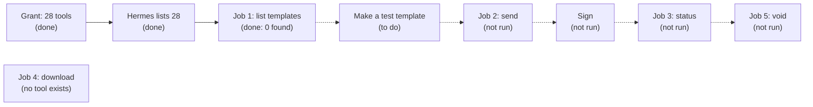

# durable-park: acceptance record, DocuSign demo (2026-10-27)

**Result: PARTLY DONE.** The agent can now see all the DocuSign tools it needs, and the first job (list templates)
works. Jobs 2 to 5 (send, status, download, void) were **not run**. Yaakov chose to do them later; they are tracked in
[GitHub issue 91](https://github.com/TapDashPayments/TapDash-Agents/issues/91) (High). Nothing below says "works" unless it was checked live.

- Environment: test VM `proto-agents`, Hermes v0.22.3, withHuman entry pipeline revision 16.
- Setup guide: [gateway-setup.md, Remote gateway servers](gateway-setup.md). Previous DocuSign record:
  [acceptance-2026-10-25-maverick-remote.md](acceptance-2026-10-25-maverick-remote.md).
- An earlier attempt (hermes-withhuman-kit PR 7, reverted) was in the wrong repo and changed nothing live.

## What was checked live

| What | Result | Evidence |
| --- | --- | --- |
| The agent's DocuSign grant before | 22 read tools only | withHuman grant for agent `proto-agents` on `docusign-demo`: mode `selected`, revision 1 |
| Grant after | **28 tools** (the 22 reads plus `createEnvelope`, `createEnvelopeFromTemplate`, `updateEnvelope`, `updateEnvelopeRecipients`, `updateEnvelopeTabs`, `sendReminder`), revision 2, scope `demo_user` | withHuman returned revision 2 with the 28 names |
| Rules for the new tools | Reads approve by name; **every other DocuSign tool asks a person** at park time and is then approved once by the bridge at the gateway | Entry pipeline revision 16 read in full: blocks `pa-park-docusign-read`, `gw-docusign`, `pa-default-human`. The rule was read, not yet exercised by a write |
| Hermes sees the new tools | **Yes: 28 DocuSign tools, 317 tools in all** | `agent.log` at 13:30:17 UTC after the gateway restart: "MCP server 'wh' (HTTP): registered 317 tool(s)", 28 of them `mcp__wh__docusign_demo__*` |
| Safe restart | Ledger had 0 parked, approved or executing rows; port 3978 had one listener afterwards | Checked before and after the restart |
| Job 1: list templates | **Works, no approval needed** | Teams message "List my DocuSign templates". 13:38:13 UTC `getUserInfo` (P-E759A2EB) and 13:38:41 UTC `getTemplates` (P-B6E302B1): both `allowed`, "withHuman: approved", about 1.3 s each. DocuSign answered `totalSetSize: 0`; the bot said so correctly |

## What the DocuSign server gives us (and what it does not)

From the tool list withHuman fetched at 12:28 UTC on 2026-10-27 (42 tools). These are read from the tools' own rules, **not** run yet:

- **Send from a template:** use `createEnvelope` with `templateId`, `templateRoles` (name, email, role, text fields by `tabLabel`) and `status: "sent"`.
- **`createEnvelopeFromTemplate` takes only an `accountId`.** It cannot carry recipients or fields, and DocuSign marks it read-only. The agent may pick it because its description says "primary tool", so the send test must steer the bot to `createEnvelope`.
- **Void:** `updateEnvelope` accepts `status: "voided"` plus `voidedReason`. There is no separate void tool.
- **Download a signed document: no tool exists.** `listEnvelopeDocuments` only lists documents. Tracked in
  [GitHub issue 92](https://github.com/TapDashPayments/TapDash-Agents/issues/92) (Medium).
- **The form check does not cover 4 of the 6 granted writes.** It covers `createEnvelope` and `updateEnvelope` only. The other four
  (`createEnvelopeFromTemplate`, `updateEnvelopeRecipients`, `updateEnvelopeTabs`, `sendReminder`) are still asked about, but their
  arguments are not checked first. Tracked in [GitHub issue 89](https://github.com/TapDashPayments/TapDash-Agents/issues/89) (High). On 2026-10-27 Yaakov widened it to every write tool without the check: these 4, plus 8 Supabase and 35 QuickBooks tools.

## Not run (still to do, GitHub issue 91)

| Job | Why not run | What it needs |
| --- | --- | --- |
| Make a test template | The demo account has 0 templates | Yaakov makes "TapDash test NDA" (role `Signer`, signature field, text field labelled `Company`) |
| 2. Send from a template | Needs the template | One approval in withHuman; the approver should see template, recipient and field. Test signer is yaakovytrout@gmail.com. The demo account sends **real emails** |
| Sign | Needs job 2 | Sign from the email |
| 3. Status lookup | Needs job 2 | No approval expected (read) |
| 5. Void | Needs a second sent envelope | One approval expected |
| 4. Download signed document | No tool | See GitHub issue 92 |

## Docs changed with this record

The DocuSign grant row, the "if DocuSign is ever added" sentence, and the "six DocuSign writes" wording were stale. They are fixed in
[gateway-setup.md](gateway-setup.md), [architecture.md](architecture.md), [form-check.md](form-check.md), the [runbook](runbook.md) and the
[README](../README.md).
