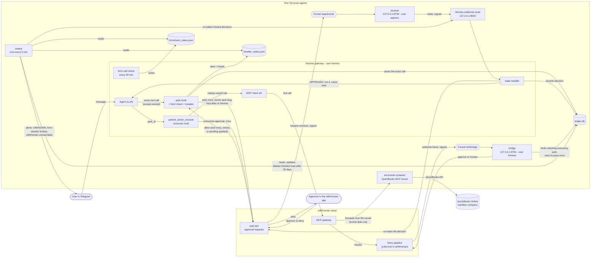
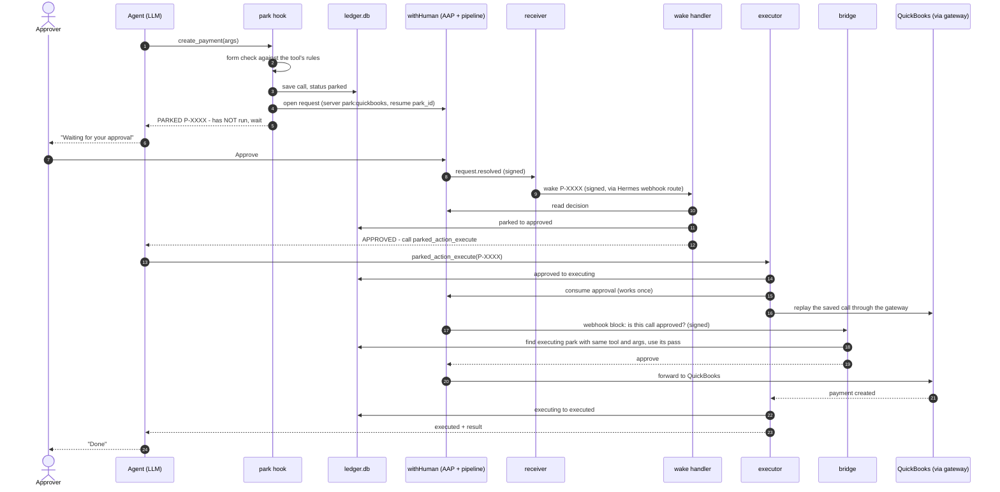
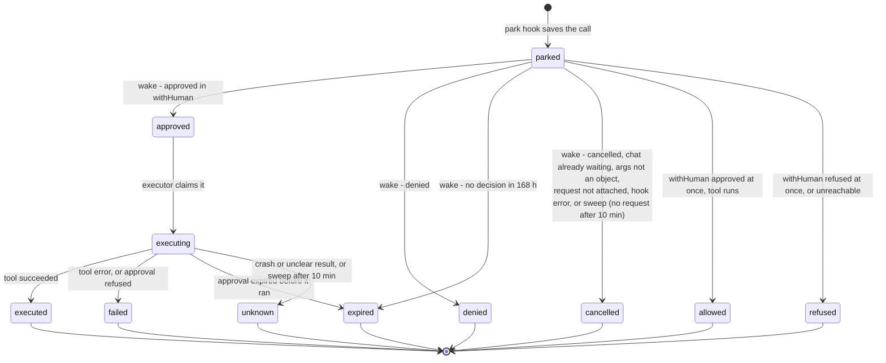
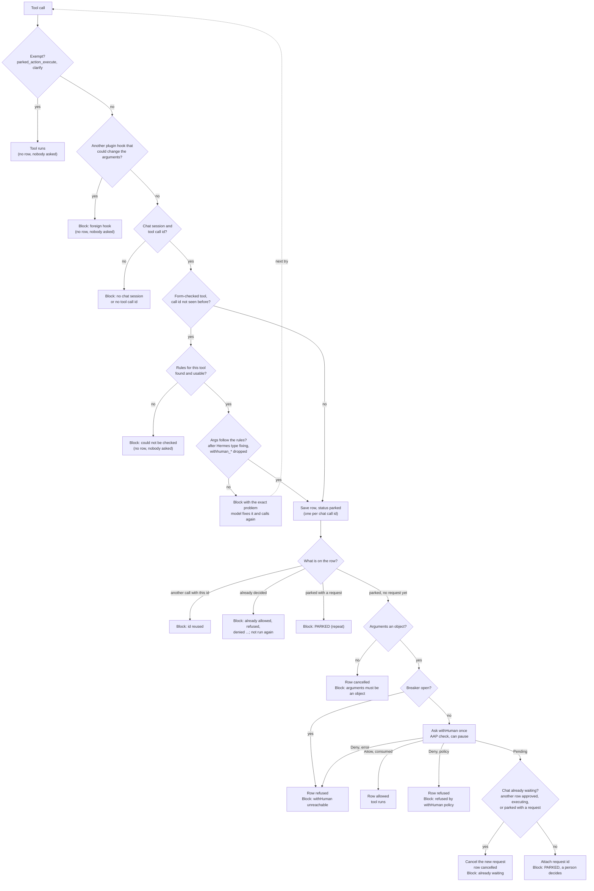

# durable-park architecture

How a risky tool call is stopped, approved once by a person, and then run exactly once, even across restarts.
This is the reference for how the pieces connect. **If you change a component, an arrow, a port, a path, a
state or a threshold, update the matching diagram or table here in the same change** (see `CONTRIBUTING.md`).
Versions and licenses of the third-party pieces (Hermes, withHuman, AAP, the QuickBooks MCP server, ...) are in
the root README's [Built on](../../README.md#built-on) table.

- [1. System map](#1-system-map)
- [2. The approval journey, step by step](#2-the-approval-journey-step-by-step)
- [3. Ledger states](#3-ledger-states)
- [4. Tool call: form check, then one question to withHuman](#4-tool-call-form-check-then-one-question-to-withhuman)
- [5. When things go wrong](#5-when-things-go-wrong)
- [6. Where everything runs](#6-where-everything-runs)
- [7. Secrets and who can read them](#7-secrets-and-who-can-read-them)
- [8. Numbers that matter](#8-numbers-that-matter)
- [Glossary](#glossary)

## The three guarantees

1. **Nothing risky runs without one human approval.** The plugin blocks the call before Hermes sends it; the
   withHuman gateway asks the bridge, and the bridge says "approve" only for a call that matches an approved park.
2. **An approved call runs at most once, exactly as approved.** The approval is consumed once; the bridge's pass is
   used once; arguments must match the saved ones.
3. **A crash never causes a silent retry.** If the outcome is unclear the row becomes `unknown` and a person checks.

How strong is the first guarantee today? **On proto-agents it is not a security boundary.** The plugin, the bridge
and the ledger all trust the user `hermes`, which is also the user the agent runs as. The agent has **no file or
terminal tools** (the v1 tool lockdown, `deploy/hermes_tool_policy.py`); that holds the first guarantee against an
agent that goes looking for a way round it, but it is a configuration guard, not a permission boundary.

Since 2026-10-21 03:16 UTC the v1 tool lockdown is re-applied on proto-agents as a stopgap: the agent can reach only
`clarify`, `parked_action_execute` and `mcp__wh__quickbooks__*` (58 platform keys; `hermes_tool_policy.py check` ok).
Hermes approvals stay off. The user `hermes` still has passwordless sudo until Clean Setup Phase 1
([spec](../../docs/specs/2026-10-21-all-tools-withhuman-design.md) §4.1); the lockdown is a configuration guard,
not a permission boundary. Tools open again only through that spec (§4.4). Re-running `configure_hermes.sh` or
`hermes_tool_policy.py` re-applies the current state and restarts the gateway, so the "no parked/approved/executing
row" rule applies.

What that means today:

- The agent can reach only `clarify`, `parked_action_execute` and `mcp__wh__quickbooks__*`. Hermes's own approvals are
  off (`approvals.mode: off`).
- The user `hermes` has **passwordless sudo**. If the agent ever got a terminal or file tool (a configuration change,
  a Hermes upgrade, a hijack), it could read everything in `/etc/durable-park/`, including the QuickBooks client
  secret, the refresh token and the withHuman tunnel token in `tunnel.env`; change the code in `/opt/durable-park`;
  forge ledger rows; and call QuickBooks directly, **bypassing withHuman**.
- Even so, durable-park asks withHuman about every tool call except `parked_action_execute` and `clarify`, and
  withHuman's pipeline decides which need a person; with the lockdown the only non-QuickBooks tool the agent reaches
  is `clarify`. It is an approval gate, not a boundary, while the agent could reach a terminal.
- Yaakov accepted this on 2026-10-20 for the exploration phase, on a test VM with a QuickBooks **sandbox** company.
  The decision: Clean Setup Phase 1 (spec §4.1), then Phase 2 (§4.5) before any local tool opens; the docker backend
  and `approvals.deny` were dropped. Both are the first items in the [backlog](backlog.md#before-real-books) and are
  needed before any real credentials.

## 1. System map

Everything durable-park adds runs on the test VM next to Hermes. By design the agent does not hold QuickBooks
credentials: QuickBooks is reached only through the withHuman MCP gateway and its tunnel. The v1 lockdown
(re-applied 2026-10-21 03:16 UTC) enforces that with a configuration guard; it is not a permission boundary, because the
credentials sit in `/etc/durable-park/tunnel.env` and `hermes` has passwordless sudo (see
[the three guarantees](#the-three-guarantees)).

| Part | Code | What it does |
|---|---|---|
| plugin entry point | `plugin/durable_park/__init__.py` | `register(ctx)`: reads the [plugin settings](#plugin-settings), builds one shared gate (hook and executor) and one breaker, registers the hooks and the executor tool. Checks Hermes's hook and middleware registries on every call for other plugins' `pre_tool_call` hooks and `tool_request` / `tool_execution` middleware (foreign-hook guard). If the ledger cannot open it registers a hook that refuses every non-exempt call and drops wakes. |
| park hook | `plugin/durable_park/park_hook.py` | Hermes `pre_tool_call` hook. For every tool call except the exempt ones (`parked_action_execute`, `clarify`): checks the form (form-checked tools only), saves the call, and asks withHuman once. An instant approval lets the tool run (row `allowed`); an instant refusal or an error blocks it (row `refused`); otherwise the call is parked until a person decides. Refuses everything while another plugin hook could change arguments after approval, or while the breaker is open. |
| form check | `plugin/durable_park/formcheck.py` | Checks arguments against the tool's own rules before anyone is asked. Background self-check. |
| ledger | `plugin/durable_park/ledger.py` | SQLite record of every tool call that was asked about and its state. The single source of truth. |
| wake handler | `plugin/durable_park/wake.py` | Hermes `pre_gateway_dispatch` hook. Turns a wake into a ledger update and a message in the original chat. |
| executor | `plugin/durable_park/executor.py` | The `parked_action_execute` tool. Consumes the approval and replays the saved call exactly once. |
| approval calls | `plugin/durable_park/gatecall.py` | Builds the withHuman (AAP) request from a ledger row for any tool: server label (`park:<slug>` gateway, `mcp:<alias>` other MCP, `hermes`), secret keys redacted and long strings cut, context (`args_sha256`, platform, session key), and one shared gate that is rebuilt when the token file changes (the replaced gate's HTTP client is closed one rebuild later, as a call may still be using it). |
| breaker | `plugin/durable_park/breaker.py` | Circuit breaker for withHuman outages: after 3 consecutive errors it stays open for 30 s (calls are refused without asking), then lets calls through again until an outcome is recorded; a failure re-opens, a success closes. It records open/close in `breaker_status.json` next to the ledger (written only on a change); it never calls withHuman itself. Started with a status file that still says open (a restart during an outage), it starts open but lets calls through at once, so the first success writes the close. |
| receiver | `receiver/app.py` | Receives withHuman's signed "request decided" webhook and posts a signed wake to Hermes. |
| bridge | `bridge/app.py` | Answers withHuman's pipeline: "is this exact gateway call an approved park?" |
| sweep | `scripts/durable_park_sweep.py` | Safety net: re-wakes missed decisions, marks stuck runs `unknown`, cancels a `parked` row that never got a request id attached after 10 minutes (a request may still be open at withHuman; approving it does nothing), alerts when the form checker is broken, once each when the tool policy check fails and passes again, and once each when withHuman becomes unreachable (breaker open) and answers again. Deletes `allowed`, `refused` and `cancelled` rows after 30 days (retention). |

### Plugin settings

Read once at gateway start from `plugins.entries.durable-park.settings.<name>` in `~/.hermes/config.yaml`
(`ctx.get_config`); a change needs a gateway restart.

| Setting | Default | What it does |
|---|---|---|
| `exempt_tools` | `["parked_action_execute", "clarify"]` | Tools that are never asked about: anything listed here runs with no approval and no ledger row. The list replaces the default, so keep `parked_action_execute` in it (a warning is logged if it is missing: approved parks could not run). Any other name is logged as an ERROR (`exempt_tools lists <name>: it runs with no approval and no ledger row`); an MCP tool (`mcp__...`) or a name a `form_checked_tools` pattern matches is refused as a bad setting (every call refused, see below). Also used by the fail-closed hook when the ledger cannot open. |
| `form_checked_tools` | `DEFAULT_FORM_CHECKED_TOOLS` (`park_hook.py`: QuickBooks create/update/delete of the 12 money types, six DocuSign writes) | Regex patterns (`fullmatch` on the Hermes tool name) whose calls get the [form check](form-check.md) before withHuman is asked. An invalid pattern is logged and the defaults are added back. Leaving a tool off does not let it through. |
| `observer_hooks` | `[]` | `module.qualname` of foreign `pre_tool_call` callbacks an admin has read and confirmed never return `modify` ([runbook](runbook.md#allow-another-hook-observer_hooks)). Foreign means anything in Hermes's hook registry that durable-park did not register: other plugins' hooks, `config.yaml` `hooks:` shell hooks (named `agent.shell_hooks.shell_hook[pre_tool_call:<command>]`) and outbound webhooks (named `agent.outbound_webhooks.outbound_webhook[pre_tool_call:<label>]`, label = the webhook's `name` or else its URL), plus a fourth source: `tool_request` / `tool_execution` middleware another plugin registered (`ctx.register_middleware`, named `<module>.<qualname>`; `tool_execution` middleware runs after `pre_tool_call` and can hand the tool other arguments than were approved). Any unlisted one, or a hook or middleware registry that cannot be read, refuses every non-exempt call. |
| `aap_base_url` | `https://app.withhuman.ai/api/aap` | withHuman Agent Approval Protocol endpoint. |
| `token_file` | `/etc/durable-park/instance_token` | Agent instance token; read lazily by the shared gate and re-read when the file changes. Unreadable: calls are refused. |
| `ledger_path` | `<plugin data dir>/ledger.db` | The ledger. `breaker_status.json` and `formcheck_status.json` are written next to it. |
| `tool_policy_status` | `<ledger dir>/tool_policy_status.json` | The report `deploy/tool_policy_check.sh` writes before every gateway start. Missing, unreadable, `ok` not true, or written more than 15 minutes before this process started: the plugin refuses every non-exempt call (see [Gateway start](#gateway-start)). A value that is not a string is a bad setting (refuse everything). |
| `risky_tools` | (retired) | Renamed `form_checked_tools`. If still set, a warning `risky_tools is renamed form_checked_tools; ignoring it` is logged and its value is not used. |

`exempt_tools`, `form_checked_tools` and `observer_hooks` must each be a list of strings (a lone string counts as a
one-item list). Any other type (a number, `true`, a mapping, an empty `key:` that YAML reads as null, a list with a
non-string) is logged (`durable-park setting <name> must be a list of strings`) and durable-park refuses every call
except `parked_action_execute` and `clarify`, as it does for any other error while loading: `register` never raises,
because Hermes would then drop all of durable-park's hooks and run every tool unchecked
(`hermes_cli/plugins_loader.py:525-537`).

### Gateway start

1. systemd runs the drop-in `50-durable-park-policy.conf`'s `ExecStartPre=-` (`deploy/tool_policy_check.sh`, as
   `hermes`): it finds Hermes's Python the way `configure_hermes.sh` does, runs `hermes_tool_policy.py check
   --status-file`, and leaves `tool_policy_status.json` next to the ledger. It always exits 0 (the `-` and the
   script both ensure the gateway starts), writing a failing report itself when there is no Python or the check left
   no new report.
2. Hermes loads the plugin. `register` validates the settings, then reads that report. A problem (missing, failed,
   written more than 15 minutes before this process started) registers the fail-closed hook (`POLICY_MESSAGE`; only the default exempt tools pass, never the configured list), the wake
   dropper, and an executor that refuses without touching the ledger; nothing else is opened.
   Age is judged against this process's own start (`PROCESS_START`, set at import), not the wall clock, so the
   gateway's uptime does not matter. Every Hermes process loads plugins (the gateway, the 5-minute cron sweep, CLI
   runs) and each fails closed on its own; only the gateway (`is_gateway_process()`: argv has `gateway run`) writes
   its verdict, `tool_policy_load.json` next to the ledger (`ok`, `problem`, `checked_at`; atomic, never raises).
   Other processes log `tool policy: load verdict not written (not the gateway process)` once and write nothing.
3. Otherwise the ledger opens and the normal hook, wake handler and executor register.

The sweep reads the same report and alerts once on a failure and once on recovery. The report is written only at
start, so a long-running gateway does not make it stale for the sweep (the plugin judges age at load). The sweep
also reads `tool_policy_load.json` and alerts once when the plugin's verdict is not ok (this catches a stale
report) and once when a later load passes.

The foreign-hook guard reads Hermes's hook registry (`ctx._manager.iter_hook_callbacks("pre_tool_call")`,
Hermes v0.22.2 `hermes_cli/plugins_dispatch.py:523`) and its middleware registry
(`ctx._manager._middleware["tool_request"]` and `["tool_execution"]`, `hermes_cli/plugins.py:1183`; no public
accessor exists) on every call; durable-park's own callbacks are recognised by object identity. The dependency is listed in `compat.py`, so a Hermes upgrade warns to re-verify it.

**The withHuman entry pipeline** (reviewed file: [`deploy/withhuman/entry-pipeline.json`](../deploy/withhuman/entry-pipeline.json);
configured in the withHuman app; as of October 2026, rev N (to be saved; see Task 13)). Every rule for agent
`proto-agents` also requires that agent; blocks run in order and the first to decide ends the pipeline.

| Order | Block | When | Then |
|---|---|---|---|
| 1 | `pa-park-money` | server `park:quickbooks` and the tool is one of the 12 money types (create/update/delete of payment, bill_payment, transfer, deposit, journal_entry, refund_receipt, sales_receipt, credit_memo, vendor_credit, purchase, invoice, bill) | Ask an approver |
| 2 | `block-06ebcdd6` | server `quickbooks` and a money tool (the gateway replay) | Webhook block `durable-park-bridge`: approves only a call matching an approved park, otherwise asks an approver |
| 3 | `pa-gateway-other` | server `quickbooks`, not a money move | Approve (already asked as `park:quickbooks`) |
| 4 | `pa-park-quickbooks-other` | server `park:quickbooks`, not a money move | Approve (the gateway decides the real call again) |
| 5 | `pa-hermes-read` | server `hermes` and a read-only tool (web_search, web_extract, vision_analyze, memory, session_search, todo_list, kanban_list, kanban_show, kanban_attachments, skills_list, skill_view, image_generate) | Approve |
| 6 | `pa-hermes-local-deny` | server `hermes` and a local machine tool (terminal, execute_code, process_manage, process, write_file, patch, read_file, search_files, delegate_task, cronjob_manage, cronjob, skill_manage) | Deny |
| 7 | `pa-mcp-human` | server starts with `mcp:` | Ask an approver |
| 8 | `pa-default-human` | any other `proto-agents` call (including a missing server) | Ask an approver |
| 9 | `hermes` | other agents: tool name contains `Stripe` | Ask an approver |
| 10 | `approve-every-call` | everything else | Approve |

Rev 8 and the earlier approve-all behaviour end when the revision above is activated; activate it before this park
hook goes live. A tool name missing from rules 5 and 6 falls through to rule 8, so a person decides.

**Who approves:** the people on the approvers' escalation path in withHuman (today `notify-yaakov-yehuda`, one
approver). Adding or changing approvers is a change to that path, not to code. **Telling the two asks apart** in the withHuman app: a park
request shows the tool as `mcp__wh__quickbooks__...` (server `park:quickbooks`) - that is the one to approve. A
request with the plain tool name (`create_payment`, server `quickbooks`) means the bridge did not recognise a
replay, so this is a second ask for the same action ([runbook](runbook.md#an-approver-was-asked-twice-for-one-action)).

Setup steps for the pipeline: [gateway-setup.md](gateway-setup.md#human-step-c-task-7-step-5-endpoint-secret-pipeline).

## 2. The approval journey, step by step

One QuickBooks payment, from the model's first try to the payment existing. The approver approves exactly once
(step 7).

Notes:
- Step 5: "NOT run" is true - the hook blocks the call before Hermes sends it anywhere.
- Steps 9-10: the wake carries only the park id. The handler always re-reads the decision from withHuman, so a
  forged wake cannot approve anything.
- Step 16: `parked_action_execute` replays with `ctx.dispatch_tool`, which does not run `pre_tool_call` hooks, so
  the replay is not parked again.
- Step 18: the bridge matches on the Hermes tool name (built the way Hermes builds it, `bridge.app.hermes_tool_name`)
  and a digest of the arguments (`ledger.normalize_args`: ignores `withhuman_context`, defaults `withhuman_scope`,
  treats `2.0` as `2`). Anything that does not match goes to a person - never auto-approved. If withHuman
  retries the **same** delivery (same idempotency key), the bridge repeats its earlier answer; that is the same
  request, not a second run.

## 3. Ledger states

Every tool call the park hook asks about is one row in `ledger.db` (exempt tools get none). Moves happen only along
these edges (`ledger.TRANSITIONS`), with a compare-and-set, so two processes can never both move the same row. A
row starts `parked` while withHuman is asked; an instant answer moves it to `allowed` or `refused` at once. While
another row of the same chat is `approved` or `executing`, or `parked` **with** a request id, a new call that needs a
person is refused ("already waiting"); a `parked` row whose request is still being opened does not count.

- `allowed` and `refused` are final: withHuman decided the call instantly (an automatic rule, no person asked), or
  could not be reached (`refused`, note `withHuman error: ...` or `error: withHuman unreachable (breaker open)`), so
  nothing waits and nothing runs later from the ledger. The request id is stored only in this final move, so a
  wake never announces them. A replay of the same call id is blocked ("already allowed/refused"), never run or
  asked again. They are not "waiting" statuses. The sweep deletes
  `allowed`, `refused` and `cancelled` rows 30 days after their last update (`--retention-days`); rows that hold an
  outcome (`executed`, `failed`, `unknown`) or a human decision (`denied`, `expired`) are kept.
- `unknown` is final on purpose: the approval was already used, so the call is never retried automatically. A
  person checks QuickBooks (runbook: [UNKNOWN outcome](runbook.md#outcome-unknown)).
- `gateway_passed_at` is set when the bridge approves the gateway call (once per row). `notified_at` is set when the
  chat was told about a decision.

## 4. Tool call: form check, then one question to withHuman

Every tool call goes through the park hook (`park_hook.make_pre_tool_call`) in this order. Every path except
"tool runs" blocks the call. A form-checked tool (`DEFAULT_FORM_CHECKED_TOOLS`: the QuickBooks money moves and the
DocuSign writes) is first checked against the rules Hermes registered for it (the same rules the model was shown),
so no approver is asked about a call QuickBooks would reject. Details and safety choices:
[form-check.md](form-check.md). Which calls need a person is a withHuman pipeline rule, not a list in the plugin.

- **Allow** means the SDK already consumed the approval. If the row cannot move to `allowed` (the sweep cancelled
  it meanwhile), the call is blocked and the spent approval is not used again.
- **Deny** with status `error` (withHuman unreachable, credential refused, bad answer) counts as a breaker failure;
  if a request was already created it is cancelled, so it never waits for a person. Every other Deny (denied,
  expired, cancelled, consumed) is an answer and resets the breaker. The note is passed to the model in the
  refusal, as one line of at most 300 characters.
- **Any error** in the hook (token file unreadable, arguments that are not strict JSON, a ledger error) blocks the
  call with "could not open an approval request"; the row is cancelled when no request was attached to it, and a
  request withHuman opened for a person but the row never got is cancelled too.
- **Arguments that are not an object** (a list, a string, a number) are refused before withHuman is asked: the
  request would show a stand-in while the real value ran.
- If the ledger cannot be opened at start, a fail-closed hook blocks every tool call except the exempt ones.

The background self-check (every 30 minutes, inside the gateway) proves the checker, the registry and every
form-checked tool's rules work, and writes `formcheck_status.json`. The sweep alerts once if that report is missing, older than
75 minutes, or failing on two sweeps in a row, and once when it recovers.

## 5. When things go wrong

| Situation | What happens | Who acts |
|---|---|---|
| Denied in withHuman | Row `denied`; the chat is told it did not run. | Nobody |
| withHuman refuses at once (a pipeline deny rule) | Row `refused`; the call is blocked with "refused by withHuman policy" (and the rule's note, if any; the ledger note says "policy", never "a reviewer"). | Nobody |
| withHuman cannot be reached | Row `refused`; the call is blocked with "withHuman could not be reached". After 3 errors in a row the breaker refuses at once for 30 s, then tries again; the sweep alerts once on open and once on close. | Check withHuman ([runbook](runbook.md#withhuman-could-not-be-reached)) |
| Another `pre_tool_call` callback (a plugin's hook, a `config.yaml` shell hook or outbound webhook) or another plugin's `tool_request` / `tool_execution` middleware could change arguments after approval | Every tool call except the exempt ones is blocked. | An admin removes the hook or lists it in `observer_hooks` |
| No chat session (e.g. a one-shot `hermes chat -q`) | Every tool call except the exempt ones is blocked. | Use a chat |
| No decision in 168 h | Row `expired`; the chat is told it can ask again. | Nobody |
| Approval expired before running | Row `expired`; nothing ran. | Ask again if still wanted |
| Gateway crashes after the approval was used | Row stays `executing`; after 10 min the sweep marks it `unknown` and alerts. Never retried. | Check QuickBooks ([runbook](runbook.md#outcome-unknown)) |
| Tool returns an unclear error (session expired, interrupted) | `unknown`, same as above. | Check QuickBooks |
| Tool returns a clear error | `failed`, error stored; nothing to check. | Fix and ask again |
| A decision's wake is lost (Hermes down, wake refused) | The sweep re-posts wakes every 5 minutes until the chat is told. | Nobody |
| Bridge cannot match the gateway call (args changed, bridge down, bad signature) | withHuman asks a person instead. Never auto-approves. | An approver decides |
| Bad form (missing required field, wrong type) | Form-checked call blocked before anyone is asked; the model is told the exact problem. | Nobody (the model fixes it) |
| Form checker cannot run | Form-checked calls blocked; sweep alert after two bad sweeps. | Fix the checker ([runbook](runbook.md#form-checker-not-working)) |
| Tool policy report missing, failed or older than 15 minutes at start (judged against the process start) | Every tool call except the exempt ones is blocked; wakes are dropped; `parked_action_execute` refuses and leaves the row as it is. The sweep alerts once, and once when it passes. | Fix the policy ([runbook](runbook.md#tool-policy-check-failed)), restart the gateway |
| Ledger cannot be opened at start | Every tool call except the exempt ones is blocked; wakes are dropped; no executor tool. | Fix the ledger file |
| A plugin setting has the wrong type, or loading fails after the ledger opened | Every tool call except `parked_action_execute` and `clarify` is blocked; wakes are dropped. | Fix the setting ([runbook](runbook.md#plugin-settings)), restart the gateway |
| Another park is still waiting in the chat | A new call that withHuman sends to a person is blocked: "already waiting", and its request is cancelled. Calls withHuman answers at once still run or are refused. A park can wait up to 168 h. | Decide the waiting one |

Known gaps (see the [backlog](backlog.md)): an inject Hermes accepted but
dropped is never retried; the bridge's
replay store is not tied to the withHuman request id.

## 6. Where everything runs

| Process | Runs as | Code it runs | Listens on | Started by |
|---|---|---|---|---|
| Hermes gateway (agent + plugin, Telegram and Teams adapters) | `hermes` | `~/.hermes/plugins/durable-park` -> `/home/hermes/durable-park/plugin/durable_park` (the git clone) | `127.0.0.1:8644` (webhook route `durable-park-wake`), `127.0.0.1:3978` (Teams bot "TapDash Agent") | systemd user unit `hermes-gateway` |
| Hermes web dashboard | `hermes` | the `hermes` install (`hermes dashboard`, basic-auth user `TapDash`) | `100.99.171.75:9119` (Tailscale only) | systemd user unit `hermes-dashboard` |
| Teams tunnel | `ubuntu` | Microsoft devtunnel `proto-agents-bot`, forwards to the gateway's `127.0.0.1:3978` | outbound only | systemd user unit `devtunnel-hermes` (user `ubuntu`) |
| Claude connector "Proto-Agents" | `hermes` | `/home/hermes/hermes-shell-mcp` (shell access for Claude on this VM) | `127.0.0.1:8792` | system service `hermes-shell-mcp` |
| receiver | `aaprecv` | `/opt/durable-park/receiver/` (root-owned copy) | `127.0.0.1:8790` `/aap/events` | system unit `durable-park-receiver` |
| bridge | `hermes` | `/opt/durable-park/bridge/` + `/opt/durable-park/plugin/durable_park/ledger.py` (root-owned copy) | `127.0.0.1:8791` `/wh/bridge` | system unit `durable-park-bridge` |
| sweep | `hermes` | `/home/hermes/durable-park/scripts/durable_park_sweep.py` (the git clone) | - | Hermes cron `durable-park-sweep`, every 5 min, no agent |
| tunnel | container user `withhuman` | image `durable-park/wh-tunnel:0.0.369-qbo-31a1dd5` | outbound only | Docker, container `wh-tunnel` |
| Public entry points | - | Tailscale Funnel `https://proto-agents.taila95862.ts.net/aap/events` and `/wh/bridge`; `/hermes-shell` for the Proto-Agents connector (GitHub OAuth, one allowed GitHub account) | 443 | `tailscale funnel --bg` |

- The git clone is `/home/hermes/tapdash-agents`; `/home/hermes/durable-park` is a link to its `durable-park/`
  folder, so older paths keep working.
- The receiver and bridge run from **root-owned copies** in `/opt/durable-park`, so the agent's user could not change
  the code that says "approved" (today the user `hermes` has passwordless sudo, so these copies are not yet a boundary;
  that changes with Clean Setup Phase 1, [spec](../../docs/specs/2026-10-21-all-tools-withhuman-design.md) §4.1). Changing them needs a root copy step (runbook: [Deploy a change](runbook.md#deploy-a-change)).
- Data lives in `/home/hermes/.hermes/plugin-data/durable-park/`: `ledger.db`, `bridge_deliveries.db`,
  `formcheck_status.json`, `formcheck_alert_state.json`, `breaker_status.json`, `breaker_alert_state.json`.
- Since 2026-10-21 03:16 UTC the v1 lockdown is applied (`deploy/hermes_tool_policy.py`: tools limited to
  `parked_action_execute`, `clarify` and `mcp__wh__quickbooks__*`; 58 platform keys, `check` ok) and Hermes's own
  approvals are off (`approvals.mode: off`). `gateway.strict: true` and `gateway.trust_recent_files: false` are set;
  with passwordless sudo they do not protect the ledger. Re-running `deploy/configure_hermes.sh` or
  `hermes_tool_policy.py` re-applies this state and restarts the gateway, so the "no parked/approved/executing row"
  rule applies. Tools open again only through the [spec](../../docs/specs/2026-10-21-all-tools-withhuman-design.md) section 4.4.
- Two agents ran on the VM until 2026-10-21 (this install and an `ubuntu` user install for Teams and the
  dashboard). Now it is **one**: the `hermes` install. The `ubuntu` install is stopped, its gateway and dashboard units are disabled (2026-10-21 02:37:47 UTC) and it is kept as an archive.

## 7. Secrets and who can read them

All secrets live in `/etc/durable-park/` on the VM. They are typed in by an admin (never pasted into chat, never in
the repo) and never printed by any script.

| File | Mode | Read by | Used for |
|---|---|---|---|
| `instance_token` | 0640 root:hermes | plugin, Hermes (`wh` MCP server via the secrets helper) | withHuman instance credential: approval requests and the gateway |
| `receiver.json` | 0600 aaprecv | receiver | withHuman webhook signing secret + the receiver's own credential copy |
| `wake_secret` | 0640 root:dpwake | receiver, sweep, Hermes (via the secrets helper) | signs the local wake to Hermes |
| `bridge_secret` | 0640 root:dpwake | bridge | verifies withHuman's pipeline webhook signature |
| `tunnel.env` | 0600 root | `wh-tunnel` container | QuickBooks app keys + refresh token, withHuman tunnel token |
| `provisioner_token` | 0600 root | `provision.py` (once) | creating the withHuman instance; delete afterwards |

The user `hermes` has passwordless sudo, so an agent that got a terminal or file tool could read every file in this table. The v1 lockdown withholds those tools today. See backlog item 0.

Rotate all of them before production: [runbook](runbook.md#rotate-secrets-before-production).

## 8. Numbers that matter

| Value | Meaning | Where |
|---|---|---|
| 168 h | An approval request waits this long for a decision | `gatecall.py` |
| 16 KiB / 1 KiB | Arguments over 16 KiB of canonical JSON are sent with every string cut to 1 KiB (`args_truncated`); the ledger keeps the exact arguments | `gatecall.py` |
| 5 min | Sweep interval (fires about 1 min late, so about 6 min in practice) | Hermes cron |
| 30 days | `allowed`, `refused` and `cancelled` rows older than this are deleted | `durable_park_sweep.py --retention-days` |
| 10 min | An `executing` row older than this becomes `unknown` | `durable_park_sweep.py` |
| 30 min | Form self-check interval | `formcheck.py` |
| 75 min | Form-check report older than this is treated as broken | `durable_park_sweep.py` |
| 2 | Bad sweeps in a row before a form-checker alert | `durable_park_sweep.py` |
| 300 s | Allowed clock difference on the bridge signature | `bridge/app.py` |
| 60 s | Hermes waits this long for the park hook | `plugins.hook_callback_timeout` |
| 3 failures / 60 s | Hermes pauses an MCP server after 3 failed calls (blocked calls never reach it) | Hermes `tools/mcp_tool.py` |

## Glossary

| Term | Meaning |
|---|---|
| Hermes | Hermes Agent (Nous Research): the agent runtime. Its **gateway** connects the model to chat apps and tools. |
| withHuman | The approval service. Holds approval requests, the MCP gateway and the pipeline rules. |
| AAP | Agent Approval Protocol: withHuman's API for approval requests (open, read, consume once). |
| MCP | Model Context Protocol: how Hermes calls tools. QuickBooks tools arrive through withHuman's **MCP gateway**. |
| park | Stopping a risky call before it runs and saving it in the ledger, with an open approval request. |
| wake | A small signed message telling the plugin "look at this park again". It carries only the park id. |
| gateway pass | The one-time "yes" the bridge gives for one approved park. Used once, then gone. |
| digest | A fingerprint (sha256) of a call's arguments, used to check a replay is the exact approved call. |
| sweep | The 5-minute cron script that catches anything missed and sends alerts. |
| tunnel | withHuman's container that runs a tool server (here QuickBooks) on the VM and dials out to withHuman. |
| Funnel | Tailscale Funnel: exposes two local paths of the VM to the internet so withHuman can reach them. |
| jump host | The production Hermes server the AI agents' connector runs on; it reaches the VM over SSH. Never changed. |
| approver | A person on withHuman's approvers' escalation path; decides approval requests in the withHuman app. |
| admin | A person with root on the VM and admin rights in withHuman; enters secrets and does the root steps. |
