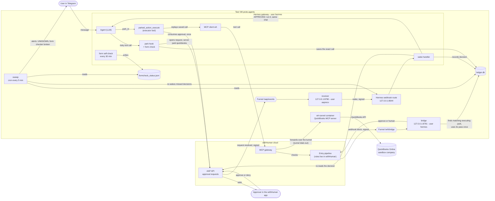
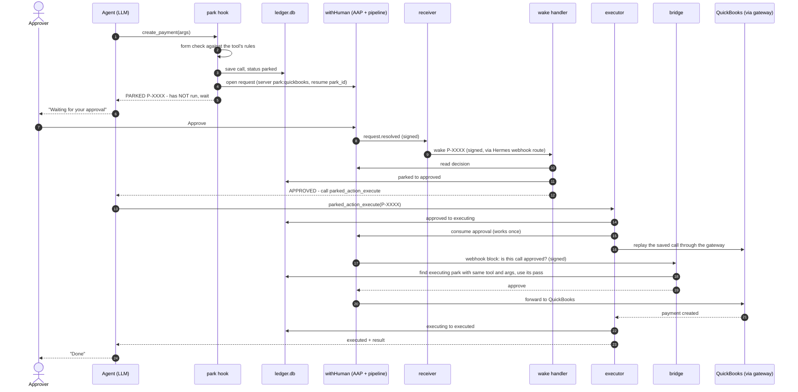
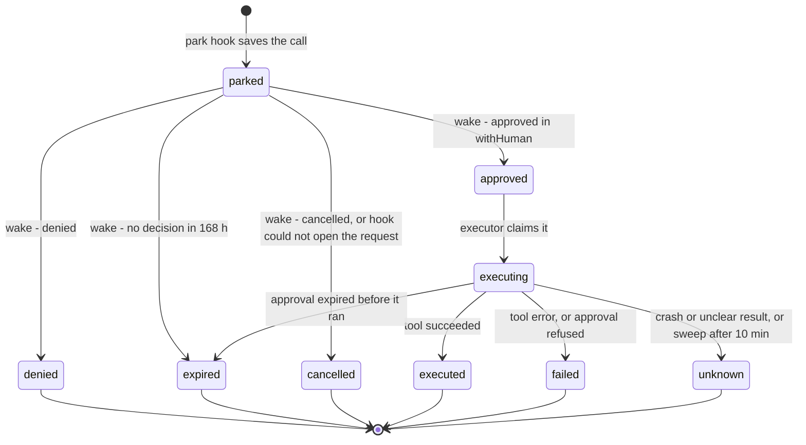
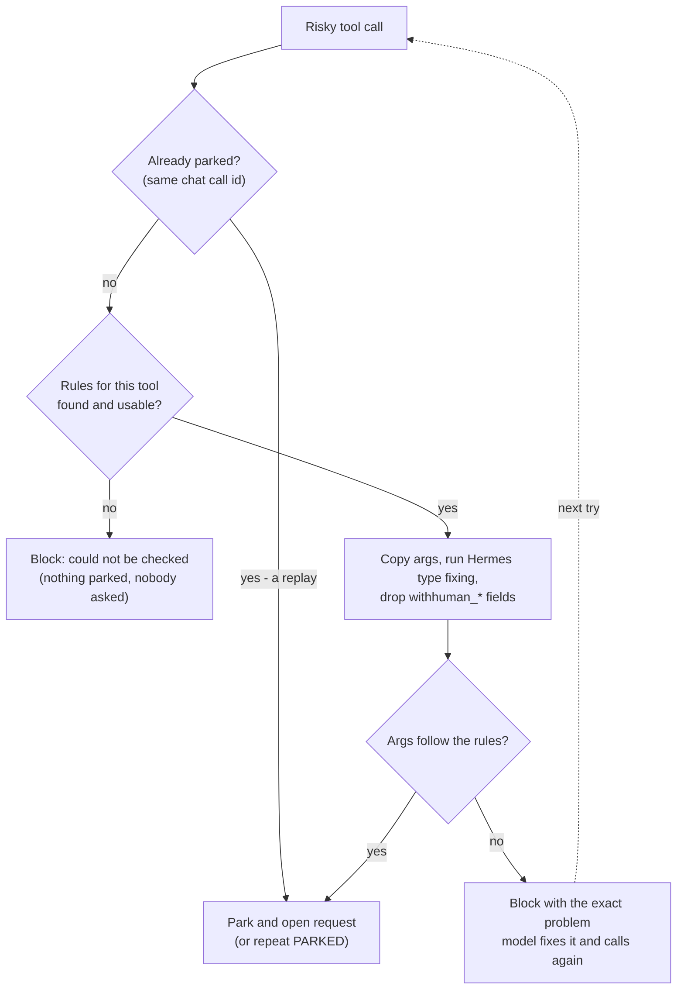

# durable-park architecture

How a risky tool call is stopped, approved once by a person, and then run exactly once, even across restarts.
This is the reference for how the pieces connect. **If you change a component, an arrow, a port, a path, a
state or a threshold, update the matching diagram or table here in the same change** (see `CONTRIBUTING.md`).
Versions and licenses of the third-party pieces (Hermes, withHuman, AAP, the QuickBooks MCP server, ...) are in
the root README's [Built on](../../README.md#built-on) table.

- [1. System map](#1-system-map)
- [2. The approval journey, step by step](#2-the-approval-journey-step-by-step)
- [3. Ledger states](#3-ledger-states)
- [4. Form check before parking](#4-form-check-before-parking)
- [5. When things go wrong](#5-when-things-go-wrong)
- [6. Where everything runs](#6-where-everything-runs)
- [7. Secrets and who can read them](#7-secrets-and-who-can-read-them)
- [8. Numbers that matter](#8-numbers-that-matter)
- [Glossary](#glossary)

## The three guarantees

1. **Nothing risky runs without one human approval.** The plugin blocks the call before Hermes sends it; the
   withHuman gateway asks the bridge, and the bridge says "approve" only for a call that matches an approved park.
2. **An approved call runs at most once, exactly as approved.** The approval is consumed once; the bridge's pass is
   used once; arguments must match the saved ones.
3. **A crash never causes a silent retry.** If the outcome is unclear the row becomes `unknown` and a person checks.

How strong is the first guarantee today? The plugin, the bridge and the ledger all trust the user `hermes`, which
is also the user the agent runs as. Until 2026-10-20 what stopped the agent from writing a fake "approved" row was
that it had **no file or terminal tools at all** (the v1 tool lockdown, `deploy/hermes_tool_policy.py`). That was a
configuration guard, not a permission boundary, and **it is lifted on proto-agents**: on 2026-10-20 Yaakov decided the
one agent gets the full Hermes toolset, and since about 02:20 UTC on 2026-10-21 it runs that way (Hermes's built-in
approvals are off too; see the [spec](../../docs/specs/2026-10-20-one-agent-merge-design.md)). durable-park (withHuman) is now the **only** approval
gate, and it covers the 12 QuickBooks money-move tool types, not terminal or file actions. An agent with a terminal
can in principle write the ledger, so the first guarantee now holds for an agent that follows the park flow, not
against one that is hijacked. That is accepted while QuickBooks is a sandbox company; a separate ledger owner (a
real permission boundary) is on the [backlog](backlog.md) and is needed before real books.

## 1. System map

Everything durable-park adds runs on the test VM next to Hermes. The agent never holds QuickBooks credentials:
QuickBooks is reached only through the withHuman MCP gateway and its tunnel.

| Part | Code | What it does |
|---|---|---|
| park hook | `plugin/durable_park/park_hook.py` | Hermes `pre_tool_call` hook. Blocks risky calls, checks the form, saves the call, opens the approval request. |
| form check | `plugin/durable_park/formcheck.py` | Checks arguments against the tool's own rules before anyone is asked. Background self-check. |
| ledger | `plugin/durable_park/ledger.py` | SQLite record of every parked call and its state. The single source of truth. |
| wake handler | `plugin/durable_park/wake.py` | Hermes `pre_gateway_dispatch` hook. Turns a wake into a ledger update and a message in the original chat. |
| executor | `plugin/durable_park/executor.py` | The `parked_action_execute` tool. Consumes the approval and replays the saved call exactly once. |
| approval calls | `plugin/durable_park/gatecall.py` | Builds the withHuman (AAP) request from a ledger row. |
| receiver | `receiver/app.py` | Receives withHuman's signed "request decided" webhook and posts a signed wake to Hermes. |
| bridge | `bridge/app.py` | Answers withHuman's pipeline: "is this exact gateway call an approved park?" |
| sweep | `scripts/durable_park_sweep.py` | Safety net: re-wakes missed decisions, marks stuck runs `unknown`, alerts when the form checker is broken. |
| tunnel | `deploy/tunnel/` | Runs Intuit's QuickBooks MCP server behind the withHuman gateway (sandbox). |

**The withHuman entry pipeline** (configured in the withHuman app, not in this repo; as of October 2026,
revision 8):

| Order | When | Then |
|---|---|---|
| 1 | Agent `proto-agents` and (server starts with `park:` or tool starts with `mcp__wh__`) - a park request | Ask an approver |
| 2 | Server `quickbooks` and the tool is one of the 12 money types (create/update/delete of payment, bill_payment, transfer, deposit, journal_entry, refund_receipt, sales_receipt, credit_memo, vendor_credit, purchase, invoice, bill) | Webhook block `durable-park-bridge`: answers approve or human (human asks an approver) |
| 3 | Everything else (reads and other writes) | Approve |

**Who approves:** the people on the approvers' escalation path in withHuman (today `notify-yaakov-yehuda`, one
approver). Adding or changing approvers is a change to that path, not to code. **Telling the two asks apart** in the withHuman app: a park
request shows the tool as `mcp__wh__quickbooks__...` (server `park:quickbooks`) - that is the one to approve. A
request with the plain tool name (`create_payment`, server `quickbooks`) means the bridge did not recognise a
replay, so this is a second ask for the same action ([runbook](runbook.md#an-approver-was-asked-twice-for-one-action)).

Setup steps for the pipeline: [gateway-setup.md](gateway-setup.md#human-step-c-task-7-step-5-endpoint-secret-pipeline).

## 2. The approval journey, step by step

One QuickBooks payment, from the model's first try to the payment existing. The approver approves exactly once
(step 7).

Notes:
- Step 5: "NOT run" is true - the hook blocks the call before Hermes sends it anywhere.
- Steps 9-10: the wake carries only the park id. The handler always re-reads the decision from withHuman, so a
  forged wake cannot approve anything.
- Step 16: `parked_action_execute` replays with `ctx.dispatch_tool`, which does not run `pre_tool_call` hooks, so
  the replay is not parked again.
- Step 18: the bridge matches on the Hermes tool name (built the way Hermes builds it, `bridge.app.hermes_tool_name`)
  and a digest of the arguments (`ledger.normalize_args`: ignores `withhuman_context`, defaults `withhuman_scope`,
  treats `2.0` as `2`). Anything that does not match goes to a person - never auto-approved. If withHuman
  retries the **same** delivery (same idempotency key), the bridge repeats its earlier answer; that is the same
  request, not a second run.

## 3. Ledger states

Every parked call is one row in `ledger.db`. Moves happen only along these edges (`ledger.TRANSITIONS`), with a
compare-and-set, so two processes can never both move the same row. `parked`, `approved` and `executing` count as
"waiting" and block new risky calls in the same chat.

- `unknown` is final on purpose: the approval was already used, so the call is never retried automatically. A
  person checks QuickBooks (runbook: [UNKNOWN outcome](runbook.md#outcome-unknown)).
- `gateway_passed_at` is set when the bridge approves the gateway call (once per row). `notified_at` is set when the
  chat was told about a decision.

## 4. Form check before parking

Before parking, the hook checks the call against the rules Hermes registered for that tool (the same rules the
model was shown). A broken call is sent back to the model to fix, so no approver is asked about a call QuickBooks
would reject. Details and safety choices: [form-check.md](form-check.md).

The background self-check (every 30 minutes, inside the gateway) proves the checker, the registry and every risky
tool's rules work, and writes `formcheck_status.json`. The sweep alerts once if that report is missing, older than
75 minutes, or failing on two sweeps in a row, and once when it recovers.

## 5. When things go wrong

| Situation | What happens | Who acts |
|---|---|---|
| Denied in withHuman | Row `denied`; the chat is told it did not run. | Nobody |
| No decision in 168 h | Row `expired`; the chat is told it can ask again. | Nobody |
| Approval expired before running | Row `expired`; nothing ran. | Ask again if still wanted |
| Gateway crashes after the approval was used | Row stays `executing`; after 10 min the sweep marks it `unknown` and alerts. Never retried. | Check QuickBooks ([runbook](runbook.md#outcome-unknown)) |
| Tool returns an unclear error (session expired, interrupted) | `unknown`, same as above. | Check QuickBooks |
| Tool returns a clear error | `failed`, error stored; nothing to check. | Fix and ask again |
| A decision's wake is lost (Hermes down, wake refused) | The sweep re-posts wakes every 5 minutes until the chat is told. | Nobody |
| Bridge cannot match the gateway call (args changed, bridge down, bad signature) | withHuman asks a person instead. Never auto-approves. | An approver decides |
| Bad form (missing required field, wrong type) | Blocked before parking; the model is told the exact problem. | Nobody (the model fixes it) |
| Form checker cannot run | Risky calls blocked; sweep alert after two bad sweeps. | Fix the checker ([runbook](runbook.md#form-checker-not-working)) |
| Ledger cannot be opened at start | Every risky call is blocked; wakes are dropped; no executor tool. | Fix the ledger file |
| Another park is still waiting in the chat | New risky call blocked: "already waiting". A park can wait up to 168 h, and the chat cannot start another risky action until it is decided. | Decide the waiting one |

Known gaps (see the [backlog](backlog.md)): an inject Hermes accepted but
dropped is never retried; a `parked` row without a request id blocks its chat until handled by hand; the bridge's
replay store is not tied to the withHuman request id.

## 6. Where everything runs

| Process | Runs as | Code it runs | Listens on | Started by |
|---|---|---|---|---|
| Hermes gateway (agent + plugin, Telegram and Teams adapters) | `hermes` | `~/.hermes/plugins/durable-park` -> `/home/hermes/durable-park/plugin/durable_park` (the git clone) | `127.0.0.1:8644` (webhook route `durable-park-wake`), `127.0.0.1:3978` (Teams bot "TapDash Agent") | systemd user unit `hermes-gateway` |
| Hermes web dashboard | `hermes` | the `hermes` install (`hermes dashboard`, basic-auth user `TapDash`) | `100.99.171.75:9119` (Tailscale only) | systemd user unit `hermes-dashboard` |
| Teams tunnel | `ubuntu` | Microsoft devtunnel `proto-agents-bot`, forwards to the gateway's `127.0.0.1:3978` | outbound only | systemd user unit `devtunnel-hermes` (user `ubuntu`) |
| Claude connector "Proto-Agents" | `hermes` | `/home/hermes/hermes-shell-mcp` (shell access for Claude on this VM) | `127.0.0.1:8792` | system service `hermes-shell-mcp` |
| receiver | `aaprecv` | `/opt/durable-park/receiver/` (root-owned copy) | `127.0.0.1:8790` `/aap/events` | system unit `durable-park-receiver` |
| bridge | `hermes` | `/opt/durable-park/bridge/` + `/opt/durable-park/plugin/durable_park/ledger.py` (root-owned copy) | `127.0.0.1:8791` `/wh/bridge` | system unit `durable-park-bridge` |
| sweep | `hermes` | `/home/hermes/durable-park/scripts/durable_park_sweep.py` (the git clone) | - | Hermes cron `durable-park-sweep`, every 5 min, no agent |
| tunnel | container user `withhuman` | image `durable-park/wh-tunnel:0.0.369-qbo-31a1dd5` | outbound only | Docker, container `wh-tunnel` |
| Public entry points | - | Tailscale Funnel `https://proto-agents.taila95862.ts.net/aap/events` and `/wh/bridge`; `/hermes-shell` for the Proto-Agents connector (GitHub OAuth, one allowed GitHub account) | 443 | `tailscale funnel --bg` |

- The git clone is `/home/hermes/tapdash-agents`; `/home/hermes/durable-park` is a link to its `durable-park/`
  folder, so older paths keep working.
- The receiver and bridge run from **root-owned copies** in `/opt/durable-park`, so the agent's user cannot change
  the code that says "approved". Changing them needs a root copy step (runbook: [Deploy a change](runbook.md#deploy-a-change)).
- Data lives in `/home/hermes/.hermes/plugin-data/durable-park/`: `ledger.db`, `bridge_deliveries.db`,
  `formcheck_status.json`, `formcheck_alert_state.json`.
- The agent has the full Hermes toolset (terminal, file, browser, ...) and Hermes's own approvals are off
  (`approvals.mode: off`). Only `tools.tool_search.enabled: off`, `gateway.strict: true` and
  `gateway.trust_recent_files: false` of the old lockdown were kept. The v1 lockdown
  (`deploy/hermes_tool_policy.py`, tools limited to `parked_action_execute`, `clarify` and
  `mcp__wh__quickbooks__*`) was lifted by hand-editing `~/.hermes/config.yaml`; do not re-run
  `deploy/configure_hermes.sh` on this VM, it re-applies it ([spec](../../docs/specs/2026-10-20-one-agent-merge-design.md) section 4.1).
- Two agents ran on the VM until 2026-10-21 (this install and an `ubuntu` user install for Teams and the
  dashboard). Now it is **one**: the `hermes` install. The `ubuntu` install is stopped and kept as an archive.

## 7. Secrets and who can read them

All secrets live in `/etc/durable-park/` on the VM. They are typed in by an admin (never pasted into chat, never in
the repo) and never printed by any script.

| File | Mode | Read by | Used for |
|---|---|---|---|
| `instance_token` | 0640 root:hermes | plugin, Hermes (`wh` MCP server via the secrets helper) | withHuman instance credential: approval requests and the gateway |
| `receiver.json` | 0600 aaprecv | receiver | withHuman webhook signing secret + the receiver's own credential copy |
| `wake_secret` | 0640 root:dpwake | receiver, sweep, Hermes (via the secrets helper) | signs the local wake to Hermes |
| `bridge_secret` | 0640 root:dpwake | bridge | verifies withHuman's pipeline webhook signature |
| `tunnel.env` | 0600 root | `wh-tunnel` container | QuickBooks app keys + refresh token, withHuman tunnel token |
| `provisioner_token` | 0600 root | `provision.py` (once) | creating the withHuman instance; delete afterwards |

Rotate all of them before production: [runbook](runbook.md#rotate-secrets-before-production).

## 8. Numbers that matter

| Value | Meaning | Where |
|---|---|---|
| 168 h | An approval request waits this long for a decision | `gatecall.py` |
| 5 min | Sweep interval (fires about 1 min late, so about 6 min in practice) | Hermes cron |
| 10 min | An `executing` row older than this becomes `unknown` | `durable_park_sweep.py` |
| 30 min | Form self-check interval | `formcheck.py` |
| 75 min | Form-check report older than this is treated as broken | `durable_park_sweep.py` |
| 2 | Bad sweeps in a row before a form-checker alert | `durable_park_sweep.py` |
| 300 s | Allowed clock difference on the bridge signature | `bridge/app.py` |
| 60 s | Hermes waits this long for the park hook | `plugins.hook_callback_timeout` |
| 3 failures / 60 s | Hermes pauses an MCP server after 3 failed calls (blocked calls never reach it) | Hermes `tools/mcp_tool.py` |

## Glossary

| Term | Meaning |
|---|---|
| Hermes | Hermes Agent (Nous Research): the agent runtime. Its **gateway** connects the model to chat apps and tools. |
| withHuman | The approval service. Holds approval requests, the MCP gateway and the pipeline rules. |
| AAP | Agent Approval Protocol: withHuman's API for approval requests (open, read, consume once). |
| MCP | Model Context Protocol: how Hermes calls tools. QuickBooks tools arrive through withHuman's **MCP gateway**. |
| park | Stopping a risky call before it runs and saving it in the ledger, with an open approval request. |
| wake | A small signed message telling the plugin "look at this park again". It carries only the park id. |
| gateway pass | The one-time "yes" the bridge gives for one approved park. Used once, then gone. |
| digest | A fingerprint (sha256) of a call's arguments, used to check a replay is the exact approved call. |
| sweep | The 5-minute cron script that catches anything missed and sends alerts. |
| tunnel | withHuman's container that runs a tool server (here QuickBooks) on the VM and dials out to withHuman. |
| Funnel | Tailscale Funnel: exposes two local paths of the VM to the internet so withHuman can reach them. |
| jump host | The production Hermes server the AI agents' connector runs on; it reaches the VM over SSH. Never changed. |
| approver | A person on withHuman's approvers' escalation path; decides approval requests in the withHuman app. |
| admin | A person with root on the VM and admin rights in withHuman; enters secrets and does the root steps. |
