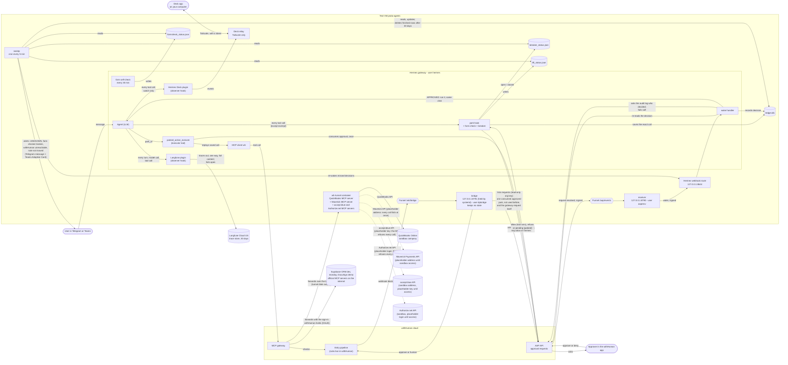
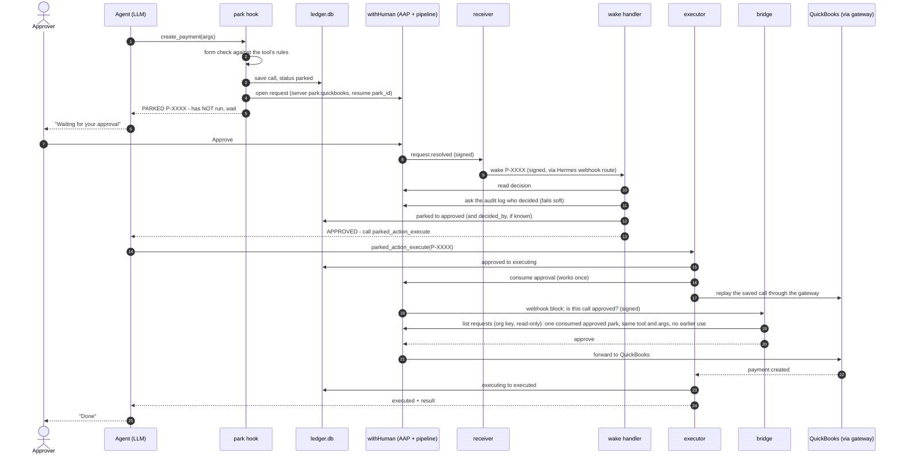
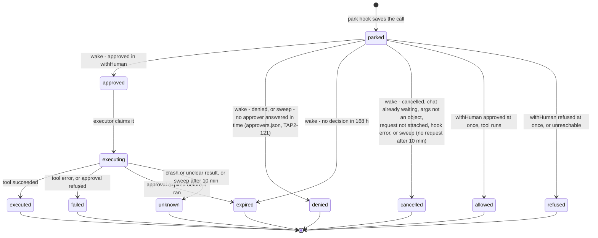
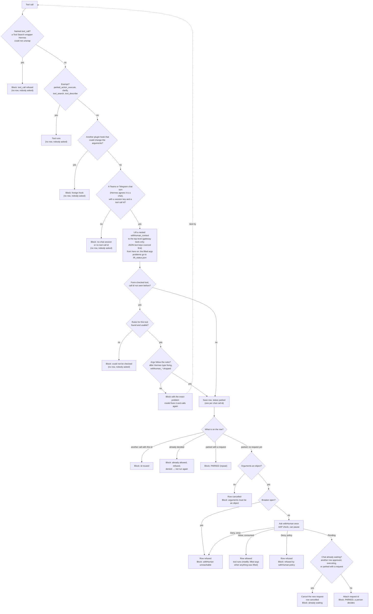

# durable-park architecture

In plain English: when the AI agent wants to do something risky, like paying a bill in QuickBooks, this system stops
it and saves the request. A person approves or denies it in the withHuman app. Only after a yes does the saved
request run, and it runs once. This page shows how the pieces connect, with diagrams. The technical detail comes
after.

How a risky tool call is stopped, approved once by a person, and then run exactly once, even across restarts.
This is the reference for how the pieces connect. **If you change a component, an arrow, a port, a path, a
state or a threshold, update the matching diagram or table here in the same change** (see `CONTRIBUTING.md`).
Versions and licenses of the third-party pieces (Hermes, withHuman, AAP, the QuickBooks MCP server, ...) are in
the root README's [Built on](../../README.md#built-on) table.

- [0. How strong is it today?](#0-how-strong-is-it-today)
- [1. System map](#1-system-map)
- [2. The approval journey, step by step](#2-the-approval-journey-step-by-step)
- [3. Ledger states](#3-ledger-states)
- [4. Tool call: form check, then one question to withHuman](#4-tool-call-form-check-then-one-question-to-withhuman)
- [5. When things go wrong](#5-when-things-go-wrong)
- [6. Where everything runs](#6-where-everything-runs)
- [7. Secrets and who can read them](#7-secrets-and-who-can-read-them)
- [8. Numbers that matter](#8-numbers-that-matter)
- [Glossary](#glossary)

## The three guarantees

1. **Nothing risky runs without one human approval.** The plugin blocks the call before Hermes sends it; the
   withHuman gateway asks the bridge, and the bridge says "approve" only after it has checked **in withHuman** that
   the call matches one approved, consumed park request that no other gateway request has used ([the decision
   rule](#the-bridges-decision-rule)).
2. **An approved call runs at most once, exactly as approved.** The approval is consumed once; the bridge approves one
   gateway call per consumed approval (withHuman's own request list shows whether another gateway request already
   used it); arguments must match the saved ones.
3. **A crash never causes a silent retry.** If the outcome is unclear the row becomes `unknown` and a person checks.

## 0. How strong is it today?

**In plain English.** The approval gate works, but it is not a full lock yet. The agent can reach QuickBooks only
through the gate, and the gate says "approve" only for a call that a person approved. The weak spot: the agent runs
as the Linux user `hermes`, and `hermes` also owns the ledger (the file that records every parked call). If the agent
ever got a terminal or file tool, it could write to that file. So those tools stay off, and only a QuickBooks
**sandbox** (fake books) is connected. A separate owner for the ledger ("Clean Setup Phase 2") closes the rest.
This section is the one place that says how strong the first guarantee is. Other docs link here instead of
repeating it.

State on 2026-10-22:

- **Not yet a full security boundary on proto-agents.** The plugin and the ledger trust the user `hermes`, which is
  also the user the agent runs as.
- **The bridge does not trust the ledger.** It keeps no state and asks withHuman with a read-only organization key, so
  a forged ledger row cannot get a gateway call approved. It runs as its own system user `dpbridge`, from a
  root-owned copy that `hermes` cannot change, and systemd holds its port (`durable-park-bridge.socket`), so nothing
  the bot runs can kill the bridge or answer "approve" in its place ([section 6](#6-where-everything-runs)).
  withHuman does not sign the bridge's "approve" or "human" answers, so whoever answers on `127.0.0.1:8791` decides;
  that is why systemd holds the port for as long as the socket unit is neither stopped nor failed (both of its
  failure limits are switched off, see the failure table in [section 5](#5-when-things-go-wrong)). `bridge_secret`
  is `root:root 0600`. `audit_key` stays readable by `hermes` (the plugin names the decider with it); it is
  read-only, so it lets a hijacked agent list requests, never approve one. `deploy/bridge_check.py` verifies all of
  this at every deploy, and the deploy stops if it fails.
- **Tool lockdown (v1): a configuration guard.** The agent can reach only `clarify`, `parked_action_execute`,
  `mcp__wh__quickbooks__*`, `mcp__wh__maverick__*`, `mcp__wh__acceptblue__*`, `mcp__wh__authnet__*` and the three remote servers' tools (`mcp__wh__supabase_crm_dev__*`,
  `mcp__wh__monday__*`, `mcp__wh__docusign_demo__*`; Hermes writes the slugs' `-` as `_`) (and, once `skills` is opened in the allow file, `skills_list` and
  `skill_view`; `skill_manage` stays denied by the live pipeline. `check` proves that the reviewed file
  `deploy/withhuman/entry-pipeline.json` denies it; the live revision is the one named below and is re-checked when
  `skills` is opened, see the [runbook](runbook.md#open-a-toolset)), plus the three Tool Search bridge tools (`tool_search`, `tool_describe`, `tool_call`)
  while Tool Search is on (it has been on since 2026-10-21 19:59 UTC). `deploy/hermes_tool_policy.py` applies it on
  every platform key (re-applied on proto-agents 2026-10-21 03:16 UTC as a stopgap; `hermes_tool_policy.py check`
  prints the key count and ends `ok`). The agent has no file, terminal or code tools, and Hermes's own approvals are
  off (`approvals.mode: off`). Tools open again only through [the spec](../../docs/specs/2026-10-21-all-tools-withhuman-design.md)
  section 4.4, and file, terminal and code tools stay off until Phase 2.
- **Clean Setup Phase 1 is done** (2026-10-22 02:22 UTC, which is 2026-10-21 10:22 PM ET;
  [spec](../../docs/specs/2026-10-21-all-tools-withhuman-design.md) section 4.1). The user `hermes` has **no sudo**
  (`/etc/sudoers.d/90-hermes` is gone, `sudo -u hermes sudo -n true` is refused). The admin connector runs as
  `ubuntu`. The root-owned parts (`/opt/durable-park`, `tunnel.env`, the other root-only secrets) are out of
  `hermes`'s reach.
- **What an agent that got a terminal or file tool could still do.** It could read the secrets `hermes` uses by
  design (`instance_token`, `audit_key`, and `wake_secret` through the group `dpwake`). Because `hermes` still owns
  the ledger (Phase 2 not done), it could forge ledger rows. A forged row no longer gets a gateway call approved
  (the bridge checks withHuman), but it could still confuse the executor or the sweep. It could **not** read the
  QuickBooks client secret, the refresh token or the withHuman tunnel token in `tunnel.env`, nor `provisioner_token`
  or `bridge_secret` (root-only), nor `receiver.json` (user `aaprecv`), and it could not change the code in
  `/opt/durable-park`. That is why file, terminal and code tools stay off until Phase 2.
- **Even so, durable-park asks withHuman about every tool call** except `parked_action_execute`, `clarify` and the
  two read-only Tool Search catalog tools (`tool_search`, `tool_describe`,
  [section 4b](#4b-hermes-tool-search-the-bridge-tools-in-the-hook-path)). withHuman's pipeline decides which calls
  need a person. With the lockdown, the only tools the agent reaches besides QuickBooks are `clarify`,
  `parked_action_execute` and the Tool Search tools. This is an approval gate, not a full boundary, while an agent
  could reach a terminal and `hermes` owns the ledger.
- **One agent, one Hermes install.** The `hermes` install is the only Hermes on the VM. An older install under the
  user `ubuntu` (the Teams bot and a dashboard, from before the one-agent merge) was stopped on 2026-10-21 and its
  units were removed. But its gateway unit was **re-created on 2026-10-21 at 22:50 ET**, most likely by a `hermes`
  command run as `ubuntu`, and an unguarded agent ran from it. It held the Teams port 3978 and the wake port 8644,
  with Hermes approvals off, no durable-park, a terminal tool and sudo. On 2026-10-22 it was stopped, backed up and
  **deleted**: `/home/ubuntu/.hermes`, its unit and the `/home/ubuntu/.local/bin/hermes` shortcut (Linear TAP2-112,
  Done). The backup is `/home/ubuntu/old-hermes-backup-2026-10-22.tar.gz` (being moved to Google Drive). It holds the
  chat databases, the config files, the skills and the logs; the secrets and the program files are not in it.
  **Rule: run `hermes` commands only as the `hermes` user** (`sudo -u hermes -H ...`). Running `hermes` as another
  user can create a second install or a second gateway, without any of these guards. What `ubuntu` holds now: the
  admin connector (`hermes-shell-mcp`, a system service, kept as `ubuntu` on purpose by Clean Setup Phase 1 so
  `hermes` has no sudo), the review checkout `/home/ubuntu/review` and the backup file.
- **Accepted risk.** Yaakov accepted the earlier, wider risk on 2026-10-20 for the exploration phase, on a test VM with
  a QuickBooks **sandbox** company. The decision: Clean Setup Phase 1 (done), then Phase 2 (spec section 4.5, open)
  before any local tool opens; the docker backend and `approvals.deny` were dropped. What is left is in the
  [backlog](backlog.md#before-real-books) and is needed before any real credentials.
- **Before you re-run `configure_hermes.sh` or `hermes_tool_policy.py`:** they re-apply this state and restart the
  gateway. Follow [Before you run the configure script](runbook.md#before-you-run-the-configure-script) (check the
  ledger, then stop the gateway first).

## 1. System map

Everything durable-park adds runs on the test VM next to Hermes. By design the agent does not hold QuickBooks
credentials: QuickBooks is reached only through the withHuman MCP gateway and its tunnel, and the credentials sit in
the root-only `/etc/durable-park/tunnel.env`. How strong that guard is today: [section 0](#0-how-strong-is-it-today).

| Part | Code | What it does |
|---|---|---|
| Langfuse plugin (Nous Research's, patched by us) | Live since 2026-10-22: TapDash's patched copy `tapdash-langfuse`, in [`tracing/tapdash_langfuse`](../../tracing/tapdash_langfuse) of this repo (changes listed in its `PATCHES.md`), installed as a symlink `~/.hermes/plugins/tapdash-langfuse` into the live clone. It replaced Nous Research's unpatched `langfuse` plugin, which is no longer enabled | Sends traces to Langfuse Cloud: one per turn, one generation per model call, one observation per tool call, full content ([runbook](runbook.md#tracing-langfuse)). The patched copy also sets the chat sender id as `userId`, names traces by platform and tags traces by configured patterns such as `park:P-...`. Its `pre_tool_call` hook only observes and is listed in `observer_hooks` (`hermes_plugins.tapdash_langfuse.on_pre_tool_call`; the function is byte-identical to upstream's). No durable-park code or approval behaviour changes. A one-way arrow out: Langfuse sends nothing back and cannot change a call. Tracing live since 2026-10-22 04:37 UTC (unpatched at first, patched copy since about 19:52 UTC). |
| Hermes Deck plugin and relay (Hermes-Deck, third party) | Live since 2026-10-22: the plugin in `~/.hermes/plugins/hermes-deck`, the relay as the user service `hermes-deck-relay`. Shows the Deck app what the agent is doing; its one `pre_tool_call` hook is a reviewed observer ([runbook](runbook.md#hermes-deck-desktop-app)) |
| plugin entry point | `plugin/durable_park/__init__.py` | `register(ctx)`: reads the [plugin settings](#plugin-settings), builds one shared gate (hook and executor) and one breaker, registers the hooks and the executor tool. Checks Hermes's hook and middleware registries on every call for other plugins' `pre_tool_call` hooks and `tool_request` / `tool_execution` middleware (foreign-hook guard). If the ledger cannot open it registers a hook that refuses every non-exempt call and drops wakes. |
| park hook | `plugin/durable_park/park_hook.py` | Hermes `pre_tool_call` hook. For every tool call except the exempt ones (`parked_action_execute`, `clarify`, `tool_search`, `tool_describe`): refuses a call that is not from a chat durable-park can wake (no session key, or a platform other than `teams` or `telegram`, or Hermes's own chat check says no, which covers the CLI, TUI and desktop; [section 4](#4-tool-call-form-check-then-one-question-to-withhuman)); refuses a `tool_call` wrapper that Hermes did not unwrap ([section 4b](#4b-hermes-tool-search-the-bridge-tools-in-the-hook-path)); lifts a `withhuman_context` note the model nested inside an argument object to the top level (gateway tools only, [section 4](#4-tool-call-form-check-then-one-question-to-withhuman)); checks the form (form-checked tools only), saves the call, and asks withHuman once, with the note as the approver's reason. An instant approval lets the tool run (row `allowed`; Hermes gets the lifted arguments when anything was lifted); an instant refusal or an error blocks it (row `refused`); otherwise the call is parked until a person decides. Refuses everything while another plugin hook could change arguments after approval, or while the breaker is open. |
| form check | `plugin/durable_park/formcheck.py` | Checks arguments against the tool's own rules before anyone is asked. Background self-check. |
| ledger | `plugin/durable_park/ledger.py` | SQLite record of every tool call that was asked about and its state. The single source of truth. |
| wake handler | `plugin/durable_park/wake.py` | Hermes `pre_gateway_dispatch` hook. Turns a wake into a ledger update and a message in the original chat. |
| executor | `plugin/durable_park/executor.py` | The `parked_action_execute` tool. Consumes the approval and replays the saved call exactly once. Its schema gives no example park ID (a concrete one invited the model to call it with that ID): the tool description says to call it only after being told in this chat that the park was APPROVED, and the `park_id` description says to use the exact ID from a `[durable-park]` message in this chat and never guess or invent one. |
| approval calls | `plugin/durable_park/gatecall.py` | Builds the withHuman (AAP) request from a ledger row for any tool: server label (`park:<slug>` gateway, `mcp:<alias>` other MCP, `hermes`), secret keys redacted and long strings cut, context (`args_sha256`, platform, session key, and the user id and profile saved with the row when there are any), the agent's top-level `withhuman_context` as the request's reasoning (the `agent_reasoning` field, at most 2000 characters), and one shared gate that is rebuilt when the token file changes (the replaced gate's HTTP client is closed one rebuild later, as a call may still be using it). `build_call` is a pure function of the row. The user id and profile are read from the Hermes session once, when the call is parked, and stored in the row. The executor never reads them again. The SDK hashes the whole body into the idempotency key, so a different body would not find the approval. |
| breaker | `plugin/durable_park/breaker.py` | Circuit breaker for withHuman outages: after 3 consecutive errors it stays open for 30 s (calls are refused without asking), then lets calls through again until an outcome is recorded; a failure re-opens, a success closes. It records open/close in `breaker_status.json` next to the ledger (written only on a change); it never calls withHuman itself. Started with a status file that still says open (a restart during an outage), it starts open but lets calls through at once, so the first success writes the close. |
| receiver | `receiver/app.py` | Receives withHuman's signed "request decided" webhook and posts a signed wake to Hermes. |
| bridge | `bridge/app.py`, `bridge/verify.py`, `bridge/whapi.py` | Answers withHuman's pipeline webhook: "is this exact gateway call an approved park?" It asks withHuman with the org key (stateless, no ledger); `verify.py` is the pure decision rule. Runs as the system user `dpbridge` and serves the socket systemd holds for it (`--systemd-socket`). Its digest comparison (`ledger.normalize_args`) drops the top-level `withhuman_context`, which is why the note the park hook moved to the top level (and the gateway strips before forwarding) does not change the match: the park row and the delivered call agree. |
| bridge check | `deploy/bridge_check.py` | Read-only isolation check, run as root by `configure_hermes.sh` right after the bridge answers 401 (the deploy stops if it fails) and by hand ([runbook](runbook.md#health-check)). Seven checks: the socket unit is active and listens on exactly `127.0.0.1:8791`; the service is active, its main process runs as `dpbridge` and the `Groups:` line of its `/proc/<pid>/status` is empty or only `dpbridge`'s own gid; only systemd and that process hold the port; no other process runs `bridge.app`; no user-level `durable-park-bridge*` unit exists for any user; `dpbridge` has the `nologin` shell and is not in `dpwake` or `hermes`; `bridge_secret` is `root:root 0600` (stat only, never read). |
| sweep | `scripts/durable_park_sweep.py` | Safety net: re-wakes missed decisions, marks stuck runs `unknown`, cancels a `parked` row that never got a request id attached after 10 minutes (a request may still be open at withHuman; approving it does nothing), routes an approval nobody answered to the backup approver and denies it when nobody answers in time (only with `/etc/durable-park/approvers.json`, TAP2-121, [runbook](runbook.md#backup-approver-and-unanswered-approvals-tap2-121)), alerts when the form checker is broken, once each when the tool policy check fails and passes again, once each when the running gateway has no plugin load proof and has one again, once each when withHuman becomes unreachable (breaker open) and answers again, and once per (tool, kind, key, detail) when the park hook reports that the agent's `withhuman_context` note was not moved, was dropped or could not be checked for (`lift_status.json`, [runbook](runbook.md#the-agents-note-could-not-be-moved)). Deletes `allowed`, `refused` and `cancelled` rows after 30 days (retention). Its alerts go to the Telegram DM (the cron job's delivery target) and, because `TEAMS_ALERT_WEBHOOK_URL` is set on the VM, also to Teams as an Adaptive Card that renders full width (`"msteams": {"width": "Full"}`) ([runbook](runbook.md#live-hermes-settings-on-proto-agents)). |

### Plugin settings

Read once at gateway start from `plugins.entries.durable-park.settings.<name>` in `~/.hermes/config.yaml`
(`ctx.get_config`); a change needs a gateway restart.

| Setting | Default | What it does |
|---|---|---|
| `exempt_tools` | `["parked_action_execute", "clarify", "tool_search", "tool_describe"]` | Tools that are never asked about: anything listed here runs with no approval and no ledger row. The list replaces the default, so keep `parked_action_execute` in it (a warning is logged if it is missing: approved parks could not run). Any other name is logged as an ERROR (`exempt_tools lists <name>: it runs with no approval and no ledger row`); an MCP tool (`mcp__...`), `tool_call` (Tool Search's tool runner: never exempt) or a name a `form_checked_tools` pattern matches is refused as a bad setting (every call refused, see below). Also used by the fail-closed hook when the ledger cannot open. |
| `form_checked_tools` | `DEFAULT_FORM_CHECKED_TOOLS` (`park_hook.py`: QuickBooks create/update/delete of the 12 money types, six DocuSign writes (slug `docusign` or `docusign_demo`), every Maverick tool `mcp__wh__maverick__maverick_*`, every accept.blue tool `mcp__wh__acceptblue__ablue_*`, every Authorize.net tool `mcp__wh__authnet__authnet_*`) | Regex patterns (`fullmatch` on the Hermes tool name) whose calls get the [form check](form-check.md) before withHuman is asked. An invalid pattern is logged and the defaults are added back. Leaving a tool off does not let it through. |
| `observer_hooks` | `[]` | `module.qualname` of foreign `pre_tool_call` callbacks an admin has read and confirmed never return `modify` ([runbook](runbook.md#allow-another-hook-observer_hooks)). Foreign means anything in Hermes's hook registry that durable-park did not register: other plugins' hooks, `config.yaml` `hooks:` shell hooks (named `agent.shell_hooks.shell_hook[pre_tool_call:<command>]`) and outbound webhooks (named `agent.outbound_webhooks.outbound_webhook[pre_tool_call:<label>]`, label = the webhook's `name` or else its URL), plus a fourth source: `tool_request` / `tool_execution` middleware another plugin registered (`ctx.register_middleware`, named `<module>.<qualname>`; `tool_execution` middleware runs after `pre_tool_call` and can hand the tool other arguments than were approved). Any unlisted one, or a hook or middleware registry that cannot be read, refuses every non-exempt call. A hook with two names (Hermes Deck: `hermes_plugins.hermes_deck.hermes_deck_pre_tool_call` with its bridge, `hermes_plugins.hermes_deck.events.on_pre_tool_call` without) is accepted under both when either is listed (`OBSERVER_HOOK_ALIASES`, TAP2-129). |
| `aap_base_url` | `https://app.withhuman.ai/api/aap` | withHuman Agent Approval Protocol endpoint. |
| `token_file` | `/etc/durable-park/instance_token` | Agent instance token; read lazily by the shared gate and re-read when the file changes. Unreadable: calls are refused. |
| `audit_key_file` | `/etc/durable-park/audit_key` | Optional for the plugin (the bridge needs the same key: systemd hands it a private copy when the bridge starts, so a rotation also needs `sudo systemctl restart durable-park-bridge`). A withHuman org API key with `audit.read`, `request.read` and `request.read.unrouted` and nothing else; the plugin only uses `audit.read`. Read per lookup, never logged. Present: the wake asks the audit log who decided and names them ("by Yaakov Yehuda (android)"). Missing, unreadable or empty: no name, one `warning` log per process, nothing else changes ([runbook](runbook.md#name-the-decider-optional)). |
| `audit_base_url` | `https://app.withhuman.ai` | Where that audit lookup (`GET /api/v1/audit`) goes. A bad `audit_*` setting (not a string, empty, a path that cannot be resolved) only switches the name off with a warning in the log; unlike the other settings it never refuses tool calls. |
| `ledger_path` | `<plugin data dir>/ledger.db` | The ledger. `breaker_status.json`, `formcheck_status.json`, `lift_status.json` and `plugin_load.json` are written next to it. |
| `tool_policy_status` | `<ledger dir>/tool_policy_status.json` | The report `deploy/tool_policy_check.sh` writes before every gateway start. Missing, unreadable, `ok` not true, or written more than 15 minutes before this process started: the plugin refuses every non-exempt call (see [Gateway start](#gateway-start)). A value that is not a string is a bad setting (refuse everything). |
| `risky_tools` | (retired) | Renamed `form_checked_tools`. If still set, a warning `risky_tools is renamed form_checked_tools; ignoring it` is logged and its value is not used. |

`exempt_tools`, `form_checked_tools` and `observer_hooks` must each be a list of strings (a lone string counts as a
one-item list). Any other type (a number, `true`, a mapping, an empty `key:` that YAML reads as null, a list with a
non-string) is logged (`durable-park setting <name> must be a list of strings`) and durable-park refuses every call
except the exempt tools (`parked_action_execute`, `clarify`, `tool_search`, `tool_describe`), as it does for any other error while loading: `register` never raises,
because Hermes would then drop all of durable-park's hooks and run every tool unchecked
(`hermes_cli/plugins_loader.py:525-537`).

### Gateway start

1. systemd runs the drop-in `50-durable-park-policy.conf`'s `ExecStartPre=-` (`deploy/tool_policy_check.sh`, as
   `hermes`): it finds Hermes's Python the way `configure_hermes.sh` does, runs `hermes_tool_policy.py check
   --status-file`, and leaves `tool_policy_status.json` next to the ledger. It always exits 0 (the `-` and the
   script both ensure the gateway starts), writing a failing report itself when there is no Python or the check left
   no new report.
2. Hermes loads the plugin. `register` validates the settings, then reads that report. A problem (missing, failed,
   written more than 15 minutes before this process started, unreadable or future-dated `checked_at`) registers the fail-closed hook (`POLICY_MESSAGE`; only the default exempt tools pass, never the configured list), the wake
   dropper, and an executor that refuses without touching the ledger; nothing else is opened.
   Age is judged against this process's own start (`PROCESS_START`, set at import), not the wall clock, so the
   gateway's uptime does not matter. Every Hermes process loads plugins (the gateway, the 5-minute cron sweep, CLI
   runs) and each fails closed on its own; only the gateway (`is_gateway_process()`: argv has `gateway run`) writes
   its verdict, `tool_policy_load.json` next to the ledger (`ok`, `problem`, `checked_at`; atomic, never raises).
   Other processes log `tool policy: load verdict not written (not the gateway process)` once and write nothing.
   A `stale` report (only too old; `policy_problem` returns distinct verdicts `unreadable checked_at` and
   `checked_at in the future` for the anomalies) in such a process is expected (the start check ran for the
   gateway, not for it): the same refusal, but logged once at INFO (`durable-park: tool policy report predates
   this side process ...`) so it does not reach `errors.log`. Every other problem in any process, and `stale` in
   the gateway, log at ERROR.
3. Otherwise the ledger opens and the normal hook, wake handler and executor register.
4. As the last step of every path that ends with a `pre_tool_call` hook registered (normal, policy refusal, ledger
   unavailable, and the `except` path of `register`), the gateway process writes the **load proof**
   `plugin_load.json` next to the ledger: `pid`, `written_at`, `mode` (`asking`, `refusing-policy` or
   `refusing-error`, naming the live hook) and the `hooks` registered (atomic, never raises; a failed write is only
   logged). Hermes v0.22.2 has no lifecycle hook that fires after all plugins loaded
   (`hermes_cli/plugins.py:109-166`, `VALID_HOOKS`, has no startup, ready or post-load event), so the proof is written
   from `register`. A plugin that fails to import, or overruns `plugins.load_timeout_seconds` (default 10 s;
   `hermes_cli/plugins_loader.py:40-60`, `:525-537`), is disposed with all its hooks and never writes it.
5. systemd then runs the drop-in's `ExecStartPost=` (no `-`): `deploy/plugin_load_check.sh` polls once a second until a
   wall-clock deadline of `DURABLE_PARK_LOAD_TIMEOUT` real seconds (default 30, never cut short by whole-second rounding; Hermes's own load deadline is 10 s and the live load takes about 2 s), for a `plugin_load.json` whose `pid` is the unit's `$MAINPID`.
   Found (any mode, `refusing-*` included: the plugin is live and refusing) it prints one line and exits 0. Not found
   it prints `durable-park ALERT: the plugin did not load in this gateway ...` and exits 1, so systemd stops the
   gateway and no tool call runs unchecked. The drop-in's `StartLimitIntervalSec=600` / `StartLimitBurst=3` stop the
   restart loop after 3 starts in 10 minutes (manual and graceful restarts count too).

The proof is written only when this load was not abandoned (`ctx._load_abandoned`, set by Hermes's
`run_with_load_deadline`, `hermes_cli/plugins_loader.py:142-148`; after it every `ctx.register_*` is a silent no-op,
`plugins.py:1100-1121`) and one of the plugin's own `pre_tool_call` callbacks is in `ctx._manager.iter_hook_callbacks`
(`plugins_dispatch.py:523`); an unreadable registry means no proof. The one remaining window is a load that finishes
between Hermes's `is_alive()` check and its dispose step (microseconds). Before each start the drop-in's first
`ExecStartPre` deletes the old proof, so one left by an earlier process with a reused pid cannot match. The sweep
runs as a Hermes cron inside the gateway, so a gateway the check stopped cannot alert (the bot going silent is the
signal).

The sweep reads the same report and alerts once on a failure and once on recovery. The report is written only at
start, so a long-running gateway does not make it stale for the sweep (the plugin judges age at load). The sweep
also reads `tool_policy_load.json` and alerts once when the plugin's verdict is not ok (this catches a stale
report) and once when a later load passes. When the start-time report itself failed, the load alert is skipped (the
failure already alerted once, and the plugin refused for that same reason), so one failure gives one ALERT and one
recovery line.

As a second line of defence the sweep compares `plugin_load.json` with the running gateway's MainPID
(`systemctl --user show hermes-gateway -p MainPID --value`, 5 s timeout; any error or `0` means it does nothing).
A missing, unreadable or other-pid proof prints one ALERT (state in `plugin_load_alert_state.json`) and one line
when it is loaded again.

The foreign-hook guard reads Hermes's hook registry (`ctx._manager.iter_hook_callbacks("pre_tool_call")`,
Hermes v0.22.2 `hermes_cli/plugins_dispatch.py:523`) and its middleware registry
(`ctx._manager._middleware["tool_request"]` and `["tool_execution"]`, `hermes_cli/plugins.py:1183`; no public
accessor exists) on every call; durable-park's own callbacks are recognised by object identity. The dependency is listed in `compat.py`, so a Hermes upgrade warns to re-verify it: one WARNING in the gateway process's log (`hermes gateway run`), and only an INFO in any other process that loads the plugin (the 5-minute cron sweep, CLI runs), so the sweep does not put a line in `errors.log` every few minutes.

The tested Hermes version is v0.22.3 (`SUPPORTED_HERMES_VERSION` in `compat.py`; live approve -> run-once re-test on
2026-10-21, see [the record](acceptance-2026-10-21-hermes-0.22.3.md)). The Hermes source line numbers in this document and in
`compat.py` were read on v0.22.2 and have not been re-read.

**The withHuman entry pipeline** (reviewed file: [`deploy/withhuman/entry-pipeline.json`](../deploy/withhuman/entry-pipeline.json);
configured in the withHuman app; live revision 16, active since 2026-10-25 16:35 UTC. Revision 12 added the Maverick rules (rows 8 to 14); revision 13 (made in the app on 2026-10-25) added the three remote servers' gateway rules with a direct ask for writes; revision 14 added their park read rules and sent their other gateway calls to the bridge; revision 15 made the three `gw-` blocks match on the server name only (it drops a tool-name fallback; a reviewer's finding on pull request 54; active from 02:54 UTC); revision 16 added the six accept.blue and Authorize.net blocks (rows 15 to 20; saved 16:35:04, active 16:35:07). Rollback: revision 15, then 14, 13 and 12.
**The file has 31 blocks and the live revision 16 is the same list**, so the row numbers below are the live block numbers. Rows 15 to 20 (the accept.blue and Authorize.net rules) have been live since 2026-10-25 16:35 UTC. If an admin goes back to revision 15 (the rollback), row 21 (`money-server-human`, which names both servers) decides every accept.blue or Authorize.net call, at park time and at the gateway, and always asks a person: nothing runs without a person, but even a lookup is asked twice. So going back is safe, only noisy.
`proto-agents` also requires that agent; blocks run in order and the first to decide ends the pipeline.

| Order | Block | When | Then |
|---|---|---|---|
| 1 | `pa-park-money` | server `park:quickbooks`, tool is one of the 12 money types (create, update or delete of payment, bill_payment, transfer, deposit, journal_entry, refund_receipt, sales_receipt, credit_memo, vendor_credit, purchase, invoice, bill) | Ask an approver |
| 2 | `block-06ebcdd6` | server `quickbooks`, same 12 money types (the gateway replay; the tool name has no `mcp__wh__<slug>__` prefix) | Webhook block `durable-park-bridge`: approve only a call that matches one approved, consumed park, otherwise ask an approver. Timeout 5 s, 3 attempts, allowed outcomes approve and ask a human only, no reasoning, context or previous metadata sent |
| 3 | `pa-gateway-read` | server `quickbooks`, a read tool (`get_`, `search_`, `list_`, `read_`, `query_`, `find_`) | Approve |
| 4 | `qb-gateway-write-bridge` | server `quickbooks`, any other tool (every non-read write, whatever its name) | Webhook block `durable-park-bridge`, same settings as block 2: approve only the replay of an approved park |
| 5 | `pa-park-quickbooks-read` | server `park:quickbooks`, a read tool (same verbs) | Approve |
| 6 | `pa-hermes-read` | server `hermes`, one of 12 read-only tools (for example `web_search`, `memory`) | Approve |
| 7 | `pa-hermes-local-deny` | server `hermes`, one of 12 local machine tools (for example `terminal`, `write_file`) | Deny, until Clean Setup Phase 2 |
| 8 | `pa-park-maverick-auto` | server `park:maverick`, tool is one of the 13 Maverick lookups and drafts (`mcp__wh__maverick__maverick_` + `search_lookups`, `describe_lookup`, `read`, `create_boarding_application`, `update_boarding_application`, `save_boarding_principal`, `update_boarding_fees`, `update_boarding_equipment`, `save_vault_customer`, `save_ach_customer`, `upload_dispute_evidence`, `create_dispute_draft`, `update_ticket`; anchored, so `maverick_read_all` does not match) | Approve |
| 9 | `pa-park-maverick-note` | server `park:maverick`, tool `maverick_add_boarding_note`, argument `notify_staff` is JSON `false`. Missing: the rule does not match and the call walks on to a person. `null`, `0` or the text `"false"`: withHuman stops with an evaluation error, which ends as a person too (checked with `preview_pipeline` on 2026-10-25) | Approve |
| 10 | `pa-park-maverick-ticket` | server `park:maverick`, tool `maverick_create_ticket` or `maverick_reply_to_ticket`, arguments `notify_merchant` and `attention_merchant` both JSON `false` (any other value: a person, as in row 9) | Approve |
| 11 | `pa-gateway-maverick-auto` | server `maverick` (the gateway replay; tool name with or without `maverick__`), the same 13 tools | Approve |
| 12 | `pa-gateway-maverick-note` | server `maverick`, the same note rule | Approve |
| 13 | `pa-gateway-maverick-ticket` | server `maverick`, the same ticket rule | Approve |
| 14 | `mav-gateway-write-bridge` | server `maverick`, any other tool | Webhook block `durable-park-bridge`, same settings as block 2: approve only the replay of an approved park |
| 15 | `pa-park-acceptblue-auto` | server `park:acceptblue`, tool is one of the 7 accept.blue tools the server itself marks `auto` (`mcp__wh__acceptblue__ablue_` + `describe_lookup`, `read`, `search_lookups`, `create_customer`, `create_customer_from_transaction`, `update_customer`, `create_invoice`; anchored, so a lookalike such as `ablue_read_all` does not match). None of them moves money: `create_invoice` makes a draft, nothing is charged | Approve |
| 16 | `pa-gateway-acceptblue-auto` | server `acceptblue` (the gateway replay; tool name with or without `acceptblue__`), the same 7 tools | Approve |
| 17 | `acceptblue-gateway-write-bridge` | server `acceptblue`, any other tool (the 21 the server marks `you`: charges, refunds, voids, captures, card storage, anything that tells someone outside) | Webhook block `durable-park-bridge` (its own copy, `acceptblue-gateway-write-bridge-webhook`), same settings as block 2: approve only the replay of an approved park |
| 18 | `pa-park-authnet-auto` | server `park:authnet`, tool is one of the 5 Authorize.net tools the server marks `auto` (`mcp__wh__authnet__authnet_` + `describe_lookup`, `read`, `search_lookups`, `save_customer_profile`, `save_shipping_address`; anchored). None moves money or stores a card | Approve |
| 19 | `pa-gateway-authnet-auto` | server `authnet` (the gateway replay; tool name with or without `authnet__`), the same 5 tools | Approve |
| 20 | `authnet-gateway-write-bridge` | server `authnet`, any other tool (the 19 the server marks `you`) | Webhook block `durable-park-bridge` (its own copy, `authnet-gateway-write-bridge-webhook`), same settings as block 2: approve only the replay of an approved park |
| 21 | `money-server-human` | ANY agent: the server is a payments or accounting server (QuickBooks, Stripe, PayPal, Maverick, Accept Blue, Authorize.net, Plaid, any name containing `pay`, `bank`, `billing`, `treasury`, ...), or the tool's `<server>__` prefix is one, or (extra) the tool name has a money verb (`pay`, `transfer`, `wire`, `refund`, `charge`, `deposit`, `payout`, `send_money`, ...) | Ask an approver. Money never auto-approves |
| 22 | `pa-park-supabase-read` | server `park:supabase_crm_dev`, tool one of the 6 read tools (`list_tables`, `list_migrations`, `list_extensions`, `get_advisors`, `query_logs`, `search_docs`, as `mcp__wh__supabase_crm_dev__<tool>`). `execute_sql` is not in it | Approve |
| 23 | `pa-park-monday-read` | server `park:monday`, one of the 33 monday read tools (the same list the agent is granted in withHuman) | Approve |
| 24 | `pa-park-docusign-read` | server `park:docusign_demo`, one of the 22 DocuSign read tools | Approve |
| 25 | `gw-supabase` | server `supabase-crm-dev` (gateway). Inside: the same 6 read tools approve; anything else (for example `execute_sql`) goes to webhook block `durable-park-bridge` | Approve reads; bridge for the rest |
| 26 | `gw-monday` | server `monday`. Inside: the 33 reads approve; anything else goes to the bridge | Approve reads; bridge for the rest |
| 27 | `gw-docusign` | server `docusign-demo`. Inside: the 22 reads approve; anything else goes to the bridge | Approve reads; bridge for the rest |
| 28 | `pa-mcp-human` | server starts with `mcp:` | Ask an approver |
| 29 | `pa-default-human` | any other call of agent `proto-agents` | Ask an approver |
| 30 | `hermes` | other agents, tool name contains `Stripe` | Ask an approver |
| 31 | `ask-unruled-call` | everything else (any agent, any tool no block names) | Ask an approver. Nothing unruled is auto-approved (replaced `approve-every-call`, which approved it) |

Rev 8 and the earlier approve-all behaviour end when the revision above is activated; activate it before this park
hook goes live. A tool name missing from rules 6 and 7 falls through to rule 29 (proto-agents) or rule 31, so a person decides. A remote-server tool that is not a read (for example monday `create_item` or Supabase `execute_sql`) reaches rule 29 at park time (a person) and its server's bridge at the gateway. Every Maverick tool not in rules 8 to 13 (refunds, charges, signatures, deletes, anything that tells someone outside) reaches rule 21 at park time (a person) and rule 14 at the gateway (the bridge). The same holds for every accept.blue tool not in rules 15 and 16 (rule 17 at the gateway) and every Authorize.net tool not in rules 18 and 19 (rule 20 at the gateway). Those two servers have no tool that is approved only when a flag is off, so there are no rules like 9 and 10 for them: a tool is either in the server's `auto` list or it is for a person. The `auto` lists are the servers' own (`python -m acceptblue_mcp --list-approvals`, `python -m authorizenet_mcp --list-approvals` at the pinned commits) and `tests/payments_servers.py` holds a copy that the pipeline tests compare with the rules, so a pin that moves without the rules is caught. QuickBooks writes that are not money types (TAP2-115) now ask a person at park time and go through the bridge at the gateway.

**Who approves:** the people on the approvers' escalation path in withHuman (today `notify-yaakov-yehuda`, one
approver). Adding or changing approvers is a change to that path, not to code. **Telling the two asks apart** in the withHuman app: a park
request shows the tool as `mcp__wh__quickbooks__...` (server `park:quickbooks`) - that is the one to approve. A
request with the plain tool name (`create_payment`, server `quickbooks`) means the bridge did not confirm a
replay (or withHuman answered it too slowly), so this is a second ask for the same action ([runbook](runbook.md#an-approver-was-asked-twice-for-one-action)).

Setup steps for the pipeline: [gateway-setup.md](gateway-setup.md#human-step-c-task-7-step-5-endpoint-secret-pipeline).

## 2. The approval journey, step by step

One QuickBooks payment, from the model's first try to the payment existing. The approver approves exactly once
(step 7).

Notes:
- Step 5: "NOT run" is true - the hook blocks the call before Hermes sends it anywhere.
- Steps 9-10: the wake carries only the park id. The handler always re-reads the decision from withHuman, so a
  forged wake cannot approve anything.
- Step 17: `parked_action_execute` replays with `ctx.dispatch_tool`, which does not run `pre_tool_call` hooks, so
  the replay is not parked again.
- Step 18: the bridge matches on the Hermes tool name (built the way Hermes builds it, `bridge.verify.hermes_tool_name`)
  and a digest of the arguments (`ledger.normalize_args`: ignores `withhuman_context`, defaults `withhuman_scope`,
  treats `2.0` as `2`; names must be plain, see [the decision rule](#the-bridges-decision-rule)). Anything that does not match goes to a person - never auto-approved. The bridge keeps no
  record of its answers. A retried delivery of the **same** gateway request gets the same answer, because the
  request never counts against itself.

### The bridge's decision rule

The bridge (`bridge/app.py` for the webhook, `bridge/verify.py` for the rule, `bridge/whapi.py` for the withHuman
call) holds no state and never opens the ledger. For each signed delivery of the gateway request G it asks withHuman
(`GET /api/v1/requests`, agent `proto-agents`, newest first, with the organization key `/etc/durable-park/audit_key`)
twice, within a total budget of 3.5 s (withHuman's webhook block gives up at 5 s): once for park requests of the
Hermes tool name (`q` = that name, 50 items), once for **every** recent request of the agent (no `q`, 200 items:
Hermes folds `-` into `_`, so a filter on the tool name could miss a second use under the other spelling). Then:

1. **Plain names only** (`unsafe-name`, before anything else): the gateway server and the tool must each be ASCII
   words joined by single `-` or `_` (the server's own tool-name shape: no `__`, no leading or trailing separator),
   and the unhashed Hermes name `mcp__wh__<server>__<tool>` must be at most 64 characters (so Hermes never adds a
   hash suffix). Hermes' name sanitisation then only folds `-` into `_`, and the bridge can name the park exactly.
   A `__` in the tool is refused because the gateway pipeline's money regex allows an optional `quickbooks__`
   prefix that the park regex lacks: `quickbooks__create-bill` must never pair with a park for `create-bill`.
2. A park request P **matches** only if all hold: same agent, tool = the Hermes tool name, server = `park:<slug>`,
   status and decision `approved`, `consumed_at` present and within the last **120 s** (5 s of clock skew allowed
   against this host's clock; the approval's own expiry is not read, withHuman already refused to consume an
   expired one), no truncated arguments, and the digest of P's arguments equals G's.
3. No match: ask a person (`no-approved-park`). Two matches: ask a person (`ambiguous-park`).
4. On the single match P: arguments the approver could not read go to a person (`redacted-args`: P's arguments hold
   the `[redacted]` placeholder anywhere, or G's arguments would be redacted or cut short by the park hook's own
   redaction); a park whose consumption already has an `outcome` was used and goes to a person
   (`already-reported`).
5. **The listing is checked, not trusted** (neither its page size nor its order): every item needs a readable
   `created_at` and the list must run newest first (`neighbours-unsorted`); and it must contain an item created
   more than 5 s before P was consumed, normally the park itself (`neighbours-truncated`), otherwise a later request
   could be hidden beyond the page boundary. Both checks run first, so a doubtful listing never reaches the next two
   steps.
6. **G itself must be in the listing**, created **at or after** P was consumed (both stamps come from withHuman's
   clock, so no skew is allowed), with the same agent, server, tool and argument digest
   (`gateway-request-not-listed`, `gateway-request-before-release`, `gateway-request-mismatch`).
7. **Single use, collision-aware:** any other request (not G) of the same agent, not itself a park request, that
   Hermes would map to the **same** park (the same Hermes tool name, so `create-bill` and `create_bill` count as
   one), with the same arguments (or arguments that are not an object), created at or after 5 s before P was
   consumed - in any state, pending, denied or expired too - means the approval is used: ask a person
   (`already-used`). The window is wider than G's on purpose: the model's own call made 3 s before the release
   cannot ride on the executor's call made 2 s after it (the earlier one is refused as before-release, the later as
   already-used).
8. Otherwise approve, naming P's id.

The webhook-level payload checks in `bridge/app.py` (signature, block type, preview flag, agent slug, shapes,
idempotency key, `request.id`) run **before** this rule; the rule only sees a delivery that passed them.

Anything unexpected - withHuman slow or down, a missing or too-weak key, a bad answer - asks a person. That is a
second ask for the same action (safe, only noisy). The bridge never raises to withHuman and never auto-approves on
error. Spec: [bridge verifies approvals in withHuman](../../docs/specs/2026-10-22-bridge-verifies-withhuman.md).

**Limit, check when adding a gateway server:** if a server ever offers two tools that differ only by `-` versus `_`
(for example `create-bill` and `create_bill`), the bridge cannot tell them apart: they share one park tool name, so
an approval for one is also an approval for the other, and a use of either uses it. Check the server's tool
catalogue first (`list_gateway_server_tools`). Today quickbooks has `create-bill` but no `create_bill`.

## 3. Ledger states

Every tool call the park hook asks about is one row in `ledger.db` (exempt tools get none). Moves happen only along
these edges (`ledger.TRANSITIONS`), with a compare-and-set, so two processes can never both move the same row. A
row starts `parked` while withHuman is asked; an instant answer moves it to `allowed` or `refused` at once. While
another row of the same chat is `approved` or `executing`, or `parked` **with** a request id, a new call that needs a
person is refused ("already waiting"); a `parked` row whose request is still being opened does not count.

- `allowed` and `refused` are final: withHuman decided the call instantly (an automatic rule, no person asked), or
  could not be reached (`refused`, note `withHuman error: ...` or `error: withHuman unreachable (breaker open)`), so
  nothing waits and nothing runs later from the ledger. The request id is stored only in this final move, so a
  wake never announces them. A replay of the same call id is blocked ("already allowed/refused"), never run or
  asked again. They are not "waiting" statuses. The sweep deletes
  `allowed`, `refused` and `cancelled` rows 30 days after their last update (`--retention-days`); rows that hold an
  outcome (`executed`, `failed`, `unknown`) or a human decision (`denied`, `expired`) are kept.
- `unknown` is final on purpose: the approval was already used, so the call is never retried automatically. A
  person checks QuickBooks (runbook: [UNKNOWN outcome](runbook.md#outcome-unknown)).
  When the cause was a timeout, the executor's reply says the call "did not finish in time" and may or may not have
  gone through; the state and the rule are the same.
- `gateway_passed_at` is no longer written: the bridge does not open the ledger (it asks withHuman). The column
  stays; old rows may have it set and nothing reads it. `notified_at` is set when the chat was told about a decision.
- `user_id` and `profile` (nullable) are the Hermes session's `HERMES_SESSION_USER_ID` and `HERMES_SESSION_PROFILE` at park time, saved by the park hook so `build_call` can rebuild the same approval body at execute time. Empty or unknown = NULL = the key is left out of the context; rows from before the columns existed are NULL, so they rebuild the body they were parked with. A replayed park keeps the first row's values. They are added to an older ledger the same way as `decided_by` (below).
- `decided_by` (nullable, `"Name (channel)"`) is written in the same single update as the decision, only for
  `approved`, `denied` and `cancelled`, and only when the withHuman audit log's newest `approval.decided` event for
  the request was made by a human. It is cosmetic: any failure of that lookup (no key file, HTTP error, 5 s timeout,
  bad JSON, a pipeline decision) leaves it empty and the message and the decision unchanged. An older ledger gets the
  column added when any process (gateway, sweep) first opens it.

## 4. Tool call: form check, then one question to withHuman

Every tool call goes through the park hook (`park_hook.make_pre_tool_call`) in this order. Every path except
"tool runs" blocks the call. A form-checked tool (`DEFAULT_FORM_CHECKED_TOOLS`: the QuickBooks money moves, the
DocuSign writes and every Maverick, accept.blue and Authorize.net tool) is first checked against the rules Hermes registered for it (the same rules the model was shown),
so no approver is asked about a call QuickBooks would reject. Details and safety choices:
[form-check.md](form-check.md). Which calls need a person is a withHuman pipeline rule, not a list in the plugin.

- **Chat turns only.** Hermes gives a one-shot `hermes chat -q` turn a session key too (it looks like
  `agent:main:local:dm:local-...`), so a key alone does not prove there is a chat. A call from the CLI could
  have run a read, and a money call would have parked with no chat to tell when it was decided (that happened:
  a QuickBooks read, ledger row `P-336DFFBB`). So step 3 now needs three things: a session key, a tool call id,
  and a turn that passes `park_hook.default_is_chat`. A turn passes only when **both** of these are true:
  1. **Its platform is on durable-park's list of chat platforms it can wake**, `CHAT_PLATFORMS` in `park_hook.py`:
     `teams` and `telegram`, the two adapters that are connected and tested here. The platform is the one the
     gateway bound for the turn (`HERMES_SESSION_PLATFORM`, set by the gateway for each message), read as the
     bound value, not from the process environment. Empty, unknown, anything else: refused. The wake itself does
     not care which platform (it injects a message through the parked chat's own adapter), so a new platform
     is added to the list only after a full park, approve, wake, execute round trip has been tried on it.
  2. **Hermes's own check agrees**, `gateway.session_context.session_is_messaging_surface()`: it is no for the
     CLI, TUI, desktop, `local`, `api_server` and `webhook` surfaces, and when `HERMES_PLATFORM` names one of them.
  In plain words: **refusing turns that are not a chat covers the CLI, the TUI and the desktop app.** Why two
  checks: Hermes's check alone lets anything through that it does not know by name. It says "chat" for
  `hermes chat -q --source anything`, and for `HERMES_PLATFORM=anything`. The list closes that. A Teams or
  Telegram message passes both.
  **A known limit.** Hermes reads `HERMES_SESSION_PLATFORM` from the process environment when the gateway has
  not bound it, so someone who types `HERMES_SESSION_PLATFORM=teams hermes chat -q ...` in a shell passes
  Hermes's check. durable-park reads the gateway's bound value instead, so that does not pass step 3. Someone
  with a shell as `hermes` is already trusted to run commands, and could also bind a platform from code. The aim
  is that the agent and ordinary CLI use cannot get a call through by accident, not to stop an admin.
  It fails closed: if Hermes cannot be asked (an import fails, an older or changed Hermes lacks the check or the
  bound platform, an error is raised, or the answer is anything but a plain yes) the turn is not a chat and the
  call is refused with the same `no chat session` message, with no ledger row and no withHuman request. The
  exempt tools and the executor are not affected: `parked_action_execute` is exempt at step 1, before this
  check, and the executor's own dispatch never runs the hook. The wake is not a turn at all (the
  `pre_gateway_dispatch` hook drops the `webhook` event); the message it injects starts a normal turn in the
  parked chat, on that chat's own platform (`teams` or `telegram`), so that turn passes. A park can no longer
  start from the CLI. If `HERMES_PLATFORM` is ever set in the gateway's own environment (to anything, `cli`
  or `teams` alike), Hermes reads it before the session platform, so every chat can be refused: leave it unset.
- **Lifting the note.** The withHuman gateway's tool schema is `{params: {...}, withhuman_context: string}`, and the
  gateway strips only the top-level `withhuman_context` before forwarding. When the model nests the note inside an
  argument object (`{"params": {..., "withhuman_context": "..."}}`), the QuickBooks server would get an unknown
  parameter and answer with an "IGNORED" warning that wastes tokens, and the approver would not see the reason.
  `gatecall.lift_gateway_context` moves it up one level for tools whose registered rules (`schema_fn`, default the
  Hermes registry) list `withhuman_context` at the top level: sorted key order, the first non-empty string wins, an
  existing top-level note always wins. For a nested object that holds a note, its own rules decide, and **the note is
  lifted unless the rules positively declare their own `withhuman_context`** (in `properties`, a matching
  `patternProperties` pattern, any `allOf`/`anyOf`/`oneOf` branch, or a local `$ref` such as `#/$defs/X` resolved inside
  the tool's rules): then the server really has that field and the key is left alone. Rules that cannot be judged (a
  remote or unresolvable `$ref`, an invalid pattern, a `$ref` cycle, nesting deeper than 10) lift too. The move is one
  level deep; deeper notes are found and reported, not moved. Arguments that arrive as JSON text (`pre_tool_call`
  fires before Hermes's type fixing) are put through Hermes's own coercion (`formcheck.hermes_coerce`, on a copy)
  when a string argument decodes to an object holding the note, and **only the values of those text keys are taken
  from the coerced copy**: every other key keeps the model's own value, and a coerced copy that has no object under
  the same key name (Hermes renames sanitized keys back to wire names) leaves that key unread. Before a `modify` is
  returned the hook checks that Hermes's merge (`{**original, **lifted}`) equals the lifted call exactly (a modify
  can neither delete nor rename a key); if not, the original arguments are used.
  **Every case where the note is not moved, is dropped, or the check could not run ends as a chat alert.** The hook
  records it in `lift_status.json` (next to the ledger; `gatecall.LiftStatus`: tool, kind, key, detail, `first_seen`,
  `last_seen`, `count`, never a value; at most 200 entries; written under a file lock that merges with other
  processes' entries, a tool call records all its problems at once and waits at most 0.2 s in total to write them; the report is mode 0644
  and its lock 0666, so a process running as another user can read the one and take the other). What could not be written
  stays in memory and is retried on every later record, at process exit, and every 30 minutes by the self-check thread
  (that thread only runs in a Hermes process that has form-checked tools, the gateway; a short-lived helper process relies
  on the next record and the exit flush). Every process holding unsaved problems (a lock timeout included) leaves its own
  marker `lift_status.unwritable.<pid>`, which only that process removes after a successful write; the sweep alerts once
  per marker, and a marker of a process that died stays until removed by hand. The sweep alerts once per (tool, kind, key, detail) (one chat line per tool and kind, naming the first place and counting the others), again once per 24 hours while the count keeps
  growing (never for `declared`, `note_cut` and `note_not_text`, said once per tool), and once when the report is unreadable or the check itself fails
  ([runbook](runbook.md#the-agents-note-could-not-be-moved)). Kinds: `declared` (a key was left alone because its rules
  declare the field; the note goes to the server, not the approver), `note_dropped` (a nested note was removed but not
  shown to the approver: not text, empty, another note was already at the top, more than one note), `schema_unavailable`
  (a gateway tool whose rules could not be read), `args_unreadable` (a JSON-text argument that Hermes's type fixing could
  not turn into an object under the same key), `lift_error` (any other error, or a lift that failed the merge check),
  `note_left_inside` (a note is still inside the final arguments, found by a bounded walk of dicts, lists and JSON text
  at any depth; also for a gateway tool whose rules do not show the field), `check_incomplete` (the walk hit its
  bound: depth 50, 10 000 nodes or 20 hits) and `schema_too_complex` (a tool's rules took more than 2 000 schema nodes to
  judge: they count as "cannot tell", so the note is moved, and it is reported so that is not silent), `note_cut` (the top-level
  note is longer than 2000 UTF-16 code units, so the approver sees it shortened; the hook works this out from the final
  arguments with the same helper `build_call` cuts with, and `build_call` itself records nothing) and `note_not_text` (the
  top-level note is empty, blank or not text, so the approver sees no reason). The call itself always goes on (with the original arguments when the lift
  could not run), so approval is unaffected. What is still **not** covered: a note hidden somewhere the walk cannot read
  (for example inside a string in another encoding), and a lift report nobody can write for longer than the gateway
  runs (the ledger shares that directory, so a full or read-only disk fails loudly elsewhere). The lifted arguments are the
  only arguments from then on: the form check, the row (digest and stored args, so the executor later dispatches the
  lifted call), the request to withHuman, and, for an instant `Allow`, the `{"action": "modify", "args": ...}` the
  hook returns (Hermes shallow-merges it into the call; nothing is returned when nothing was lifted). The top-level
  note goes to the approver as the request's reasoning (`gatecall.build_call`, cut to 2000 characters, a pure
  function of the row).
- **Allow** means the SDK already consumed the approval. If the row cannot move to `allowed` (the sweep cancelled
  it meanwhile), the call is blocked and the spent approval is not used again.
- **Deny** with status `error` (withHuman unreachable, credential refused, bad answer) counts as a breaker failure;
  if a request was already created it is cancelled, so it never waits for a person. Every other Deny (denied,
  expired, cancelled, consumed) is an answer and resets the breaker. The note is passed to the model in the
  refusal, as one line of at most 300 characters.
- **Any error** in the hook (token file unreadable, arguments that are not strict JSON, a ledger error) blocks the
  call with "could not open an approval request"; the row is cancelled when no request was attached to it, and a
  request withHuman opened for a person but the row never got is cancelled too.
- **Arguments that are not an object** (a list, a string, a number) are refused before withHuman is asked: the
  request would show a stand-in while the real value ran.
- If the ledger cannot be opened at start, a fail-closed hook blocks every tool call except the exempt ones.

The background self-check (every 30 minutes, inside the gateway) proves the checker, the registry and every
form-checked tool's rules work, and writes `formcheck_status.json`. The sweep alerts once if that report is missing, older than
75 minutes, or failing on two sweeps in a row, and once when it recovers.

## 4b. Hermes Tool Search: the bridge tools in the hook path

Hermes's **Tool Search** (`tools.tool_search.enabled`, Hermes docs `website/docs/user-guide/features/tool-search.md`)
hides every MCP and plugin tool behind three bridge tools Hermes synthesizes (never registers): `tool_search` and
`tool_describe` read the session's own tool catalog, and `tool_call` runs a hidden tool. It cuts the schema tokens of
the 142 QuickBooks tools from tens of thousands to a name listing. It is **on** on proto-agents since 2026-10-21 19:59 UTC
([runbook](runbook.md#turn-on-tool-search), [verification record](acceptance-2026-10-21-tool-search.md)). What the park hook receives for each bridge tool, read in Hermes v0.22.3
and re-run against the real code on the VM (2026-10-21):

| The model calls | `pre_tool_call` receives | durable-park | Hermes code |
|---|---|---|---|
| `tool_search` | `tool_name: tool_search`, `args: {queries, limit}`, the call's own id | **Exempt** (`BRIDGE_READ_TOOLS`): no request, no row. It only reads the catalog of the session's own tools; it cannot invoke anything. | `tools/tool_search.py:438-492`, `model_tools.py:726-729` |
| `tool_describe` | `tool_name: tool_describe`, `args: {names}` | **Exempt**, same reason | `tools/tool_search.py:495-541` |
| `tool_call` with one valid entry | the **real tool name** (for example `mcp__wh__quickbooks__create_payment`), the entry's `arguments` as the model sent them (a JSON-string `arguments` is parsed to an object; nothing is type-fixed), the outer `tool_call`'s id | Judged exactly like a direct call: form check, one ledger row (`tool` is the real name, `args_digest` the real arguments), one withHuman request, parking. The row and the request are identical to a direct call's. | `agent/tool_executor.py:399-441`, `:460-466` (unwrap before the hook), `tools/tool_search_validation.py:139-170` |
| `tool_call` Hermes cannot unwrap (a batch of two or more, unparsable `calls`, a core tool such as `clarify`, a `connectors__` name) | `tool_name: tool_call` and the raw `calls` | **Refused** with `BRIDGE_CALL_MESSAGE`, never exempt, no row, nobody asked. Hermes would re-resolve the wrapper later with the hook switched off (`model_tools.py:906-922`), so the wrapper must never pass. | `agent/tool_executor.py:417-422` |
| `parked_action_execute` through the bridge | the real name | **Exempt**, as when called directly. | as above |

- **The replay still works.** The executor dispatches with `ctx.dispatch_tool`, which is `registry.dispatch(name, args)`
  (`hermes_cli/plugins.py:670-679`, `tools/registry.py:946-963`). Deferral only changes the tool list shown to the
  model; every tool stays in the registry under its real name, so a deferred MCP tool is replayed like any other.
- **Unchanged:** the form check (it reads the schema from the registry, not from the model's tool list), the bridge's
  tool-name matching (`bridge.verify.hermes_tool_name`; withHuman's own call still names the real tool), the ledger and
  the sweep. One model call is one ledger row because a batch of local tools is rejected by Hermes (one entry per
  `tool_call`), so no two real calls share an outer call id.
- **`parked_action_execute` is deferred too** (it is a plugin tool). The model reaches it through `tool_describe` and
  `tool_call`; the bridge's description lists its exact name. Hermes rejects a hidden tool called by its own name as an
  invalid tool name (`agent/agent_init.py:1127`: the valid names come from the visible list only), so the APPROVED wake
  text (`APPROVED_TEXT` in `wake.py`) says "If parked_action_execute is not in your tool list, call it through
  tool_call." between its instruction to call `parked_action_execute` and its "Do not call <tool> directly"; the
  DENIED and EXPIRED texts need no tool.
- **The tool policy check judges two lists** (`deploy/hermes_tool_policy.py`, `tool_problems`): the *catalog* (every
  tool the session can reach, which `tool_call` can invoke) and what the model *sees*. Only the allowed names may be in
  the catalog (a bridge name there is a leak: Hermes never registers one); the visible list may add all three bridge
  tools or none. Judging only the visible list would let a forbidden tool hide behind the bridge. The constants
  (`BRIDGE_TOOL_NAMES` in the script, `BRIDGE_TOOLS` in `park_hook.py`) are pinned equal by a test.
- `exempt_tools` may not list `tool_call` (a bad setting: every call is refused), and the hook itself drops it from
  any exempt list it is given.

## 5. When things go wrong

| Situation | What happens | Who acts |
|---|---|---|
| Denied in withHuman | Row `denied`; the chat is told it did not run. | Nobody |
| withHuman refuses at once (a pipeline deny rule) | Row `refused`; the call is blocked with "refused by withHuman policy" (and the rule's note, if any; the ledger note says "policy", never "a reviewer"). | Nobody |
| withHuman cannot be reached | Row `refused`; the call is blocked with "withHuman could not be reached". After 3 errors in a row the breaker refuses at once for 30 s, then tries again; the sweep alerts once on open and once on close. | Check withHuman ([runbook](runbook.md#withhuman-could-not-be-reached)) |
| Another `pre_tool_call` callback (a plugin's hook, a `config.yaml` shell hook or outbound webhook) or another plugin's `tool_request` / `tool_execution` middleware could change arguments after approval | Every tool call except the exempt ones is blocked. | An admin removes the hook or lists it in `observer_hooks` |
| Not a chat turn: no session key, a platform other than `teams` or `telegram` (the CLI, TUI, desktop, `--source <tag>`, an unknown platform), Hermes's chat check says no, or it cannot be read | Every tool call except the exempt ones is blocked with `no chat session`, with no row and no request. The platform must be on `CHAT_PLATFORMS` and Hermes's own `session_is_messaging_surface()` must agree; if either cannot be asked, the turn counts as not a chat. | Use a chat (Teams or Telegram). If a real chat is refused, see the [runbook](runbook.md) row for this message |
| No decision in 168 h | Row `expired`; the chat is told it can ask again. | Nobody |
| Approval expired before running | Row `expired`; nothing ran. | Ask again if still wanted |
| Gateway crashes after the approval was used | Row stays `executing`; after 10 min the sweep marks it `unknown` and alerts. Never retried. | Check QuickBooks ([runbook](runbook.md#outcome-unknown)) |
| Tool returns an unclear error (session expired, interrupted) | `unknown`, same as above. | Check QuickBooks |
| Tool returns a clear error | `failed`, error stored; nothing to check. | Fix and ask again |
| A decision's wake is lost (Hermes down, wake refused) | The sweep re-posts wakes every 5 minutes until the chat is told. | Nobody |
| Bridge cannot confirm the gateway call (no matching consumed park, args changed, approval older than 120 s, already used by another gateway request, withHuman slow or down, org key missing or too weak, bridge down, bad signature) | withHuman asks a person instead: a second ask for the same action, still safe. Never auto-approves. | An approver decides ([runbook](runbook.md#an-approver-was-asked-twice-for-one-action)) |
| The bridge process dies or is restarted | systemd keeps listening on `127.0.0.1:8791` (the socket unit holds the port) and restarts the service after 1 s (`Restart=always`); a delivery meanwhile waits in the socket's backlog or times out, and withHuman asks a person instead. Nobody else can bind the port and answer, for as long as the socket unit is neither stopped nor failed. systemd fails a socket unit when the service it activates trips its start limit (`service-start-limit-hit`, with `Accept=no`) and when the socket trips its own trigger limit, and either frees the port; so the service has `StartLimitIntervalSec=0` (systemd keeps retrying every second, however long the start keeps failing) and the socket has `TriggerLimitIntervalSec=0`. Only an admin's `systemctl stop` or `disable --now` of the socket frees the port, and `bridge_check.py` check 1 fails when it is not active. | Nobody; check the unit if it keeps restarting ([runbook](runbook.md#health-check)) |
| Bad form (missing required field, wrong type) | Form-checked call blocked before anyone is asked; the model is told the exact problem. | Nobody (the model fixes it) |
| The agent's `withhuman_context` note was not moved to the top level, was dropped, or could not be checked for (rules or arguments unreadable, an error, a tool that declares its own field, a note left inside or removed, a search cut short, a note shortened or missing for the approver) | The call goes on with the original arguments, approval is unaffected; the note may reach the server instead of the approver. The sweep prints one chat line per tool and kind for each new key and detail (naming the first place and counting the others), and again after 24 hours while the count keeps growing. | See [runbook](runbook.md#the-agents-note-could-not-be-moved) |
| Form checker cannot run | Form-checked calls blocked; sweep alert after two bad sweeps. | Fix the checker ([runbook](runbook.md#form-checker-not-working)) |
| Tool policy report missing, failed or older than 15 minutes at start (judged against the process start) | Every tool call except the exempt ones is blocked; wakes are dropped; `parked_action_execute` refuses and leaves the row as it is. The sweep alerts once, and once when it passes. | Fix the policy ([runbook](runbook.md#tool-policy-check-failed)), restart the gateway |
| The plugin did not load at all (import error, missing dependency or `_vendor`, overran `plugins.load_timeout_seconds`, or disabled in `config.yaml`): Hermes drops every registration and runs with no `pre_tool_call` hook | `plugin_load_check.sh` (`ExecStartPost`) finds no `plugin_load.json` for the gateway's pid within the timeout and fails, so systemd stops the gateway; after 3 starts in 10 minutes it stays stopped. If the gateway is somehow running anyway, the sweep alerts once. | Fix the plugin ([runbook](runbook.md#gateway-will-not-start-the-plugin-did-not-load)) |
| Ledger cannot be opened at start | Every tool call except the exempt ones is blocked; wakes are dropped; no executor tool. | Fix the ledger file |
| A plugin setting has the wrong type, or loading fails after the ledger opened | Every tool call except the exempt tools (`parked_action_execute`, `clarify`, `tool_search`, `tool_describe`) is blocked; wakes are dropped. | Fix the setting ([runbook](runbook.md#plugin-settings)), restart the gateway |
| Another park is still waiting in the chat | A new call that withHuman sends to a person is blocked: "already waiting", and its request is cancelled. Calls withHuman answers at once still run or are refused. A park can wait up to 168 h. | Decide the waiting one |

Known gaps (see the [backlog](backlog.md)): an inject Hermes accepted but
dropped is never retried. `bridge_check.py` is a deploy-time check, not a monitor: its process scan (no other process
runs `bridge.app`) is a heuristic that can raise a false alarm, it does not look at the running bridge's supplementary
groups or at the permissions of `/etc/durable-park` itself, and a change to the socket unit takes effect only after
`sudo systemctl restart durable-park-bridge.socket` (the deploy script does not restart a running socket).

## 6. Where everything runs

| Process | Runs as | Code it runs | Listens on | Started by |
|---|---|---|---|---|
| Hermes gateway (agent + plugin, Telegram and Teams adapters) | `hermes` | `~/.hermes/plugins/durable-park` -> `/home/hermes/durable-park/plugin/durable_park` (the git clone) | `127.0.0.1:8644` (webhook route `durable-park-wake`), `127.0.0.1:3978` (Teams bot "TapDash Agent") | systemd user unit `hermes-gateway` |
| Hermes web dashboard | `hermes` | the `hermes` install (`hermes dashboard`, basic-auth user `TapDash`) | `100.99.171.75:9119` (Tailscale only), HTTPS via Tailscale Serve on `:8443` | systemd user unit `hermes-dashboard` |
| Teams tunnel | `hermes` (moved from `ubuntu` on 2026-10-22) | Microsoft devtunnel `proto-agents-bot` (program `/usr/local/bin/devtunnel`, root-owned; login cache `/home/hermes/.local/share/DevTunnels`, mode 600, signed in as Yaakov@TapDash.co), forwards to the gateway's `127.0.0.1:3978` | outbound only | systemd user unit `devtunnel-hermes` (in `/home/hermes/.config/systemd/user`, enabled); manage it with `sudo -u hermes XDG_RUNTIME_DIR=/run/user/1001 systemctl --user <verb> devtunnel-hermes` |
| Claude connector "Proto-Agents" | `ubuntu` (the admin; was `hermes` until 2026-10-22) | `/home/ubuntu/hermes-shell-mcp` (shell access for Claude on this VM; reaches Hermes with `sudo -u hermes ...`) | `127.0.0.1:8792` | system service `hermes-shell-mcp` |
| receiver | `aaprecv` | `/opt/durable-park/receiver/` (root-owned copy) | `127.0.0.1:8790` `/aap/events` | system unit `durable-park-receiver` |
| bridge | `dpbridge` | `/opt/durable-park/bridge/` + the whole `/opt/durable-park/plugin/durable_park/` package (root-owned copy; it uses `ledger.args_digest` and `gatecall.gateway_slug`, never the ledger file) | `127.0.0.1:8791` `/wh/bridge` (the socket is held by systemd, not by the bridge process) | system units `durable-park-bridge.socket` (holds the port) and `durable-park-bridge` (`Restart=always`) |
| sweep | `hermes` | `/home/hermes/durable-park/scripts/durable_park_sweep.py` (the git clone) | - | Hermes cron `durable-park-sweep`, `*/5 * * * *`, no agent |
| tunnel | container user `withhuman` | image `durable-park/wh-tunnel:0.0.369-qbo-31a1dd5-mav-d6f43f9-ab-9bb8d72-an-6084f36` (live since 2026-10-25 16:31 UTC), QuickBooks, Maverick, accept.blue and Authorize.net servers (4 servers; [gateway setup](gateway-setup.md#the-acceptblue-and-authorizenet-servers-in-the-image)). It replaced `-mav-d6f43f9` (live from 15:22 UTC), which is kept for rollback, as are `-mav-e4a2b10` (live from 02:38 UTC) and the QuickBooks-only `durable-park/wh-tunnel:0.0.369-qbo-31a1dd5` ([gateway setup](gateway-setup.md#the-maverick-server-in-the-image)) | outbound only | Docker, container `wh-tunnel` |
| Public entry points | - | Tailscale Funnel `https://proto-agents.taila95862.ts.net/aap/events` and `/wh/bridge`; `/hermes-shell` for the Proto-Agents connector (GitHub OAuth, one allowed GitHub account) | 443 | `tailscale funnel --bg` |

System users behind that table:

| User | What runs as it | Groups that matter |
|---|---|---|
| `hermes` | the agent, the plugin, the sweep, the Hermes user units (gateway, dashboard, Teams tunnel) | `dpwake` (reads `wake_secret`); no sudo |
| `aaprecv` | the receiver | `dpwake` |
| `dpbridge` | the gateway bridge | its own group only; no login, no home, shell `nologin`; deliberately not in `dpwake` or `hermes` (`bridge_check.py` checks it) |
| `ubuntu` | the admin and the Claude connector (no Hermes install since 2026-10-22) | passwordless sudo |

- Outside services the gateway talks to: withHuman (approvals and the MCP gateway), Telegram, Teams and, since 2026-10-22, Langfuse Cloud (traces out only).
- The git clone is `/home/hermes/tapdash-agents`; `/home/hermes/durable-park` is a link to its `durable-park/`
  folder, so older paths keep working.
- The receiver and bridge run from **root-owned copies** in `/opt/durable-park`, so the agent's user could not change
  the code that says "approved" (since Clean Setup Phase 1, 2026-10-22, `hermes` has no sudo, so these copies are now a
  boundary for the code, [spec](../../docs/specs/2026-10-21-all-tools-withhuman-design.md) §4.1). Changing them needs a root copy step (runbook: [Deploy a change](runbook.md#deploy-a-change)).
- Data lives in `/home/hermes/.hermes/plugin-data/durable-park/`: `ledger.db`,
  `formcheck_status.json`, `formcheck_alert_state.json`, `breaker_status.json`, `breaker_alert_state.json`,
  `lift_status.json` (what the lift could not do; with `.lock`, a `lift_status.unwritable.<pid>` marker for each process
  that cannot write it, and, if ever needed, `.corrupt`), `lift_alert_state.json`, `lift_unwritable_alert_state.json`,
  `lift_check_alert_state.json`, `plugin_load.json` (the load proof) and
  `plugin_load_alert_state.json`. The bridge keeps nothing here: the
  `bridge_deliveries.db` of the old bridge is unused and can be deleted once the new bridge is live.
- Hermes settings that go with the tool lockdown: `approvals.mode: off`, `gateway.strict: true` and
  `gateway.trust_recent_files: false` (while `hermes` owns the ledger, the last two do not protect it). What the
  lockdown allows, and the rule to follow before `configure_hermes.sh`, are in [section 0](#0-how-strong-is-it-today).
- There is **one** Hermes install on the VM, the `hermes` one. The old `ubuntu` install was deleted on 2026-10-22
  (TAP2-112); what happened is in [section 0](#0-how-strong-is-it-today). Run `hermes` commands only as `hermes`.

## 7. Secrets and who can read them

The agent's own keys (Teams, Telegram, Langfuse) live in Bitwarden Secrets Manager, described below the table. All of
durable-park's secrets live in `/etc/durable-park/` on the VM. They are typed in by an admin (never pasted into chat, never in
the repo) and never printed by any script.

| File | Mode | Read by | Used for |
|---|---|---|---|
| `instance_token` | 0640 root:hermes | plugin, Hermes (`wh` MCP server via the secrets helper) | withHuman instance credential: approval requests and the gateway |
| `receiver.json` | 0600 aaprecv | receiver | withHuman webhook signing secret + the receiver's own credential copy |
| `wake_secret` | 0640 root:dpwake | receiver, sweep, Hermes (via the secrets helper) | signs the local wake to Hermes |
| `bridge_secret` | 0600 root:root | bridge (systemd reads it as root and hands the bridge a private copy: `LoadCredential`) | verifies withHuman's pipeline webhook signature. The bot cannot read it |
| `tunnel.env` | 0600 root | `wh-tunnel` container | QuickBooks app keys + refresh token, withHuman tunnel token |
| `maverick.env` | 0600 root | `wh-tunnel` container (passed to the `maverick` server only) | Maverick API token and the two Maverick API addresses; placeholders (`pending`, `https://maverick.invalid`) until sandbox access. Written by `enter-maverick-secrets.sh`; the tunnel will not start without it |
| `acceptblue.env` | 0600 root | `wh-tunnel` container (passed to the `acceptblue` server only) | accept.blue source key, the PIN and the API address; placeholders (`pending`, `pending`, and the sandbox address `https://api.sandbox.accept.blue/api/v2`: the server refuses any host that is not accept.blue) until access. Written by `enter-acceptblue-secrets.sh`; the tunnel will not start without it |
| `authnet.env` | 0600 root | `wh-tunnel` container (passed to the `authnet` server only) | Authorize.net sandbox login id and transaction key; placeholders (`pending`) until access. Written by `enter-authnet-secrets.sh`; the tunnel will not start without it |
| `provisioner_token` | 0600 root | `provision.py` (once) | creating the withHuman instance; delete afterwards |
| `audit_key` | 0640 root:hermes | bridge (every gateway call; systemd copies it when the bridge starts: `LoadCredential`), plugin (optional; reads the file) | withHuman org API key with `audit.read`, `request.read`, `request.read.unrouted` and nothing else (it must not read rules or members, and it cannot decide): the bridge lists requests with it; the plugin names who decided in the chat message. Without it the bridge answers `human` to every gateway call |

The Langfuse keys are not in this folder. Since 2026-10-22/23 they are in **Bitwarden Secrets Manager** with the other agent keys (`TEAMS_CLIENT_ID`, `TEAMS_CLIENT_SECRET`, `TEAMS_TENANT_ID`, `TELEGRAM_BOT_TOKEN`, `HERMES_LANGFUSE_PUBLIC_KEY`, `HERMES_LANGFUSE_SECRET_KEY`). Hermes pulls them at every start with its built-in `secrets bitwarden` support. The one key left in `~hermes/.hermes/.env` for this is `BWS_ACCESS_TOKEN`, which opens the Bitwarden project "TapDash Agents" ([runbook](runbook.md#secrets-bitwarden)). The Langfuse key pair gives full read and write access to the project's traces, and with capture mode `full` the traces hold all conversations, so treat the keys like the other secrets: never in chat, rotated before production.

**Trust boundary:** durable-park's own secrets (the files in the table above and the `command` secret source `/opt/durable-park/libexec/hermes-secrets`, 2 secrets) are deliberately **not** in the agent's Bitwarden project. So the agent's access token cannot read them, and a leak of that token does not reach the approval system. The owner keeps copies of them in his personal password vault.

Which of these files an agent could still read if it ever got a terminal or file tool is in
[section 0](#0-how-strong-is-it-today). See also backlog items 0 and 7.

`bridge_secret` and `audit_key` reach the bridge as systemd credentials (`LoadCredential`: private copies made when the service starts, in a directory only `dpbridge` can read). A rotation of either therefore takes effect after `sudo systemctl restart durable-park-bridge`; the socket unit keeps the port during the restart.

Rotate all of them before production: [runbook](runbook.md#rotate-secrets-before-production).

## 8. Numbers that matter

| Value | Meaning | Where |
|---|---|---|
| 168 h | An approval request waits this long for a decision | `gatecall.py` |
| 16 KiB / 1 KiB | Arguments over 16 KiB of canonical JSON are sent with every string cut to 1 KiB (`args_truncated`); the ledger keeps the exact arguments | `gatecall.py` |
| 5 min | Sweep interval: cron expression `*/5 * * * *`, anchored to the wall clock; each run starts up to 1 min after the boundary (Hermes's ticker runs every 60 s). The earlier `every 5m` interval was re-armed from the previous run's time and ran every ~6 min | Hermes cron |
| 30 days | `allowed`, `refused` and `cancelled` rows older than this are deleted | `durable_park_sweep.py --retention-days` |
| 10 min | An `executing` row older than this becomes `unknown` | `durable_park_sweep.py` |
| 30 min | Form self-check interval | `formcheck.py` |
| 75 min | Form-check report older than this is treated as broken | `durable_park_sweep.py` |
| 2 | Bad sweeps in a row before a form-checker alert | `durable_park_sweep.py` |
| 300 s | Allowed clock difference on the bridge signature | `bridge/app.py` |
| 120 s | A park approval can approve one gateway call only if it was consumed this recently (5 s of clock skew allowed) | `bridge/verify.py` |
| 3.5 s | The bridge's total budget for its two withHuman lists (withHuman's webhook block gives up at 5 s; 3 s per call). A hard limit: each list runs in a worker thread and the caller stops waiting for it when the budget is spent (`deadline`), even if withHuman stalls mid-response; an abandoned worker ends at its own 3 s httpx timeout | `bridge/app.py`, `bridge/whapi.py` |
| 60 s | Hermes waits this long for the park hook | `plugins.hook_callback_timeout` |
| 3 failures / 60 s | Hermes pauses an MCP server after 3 failed calls (blocked calls never reach it) | Hermes `tools/mcp_tool.py` |

## Glossary

| Term | Meaning |
|---|---|
| Hermes | Hermes Agent (Nous Research): the agent runtime. Its **gateway** connects the model to chat apps and tools. |
| withHuman | The approval service. Holds approval requests, the MCP gateway and the pipeline rules. |
| AAP | Agent Approval Protocol: withHuman's API for approval requests (open, read, consume once). |
| MCP | Model Context Protocol: how Hermes calls tools. QuickBooks tools arrive through withHuman's **MCP gateway**. |
| park | Stopping a risky call before it runs and saving it in the ledger, with an open approval request. |
| wake | A small signed message telling the plugin "look at this park again". It carries only the park id. |
| gateway pass | The one-time "yes" the bridge gives for one consumed park approval. withHuman's request list is the record of whether it was used. |
| digest | A fingerprint (sha256) of a call's arguments, used to check a replay is the exact approved call. |
| sweep | The 5-minute cron script that catches anything missed and sends alerts. |
| tunnel | withHuman's container that runs a tool server (here QuickBooks) on the VM and dials out to withHuman. |
| Funnel | Tailscale Funnel: exposes two local paths of the VM to the internet so withHuman can reach them. |
| jump host | The production Hermes server the AI agents' connector runs on; it reaches the VM over SSH. Never changed. |
| approver | A person on withHuman's approvers' escalation path; decides approval requests in the withHuman app. |
| admin | A person with root on the VM and admin rights in withHuman; enters secrets and does the root steps. |
