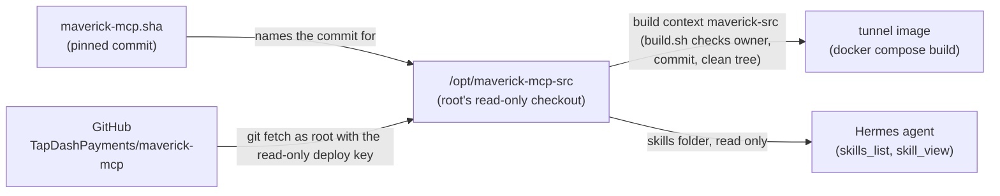
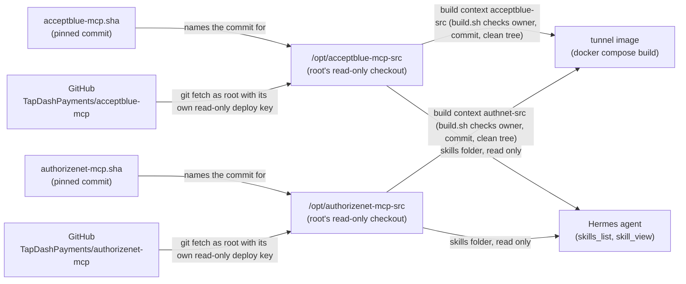
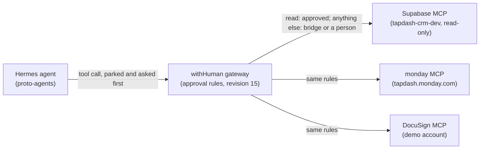

# QuickBooks behind the withHuman gateway (tunnel)

In plain English: the AI agent never holds the keys to QuickBooks. A small container on the server (the tunnel) holds
them and talks to QuickBooks. Every request goes through withHuman first, and the risky ones wait for a person. This
page says how that is set up, what the pipeline rules are and how to check that it works.

By design the agent does not hold QuickBooks credentials. How strong that guard is today:
[architecture section 0](architecture.md#0-how-strong-is-it-today). A withHuman **tunnel** container
(`wh-tunnel`) runs on the VM, makes one outbound HTTPS connection to
`app.withhuman.ai`, and starts the Intuit QuickBooks MCP server as a child
process. Every call goes through the withHuman approval pipeline first.

## Pinned versions (verified 2026-10-19)

| Thing | Value |
| --- | --- |
| Tunnel image | `quay.io/withhuman/tunnel:0.0.369` |
| Tunnel digest | `sha256:dad0c8b52d653b4969161a8ec589cf37048da6eec5747e098969e6a281f0c3e0` (this is also what `:latest` pointed to when pinned; published 2026-10-16) |
| Tunnel binary | `withhuman-tunnel 0.0.369 (protocol 1)`, entrypoint `withhuman-tunnel`, default cmd `run`, user `withhuman` (uid 100), Alpine, Node 24.22.0, `uv` 0.9.30 |
| Intuit server | `https://github.com/intuit/quickbooks-online-mcp-server` at commit `31a1dd5c3e170e368dbff651abbaf61aabde6ed9` (2026-09-15, "fix: make tests and CI cross-platform (#136)") |
| Local image built | `durable-park/wh-tunnel:0.0.369-qbo-31a1dd5-mav-d6f43f9` (2026-10-25: QuickBooks + Maverick at d6f43f9; built with `build.sh`). **Running** in `wh-tunnel` since 2026-10-25. Rollback images: `...-mav-e4a2b10` (the previous Maverick pin; also set it back in `maverick-mcp.sha`, `docker-compose.yml` and `/opt/maverick-mcp-src`) and `durable-park/wh-tunnel:0.0.369-qbo-31a1dd5` (QuickBooks only: also remove the `maverick` entry from `tunnel.yaml`) |
| Next image (reviewed, **not built or running yet**) | `durable-park/wh-tunnel:0.0.369-qbo-31a1dd5-mav-d6f43f9-ab-9bb8d72-an-6084f36`: the same plus the accept.blue server at `9bb8d72` and the Authorize.net server at `6084f36`. The tag lists the commit of every server inside. Until an admin builds it, the running tunnel is the `-mav-d6f43f9` image and the new servers are not reachable. **To go back** after it is live: the previous image above, with the previous `docker-compose.yml`, `tunnel.yaml` and the two new `.env` files left unused (see [rollback](runbook.md#acceptblue-and-authorizenet)) |
| Docker on VM | `docker.io` 29.1.3 + `docker-compose-v2` 2.40.3 + `docker-buildx` (Ubuntu 26.04 packages); service enabled; `hermes` is NOT in the `docker` group, run docker with `sudo` (as the admin `ubuntu`; `hermes` has had no sudo since 2026-10-22) |

The tunnel tells you to upgrade when its protocol is outdated ("the tunnel stops
asking you to upgrade"). If that happens: look up the newest tag at
https://quay.io/repository/withhuman/tunnel?tab=tags, change `TUNNEL_IMAGE` in
`Dockerfile` and `image:` in `docker-compose.yml`, rebuild.

## Maverick server source

In plain English: the tunnel image also carries TapDash's own Maverick MCP server. Its code lives in a **private**
GitHub repo, so the VM keeps a read-only copy of it, frozen at one reviewed commit. The copy belongs to **root**:
the agent's user (`hermes`) can read it (the agent reads the Maverick skills from it) but cannot change it, because
`build.sh` runs as root and builds the payments server from it.

| Thing | Value |
| --- | --- |
| Repo | `TapDashPayments/maverick-mcp` (private) |
| Pinned commit | the one line in [`deploy/tunnel/maverick-mcp.sha`](../deploy/tunnel/maverick-mcp.sha) (`d6f43f922a9cf3416c6fdb536a07fd67caec17ac`, `main` after PR #4: a failed connection is named, not called a slow answer) |
| Checkout on the VM | `/opt/maverick-mcp-src` (owner `root`, mode 0755, files 0644, detached at the pinned commit) |
| Access | deploy key `proto-agents-root-read` (**read-only**), private key `/root/.ssh/maverick_mcp_deploy` |
| Skills the agent reads | `/opt/maverick-mcp-src/skills` (`skills.external_dirs`, set by `hermes_mcp.sh`) |



Why root: `build.sh` runs git and `docker compose build` as root. If the checkout belonged to `hermes`, a changed
`.git/config` (for example `core.fsmonitor`) could make root run a command, and replace refs or grafts could make
git show the pinned commit while other files are built (independent review of PR 53, finding I1). So `build.sh`
refuses a checkout that is not root's, that has any file owned by someone else or writable by group or others, or
that has `.git/info/grafts` or `refs/replace/`; it runs git with `--no-replace-objects` and no `safe.directory`.

How it was set up (2026-10-25), and how to redo it on a fresh VM (as `ubuntu`, with sudo):

1. **Key.** `sudo ssh-keygen -t ed25519 -N '' -C root@proto-agents-maverick-mcp-src -f /root/.ssh/maverick_mcp_deploy`.
   Copy the public half somewhere `ubuntu` can read (`sudo cp /root/.ssh/maverick_mcp_deploy.pub /tmp/k.pub`) and
   add it as a **read-only** deploy key (no `--allow-write`):
   `gh repo deploy-key add /tmp/k.pub -R TapDashPayments/maverick-mcp -t proto-agents-root-read`.
   GitHub's host key: `/root/.ssh/known_hosts_github` (the same pinned line as `~hermes/.ssh/known_hosts_github`).
2. **Checkout.**

   ```sh
   sudo env GIT_SSH_COMMAND="ssh -i /root/.ssh/maverick_mcp_deploy -o IdentitiesOnly=yes \
     -o UserKnownHostsFile=/root/.ssh/known_hosts_github -o StrictHostKeyChecking=yes" \
     git clone -q git@github.com:TapDashPayments/maverick-mcp.git /opt/maverick-mcp-src
   sudo git -C /opt/maverick-mcp-src checkout -q "$(cat <worktree>/durable-park/deploy/tunnel/maverick-mcp.sha)"
   sudo chown -R root:root /opt/maverick-mcp-src && sudo chmod -R u=rwX,go=rX /opt/maverick-mcp-src
   ```

   Check: `sudo git -C /opt/maverick-mcp-src rev-parse HEAD` prints the same 40 characters as the file.

**Move to a new commit** (after a reviewed change is merged to `maverick-mcp` `main`):

1. In a TapDash-Agents worktree, write the new commit into `maverick-mcp.sha` (one line, 40 characters), and change
   the `-mav-<first 7>` part of the image tag in `docker-compose.yml` (both services) and in the docs.
2. As root, with the `GIT_SSH_COMMAND` above: `git -C /opt/maverick-mcp-src fetch -q origin && git -C
   /opt/maverick-mcp-src checkout -q <new sha>`, then the same `chown` and `chmod`.
3. Rebuild with `sudo bash build.sh` (below). It refuses when the checkout is not root's or has a writable or foreign
   file, has grafts or replace refs, is at another commit, has any local change (also ignored files such as
   `__pycache__`), or when the image tag does not end in `-mav-<first 7>`. Then check `--list-approvals`, and update
   the approval rules if a tool was added or changed its approval level.

## Payment server sources (accept.blue and Authorize.net)

In plain English: the tunnel image also carries two more TapDash payment servers, one for accept.blue and one for
Authorize.net. Like Maverick, each lives in a **private** GitHub repo, so the VM will keep a read-only copy of each,
frozen at one reviewed commit. Both copies belong to **root**: the agent's user (`hermes`) can read them (the agent
reads the how-to notes in their `skills` folders) but cannot change them, because `build.sh` runs as root and builds
the payments servers from them. Everything said above about why root, and about what `build.sh` refuses, holds for
all three checkouts.

| Thing | accept.blue | Authorize.net |
| --- | --- | --- |
| Repo | `TapDashPayments/acceptblue-mcp` (private) | `TapDashPayments/authorizenet-mcp` (private) |
| Pinned commit | the one line in [`deploy/tunnel/acceptblue-mcp.sha`](../deploy/tunnel/acceptblue-mcp.sha) (`9bb8d722a0d5fc9dce08437eedc8328d34005bcc`) | the one line in [`deploy/tunnel/authorizenet-mcp.sha`](../deploy/tunnel/authorizenet-mcp.sha) (`6084f3693b135d8e3d4c237cc147ad963826d654`) |
| Checkout on the VM | `/opt/acceptblue-mcp-src` (owner `root`, mode 0755, files 0644, detached at the pinned commit) | `/opt/authorizenet-mcp-src` (same) |
| Access (to create) | deploy key `proto-agents-root-read` on that repo (**read-only**), private key `/root/.ssh/acceptblue_mcp_deploy` | deploy key `proto-agents-root-read` on that repo (**read-only**), private key `/root/.ssh/authorizenet_mcp_deploy` |
| Skills the agent reads | `/opt/acceptblue-mcp-src/skills` | `/opt/authorizenet-mcp-src/skills` |
| Python package, tool prefix | `acceptblue_mcp`, `ablue_` | `authorizenet_mcp`, `authnet_` |
| Gateway server slug (the name in withHuman) | `acceptblue` | `authnet` |
| Tools at the pinned commit | 28: 7 `auto`, 21 `you` (a person approves) | 24: 5 `auto`, 19 `you` |
| Agent's names | `mcp__wh__acceptblue__ablue_*` | `mcp__wh__authnet__authnet_*` |

GitHub lets a deploy key belong to only one repo, so each repo gets its own key (do not reuse the Maverick key).



How to set them up on the VM (as `ubuntu`, with sudo; **not done yet**, these are the admin steps). Do the whole list
once per server, with the names from the table (`acceptblue` and `acceptblue-mcp`, then `authorizenet` and `authorizenet-mcp`):

1. **Key.** `sudo ssh-keygen -t ed25519 -N '' -C root@proto-agents-acceptblue-mcp-src -f /root/.ssh/acceptblue_mcp_deploy`.
   Copy the public half somewhere `ubuntu` can read (`sudo cp /root/.ssh/acceptblue_mcp_deploy.pub /tmp/k.pub`) and
   add it as a **read-only** deploy key (no `--allow-write`):
   `gh repo deploy-key add /tmp/k.pub -R TapDashPayments/acceptblue-mcp -t proto-agents-root-read`. GitHub's host key
   is already in `/root/.ssh/known_hosts_github` (the Maverick step made it).
2. **Checkout.**

   ```sh
   sudo env GIT_SSH_COMMAND="ssh -i /root/.ssh/acceptblue_mcp_deploy -o IdentitiesOnly=yes \
     -o UserKnownHostsFile=/root/.ssh/known_hosts_github -o StrictHostKeyChecking=yes" \
     git clone -q git@github.com:TapDashPayments/acceptblue-mcp.git /opt/acceptblue-mcp-src
   sudo git -C /opt/acceptblue-mcp-src checkout -q "$(cat <worktree>/durable-park/deploy/tunnel/acceptblue-mcp.sha)"
   sudo chown -R root:root /opt/acceptblue-mcp-src && sudo chmod -R u=rwX,go=rX /opt/acceptblue-mcp-src
   ```

   Check: `sudo git -C /opt/acceptblue-mcp-src rev-parse HEAD` prints the same 40 characters as the file. The same for
   Authorize.net, with `authorizenet_mcp_deploy`, `TapDashPayments/authorizenet-mcp`, `/opt/authorizenet-mcp-src` and
   `authorizenet-mcp.sha`.

**Move to a new commit** (after a reviewed change is merged to the server's `main`): as for Maverick above, but write the new
commit into that server's `.sha` file and change **that** server's part of the image tag (`-ab-<first 7>` for accept.blue,
`-an-<first 7>` for Authorize.net) in `docker-compose.yml` (both services) and in the docs. Then run `--list-approvals`
on the new image and update `tests/payments_servers.py` and the pipeline rules in the same change (the tests compare the
pipeline's `auto` lists with that file, and that file with the pinned commits).

**Why the image tag is long.** `durable-park/wh-tunnel:0.0.369-qbo-31a1dd5-mav-d6f43f9-ab-9bb8d72-an-6084f36` names the
tunnel version and the commit of every server inside (`qbo` QuickBooks, `mav` Maverick, `ab` accept.blue, `an`
Authorize.net), so the tag alone says what is in the image, and `build.sh` refuses a tag that does not match the three
`.sha` files. The tag part is 53 characters (Docker allows 128).

## Remote gateway servers (Supabase CRM dev, monday, DocuSign demo)

In plain English: three services run their own official MCP servers on the internet. withHuman connects to them with
a sign-in (OAuth) that Yaakov did once in the withHuman app, so no key for them is on the VM. The agent reaches them
through the same `wh` gateway as QuickBooks, and every call goes through the same approval rules.

| Slug | URL | Scope (sign-in) | Granted to `proto-agents` | Agent's names |
| --- | --- | --- | --- | --- |
| `supabase-crm-dev` | `https://mcp.supabase.com/mcp?project_ref=jtwkxbagxuxjzlurgnim&read_only=true&features=database,docs,debugging` (only the `tapdash-crm-dev` project, read-only) | `crm_dev_readonly` | all 7 tools (`execute_sql` always asks a person) | `mcp__wh__supabase_crm_dev__*` |
| `monday` | `https://mcp.monday.com/mcp` | `tapdash_agents` (tapdashagents@gmail.com on tapdash.monday.com) | the 33 read tools only | `mcp__wh__monday__*` |
| `docusign-demo` | `https://mcp-d.docusign.com/mcp` (DocuSign developer/demo) | `demo_user` (integration key `7b89fd67-...`, redirect `https://app.withhuman.ai/auth/gateway/oauth/callback`) | the 22 read tools only | `mcp__wh__docusign_demo__*` |



Hermes turns the `-` in a slug into `_` (`supabase-crm-dev` becomes `mcp__wh__supabase_crm_dev__...`); the park server is
then `park:supabase_crm_dev`, and the bridge pairs a gateway call with its park the same way
(`bridge/verify.py: hermes_tool_name`). To give the agent a write tool later: grant it in withHuman
(`set_agent_tool_access`); it then asks a person at park time and goes through the bridge at the gateway, with no rule change.
To give it another **read** tool: grant it and add it to both read lists for that server (park and gateway) in
`deploy/withhuman/entry-pipeline.json` (the tests check the two lists agree), then save the file as a new revision.
The gateway read lists name each tool twice, bare (`list_tables`) and with the server in front
(`supabase-crm-dev__list_tables`), on purpose: like the QuickBooks rule (`^(quickbooks__)?`), they accept either form the
gateway may send. The outer rule already checks the server, so the second form widens nothing.

What the reads can show the agent (and the full Langfuse traces): monday holds live business data (items, people,
meeting summaries and transcripts, file links); DocuSign agreement details can hold personal data; Supabase
`query_logs` can return SQL text from the logs. The dev project is empty today; the real CRM would hold merchant data.

Who changed what: revision 13 (the three servers' first gateway rules) was made in the withHuman app by the member
account "Yaakov Y Trout" (driven by another assistant, Grok), not from the file. After any revision that is not made
from this file, read `get_pipeline entry` and compare it with the file before relying on either. That member can still
activate pipeline revisions; removing that permission once setup is done is Yaakov's call.

## Files

| File | Purpose |
| --- | --- |
| `deploy/tunnel/Dockerfile` | `FROM` the pinned tunnel image; builds the Intuit server (`npm ci` -> `tsc`) at the pinned SHA, installs it at `/opt/qbo-mcp`, symlinks `/usr/local/bin/qbo-mcp-server`, creates `/data` owned by `withhuman`. Stages `maverick`, `acceptblue` and `authnet`: each builds its server into its own venv (`/opt/maverick-mcp`, `/opt/acceptblue-mcp`, `/opt/authnet-mcp`; see [The Maverick server in the image](#the-maverick-server-in-the-image) and [The accept.blue and Authorize.net servers in the image](#the-acceptblue-and-authorizenet-servers-in-the-image)), launchers `/usr/local/bin/{maverick,acceptblue,authnet}-mcp-server`, creates `/data/maverick-inbox` (`withhuman`, 0700; the two new servers write no files) |
| `deploy/tunnel/build.sh` | the only way to build: checks the three TapDash checkouts (Maverick, accept.blue, Authorize.net: each root's, nothing writable by others, no grafts or replace refs, pinned commit, no local changes, also no ignored files) and the image tag (`-mav-<7>-ab-<7>-an-<7>`), then runs `docker compose build`. Never starts or stops the tunnel |
| `deploy/tunnel/maverick-mcp.sha`, `acceptblue-mcp.sha`, `authorizenet-mcp.sha` | the pinned commit of each TapDash server (one line each, 40 characters) |
| `deploy/tunnel/tunnel.yaml` | four servers: `quickbooks` (`command: ["qbo-mcp-server"]` + env), `maverick` (`command: ["maverick-mcp-server"]` + env), `acceptblue` (`command: ["acceptblue-mcp-server"]`, env `ACCEPTBLUE_SOURCE_KEY`, `ACCEPTBLUE_PIN`, `ACCEPTBLUE_BASE_URL`) and `authnet` (`command: ["authnet-mcp-server"]`, env `AUTHNET_ENV: sandbox` fixed, `AUTHNET_LOGIN_ID`, `AUTHNET_TRANSACTION_KEY`). It sets no `AUTHNET_WEBHOOK_LISTEN`, so Authorize.net's optional webhook receiver does not run |
| `deploy/tunnel/docker-compose.yml` | service/container `wh-tunnel` (`restart: unless-stopped`), build contexts `maverick-src` = `${MAVERICK_MCP_SRC:-/opt/maverick-mcp-src}`, `acceptblue-src` = `${ACCEPTBLUE_MCP_SRC:-/opt/acceptblue-mcp-src}` and `authnet-src` = `${AUTHORIZENET_MCP_SRC:-/opt/authorizenet-mcp-src}`, named volumes `durable-park-qbo-data` at `/data` and `durable-park-maverick-inbox` at `/data/maverick-inbox`, `tunnel.yaml` read-only at `/etc/withhuman/tunnel.yaml`, four env files `/etc/durable-park/tunnel.env`, `maverick.env`, `acceptblue.env` and `authnet.env` (paths overridable with `TUNNEL_ENV_FILE`, `MAVERICK_ENV_FILE`, `ACCEPTBLUE_ENV_FILE`, `AUTHNET_ENV_FILE`); profile service `check` (same four env files) |
| `deploy/tunnel/enter-secrets.sh` | interactive script that writes `/etc/durable-park/tunnel.env` |
| `deploy/tunnel/enter-maverick-secrets.sh` | interactive script that writes `/etc/durable-park/maverick.env` (3 values) |
| `deploy/tunnel/enter-acceptblue-secrets.sh` | interactive script that writes `/etc/durable-park/acceptblue.env` (3 values) |
| `deploy/tunnel/enter-authnet-secrets.sh` | interactive script that writes `/etc/durable-park/authnet.env` (2 values) |

## The Maverick server in the image

The `maverick` stage of the `Dockerfile` (verified 2026-10-24, image `durable-park/wh-tunnel:0.0.369-qbo-31a1dd5-mav-e4a2b10`):

1. It uses the pinned tunnel image as the builder too, so the venv's Python is the image's own (`/usr/bin/python3`,
   Python 3.14.8 in tunnel 0.0.369).
2. It copies `requirements.lock`, `requirements-dev.lock`, `pyproject.toml` and `src/` from the build context
   `maverick-src` (the checkout). Nothing is fetched from git inside the build.
3. A throw-away build venv installs `requirements-dev.lock` with `--require-hashes --only-binary=:all:` (that gives the
   pinned `setuptools`) and builds the package wheel with `--no-deps --no-build-isolation --check-build-dependencies`,
   the same way the server's own CI installs it.
4. The runtime venv `/opt/maverick-mcp` gets only `requirements.lock` (`--require-hashes --only-binary=:all:`: every
   file's hash is checked, nothing is compiled), then the wheel with `--no-deps --no-index`. The build fails if
   `python -m maverick_mcp --list-approvals` does not run.
5. The runtime stage copies `/opt/maverick-mcp` (owner root, read-only for `withhuman`) and writes the launcher
   `/usr/local/bin/maverick-mcp-server` (`exec /opt/maverick-mcp/bin/python -m maverick_mcp "$@"`).

Check a built image (no secrets needed, does not touch the running tunnel):

```bash
sudo docker run --rm --entrypoint maverick-mcp-server durable-park/wh-tunnel:0.0.369-qbo-31a1dd5-mav-d6f43f9 --list-approvals
```

Verified 2026-10-24 on `...-mav-e4a2b10`: 42 tools, 13 `auto`, 3 `auto_unless_notify`, 26 `you` (a person
approves). Verified again 2026-10-25 on `...-mav-d6f43f9`: the same 42 tools and levels (the two outputs are
byte-identical, same SHA-256), and `check` said `maverick: ok, 42 tools`.

## The accept.blue and Authorize.net servers in the image

The `acceptblue` and `authnet` stages of the `Dockerfile` are the `maverick` stage again with other names (written and
tested, **not built yet**: the build needs Docker and an admin, see [the admin steps](runbook.md#acceptblue-and-authorizenet)).
For each server, in plain words:

1. The builder is the pinned tunnel image, so the venv's Python is the image's own.
2. `requirements.lock`, `requirements-dev.lock`, `pyproject.toml` and `src/` come from the build context
   (`acceptblue-src` or `authnet-src`, root's checkout). Nothing is fetched from git inside the build.
3. A throw-away build venv installs `requirements-dev.lock` with `--require-hashes --only-binary=:all:` and builds
   the package wheel with `--no-deps --no-build-isolation --check-build-dependencies`.
4. The runtime venv (`/opt/acceptblue-mcp`, `/opt/authnet-mcp`) gets only `requirements.lock` (hash-checked, wheels
   only), then the wheel with `--no-deps --no-index`. The build fails if `python -m acceptblue_mcp --list-approvals`
   or `python -m authorizenet_mcp --list-approvals` does not run.
5. The runtime stage copies the venvs (owner root, read-only for `withhuman`) and writes the launchers
   `/usr/local/bin/acceptblue-mcp-server` (`exec /opt/acceptblue-mcp/bin/python -m acceptblue_mcp "$@"`) and
   `/usr/local/bin/authnet-mcp-server` (`exec /opt/authnet-mcp/bin/python -m authorizenet_mcp "$@"`).

Only the stdio server of each package is started. Authorize.net's optional webhook receiver (a small web server for
Authorize.net's event notices) is **not** run: nothing sets `AUTHNET_WEBHOOK_LISTEN` or `AUTHNET_SIGNATURE_KEY`, so no
port opens in the container. Wiring it needs a public address, a signature key and its own review: it is a separate task.

What was checked outside Docker (2026-10-25, at the pinned commits): both wheels were built from the pinned sources with
`pip wheel`, and `--list-approvals` gave the lists above. **Not checked:** the image build itself, and whether every
native wheel in the two lock files exists for this image's platform (the runtime lock of each server is the same
as Maverick's, which builds; the build stops with a clear error if one is missing).

Check a built image (no secrets needed, does not touch the running tunnel):

```bash
sudo docker run --rm --entrypoint acceptblue-mcp-server durable-park/wh-tunnel:0.0.369-qbo-31a1dd5-mav-d6f43f9-ab-9bb8d72-an-6084f36 --list-approvals
sudo docker run --rm --entrypoint authnet-mcp-server durable-park/wh-tunnel:0.0.369-qbo-31a1dd5-mav-d6f43f9-ab-9bb8d72-an-6084f36 --list-approvals
```

Expect 28 accept.blue tools (7 `auto`, 21 `you`) and 24 Authorize.net tools (5 `auto`, 19 `you`). If the numbers
or names differ, stop: the pipeline rules are written for exactly these lists (`tests/payments_servers.py`).

## Environment variables

Stored in `/etc/durable-park/tunnel.env` (0600 root:root, never committed):

| Variable | Meaning |
| --- | --- |
| `QUICKBOOKS_CLIENT_ID` | Intuit app Client ID (sandbox/development key) |
| `QUICKBOOKS_CLIENT_SECRET` | Intuit app Client Secret |
| `QUICKBOOKS_REFRESH_TOKEN` | OAuth 2.0 refresh token from the Playground |
| `QUICKBOOKS_REALM_ID` | company ID of the sandbox company |
| `WITHHUMAN_TUNNEL_TOKEN` | tunnel token from withHuman (read by the tunnel only; the QuickBooks child process never sees it) |

Fixed in `tunnel.yaml` (not secrets): `QUICKBOOKS_ENVIRONMENT=sandbox`,
`QUICKBOOKS_TOKEN_STORE_PATH=/data/qbo-token.env`.

Token store (verified in the server source at the pinned commit,
`src/clients/quickbooks-client.ts`): `QUICKBOOKS_TOKEN_STORE_PATH` is supported.
It must be absolute and set in the process env (the tunnel.yaml `env` block does
that). When set, the server loads that file with dotenv `override: true`, and
writes the rotated `QUICKBOOKS_REFRESH_TOKEN` (and realm id) back to it
atomically (tmp file + rename, mode 0600) on every refresh. If the file does not
exist yet, dotenv ignores it and the env values are used; the first refresh
creates the file. The package's own `.env` is not read.

**Stale-token trap:** once `/data/qbo-token.env` exists, its refresh token beats
`QUICKBOOKS_REFRESH_TOKEN` from the env. Intuit invalidates the old refresh
token on each rotation. If you ever enter a NEW refresh token (new Playground
run), also wipe the volume: `sudo docker compose down && sudo docker volume rm durable-park-qbo-data`.
Refresh tokens expire after roughly 100 days of no use (Intuit; unverified for
sandbox).

### Maverick settings: `/etc/durable-park/maverick.env`

A second file (0600 root:root, never committed), written only by `sudo bash deploy/tunnel/enter-maverick-secrets.sh`.
Both compose services load it next to `tunnel.env`, and `tunnel.yaml` passes the values to the `maverick` server only
(the QuickBooks server never sees them, and the Maverick server never sees the QuickBooks keys or the tunnel token):

| Variable | Meaning |
| --- | --- |
| `MAVERICK_TOKEN` | Maverick API token (`pending` until sandbox access arrives) |
| `MAVERICK_GATEWAY_URL` | Maverick gateway API base address; must start with `https://` (`https://maverick.invalid` until then) |
| `MAVERICK_DASHBOARD_URL` | Maverick dashboard API base address; must start with `https://` (`https://maverick.invalid` until then) |

Fixed in `tunnel.yaml` (not a secret): `MAVERICK_INBOX_DIR=/data/maverick-inbox` (the named volume
`durable-park-maverick-inbox`, where the server keeps files it downloads).

The script asks for each value with `read -rs` (nothing is shown), refuses an empty value, a value with whitespace,
quotes, `$`, `#`, a backslash, a backtick or a control character (the same rule as `enter-secrets.sh`), and a URL
that does not start with `https://`; it asks before overwriting, writes through a temporary file and `mv -f`, and
prints `saved 3 values`.

**No file, no tunnel.** If `maverick.env` is missing, `docker compose up` and `run` stop at once with
`env file /etc/durable-park/maverick.env not found`. If the file is there but a value is missing, the tunnel refuses to
start: `withhuman-tunnel: the configuration refers to variables that are not set: MAVERICK_...`. Either way the
tunnel does not quietly run QuickBooks alone. Both were seen on 2026-10-24 with dummy files (no real secrets, a
separate compose project, the running tunnel untouched).

### accept.blue settings: `/etc/durable-park/acceptblue.env`

A third file (0600 root:root, never committed), written only by `sudo bash deploy/tunnel/enter-acceptblue-secrets.sh`.
`tunnel.yaml` passes the three values to the `acceptblue` server only:

| Variable | Meaning |
| --- | --- |
| `ACCEPTBLUE_SOURCE_KEY` | accept.blue source key (`pending` until access). A key that starts with `pk_` is a public web-page key: the script and the server both refuse it |
| `ACCEPTBLUE_PIN` | the PIN that goes with the source key (`pending` until access) |
| `ACCEPTBLUE_BASE_URL` | API base address. It must be `https://<host>.accept.blue/api/v2`: the server refuses any other host. Placeholder: the real sandbox address `https://api.sandbox.accept.blue/api/v2` (a `.invalid` placeholder, as Maverick has, is refused by this server, and the server was not weakened for it, so the placeholder key just gets a refusal from the sandbox) |

### Authorize.net settings: `/etc/durable-park/authnet.env`

A fourth file (0600 root:root, never committed), written only by `sudo bash deploy/tunnel/enter-authnet-secrets.sh`:

| Variable | Meaning |
| --- | --- |
| `AUTHNET_LOGIN_ID` | API login id (`pending` until access); at most 20 characters, which the script checks |
| `AUTHNET_TRANSACTION_KEY` | transaction key (`pending` until access); at most 16 characters, which the script checks |

Fixed in `tunnel.yaml` (not secrets): `AUTHNET_ENV=sandbox`. The server then uses its own sandbox addresses
(`apitest.authorize.net`, `test.authorize.net`) and refuses any other. **To go live** (production) is a separate,
reviewed change: it is not an option in the script on purpose.

Both scripts use the same rules as `enter-secrets.sh`: each value is asked with `read -rs`, an empty value or a value with
whitespace, quotes, `$`, `#`, a backslash, a backtick or a control character is refused, it asks before overwriting, and it
writes through a temporary file and `mv -f`. They print `saved 3 values` and `saved 2 values`.
**No file, no tunnel**, as for Maverick: a missing `acceptblue.env` or `authnet.env` stops `docker compose up` and `run`
at once, and a missing value stops the tunnel from starting.

## Build, check, run (Task 2 Step 3, after the human step below)

All commands from `/home/hermes/durable-park/deploy/tunnel`, with `sudo`:

```bash
sudo bash build.sh                         # check the three TapDash checkouts, then build the image (no secrets needed)
sudo docker compose run --rm check         # starts the server once, lists tools; no tunnel token needed
sudo docker compose up -d wh-tunnel        # long-running tunnel
sudo docker logs -f wh-tunnel              # watch it connect
sudo docker compose ps
```

`check` runs `withhuman-tunnel check` with the same image and `tunnel.yaml`. It
does not connect to withHuman, so `WITHHUMAN_TUNNEL_TOKEN` is not required, but
the four `QUICKBOOKS_*` variables are (the tunnel refuses to start when a
`${VAR}` in the config is unset). It does not call QuickBooks: tool listing
needs no network, so it passes even with dummy credentials. A real call proves
credentials.

Verified result (dummy credentials, 2026-10-19): `quickbooks: ok, 142 tools`
(the server's README claims 145; `tools/list` over MCP returns 142).
With the Maverick server (image `...-mav-e4a2b10`, dummy QuickBooks values and the Maverick placeholders,
2026-10-24): `maverick: ok, 42 tools` and `quickbooks: ok, 142 tools`.
With the two payment servers added, `check` should also say `acceptblue: ok, 28 tools` and `authnet: ok, 24 tools` (expected from `--list-approvals`; **not run yet**, the image is not built).

## Never run these (they print the secrets)

`wh-tunnel` gets all five values from `/etc/durable-park/tunnel.env`, three more from
`/etc/durable-park/maverick.env`, three from `acceptblue.env` and two from `authnet.env`, and these commands print them in plain text. Do not run them, and do not paste their output
anywhere:

- `docker compose config` (prints the resolved `env_file` values)
- `docker inspect wh-tunnel` / `docker inspect <image>` on a running container
  (the container's `Env` lists every value)
- `docker exec wh-tunnel env` / `printenv` / `cat /proc/1/environ`
- `docker compose run ... env`, `docker run --env-file ... env`
- `sudo cat` of any of the four files in `/etc/durable-park/` that end in `.env` (`tunnel`, `maverick`, `acceptblue`, `authnet`)
- `docker logs wh-tunnel` is probably safe, but nobody has checked its output for
  secrets: skim it yourself before sharing it.

Note that `QUICKBOOKS_ENVIRONMENT` and `QUICKBOOKS_TOKEN_STORE_PATH` are set in
`tunnel.yaml` (the QuickBooks child process env), not in the `wh-tunnel`
container env, so checking them via `docker exec wh-tunnel env` will not show
them (and must not be done). To check them, read `tunnel.yaml`; to prove the
child works, use `docker compose run --rm check`.

## HUMAN STEP A (Task 2 Step 2): get the five values

### Intuit (about 10 minutes)

All UI paths below are from memory of Intuit's portal and are **unverified**;
names may differ slightly.

1. Go to https://developer.intuit.com and sign in (or create a developer account).
2. Dashboard -> **Create an app** (or **My Apps** -> **Create an app**). Choose
   the **QuickBooks Online and Payments** platform, name it e.g. `proto-agents`,
   select scope **Accounting** (`com.intuit.quickbooks.accounting`), create it.
3. Open the app -> **Keys & credentials** -> **Development** tab (sandbox keys).
   Copy **Client ID** and **Client secret**.
4. On that same page add this Redirect URI and save (the Playground needs it):
   `https://developer.intuit.com/v2/OAuth2Playground/RedirectUrl`
5. Sandbox company: a sandbox company is normally created automatically with a
   developer account. Check Dashboard -> **Sandbox** (or the profile menu). If
   none exists, click **Add a sandbox company** (QuickBooks Online, US).
6. Open the **OAuth 2.0 Playground**: https://developer.intuit.com/app/developer/playground
   (also under Dashboard -> **Playground**).
7. Select your app, tick scope **Accounting**, click **Get authorization code**.
   Sign in, pick the **sandbox company**, click **Connect/Authorize**. You land
   back in the Playground with an authorization code and a **Realm ID**.
8. Click **Get tokens**. Copy the **Refresh token** (long string starting `RT1-...`)
   and the **Realm ID** (a number; shown in step 7 and also next to the tokens).
   Do not worry about the access token (1 hour).

### withHuman tunnel token

1. https://app.withhuman.ai -> **Gateway** -> **Tunnels** -> **Set up a tunnel**.
2. Name it e.g. `proto-vm`. The token is shown **once**: keep the tab open and
   copy it when the script asks.

### Enter all five into the VM

The script needs an interactive terminal (it refuses to run without a tty), so
open one on the VM over Tailscale SSH. Use a terminal that is not being
screen-shared or recorded.

1. From any device on your tailnet run:

   ```bash
   tailscale ssh ubuntu@proto-agents
   ```

   (MagicDNS name `proto-agents.taila95862.ts.net`.)
   Tailscale SSH is enabled on the VM (`tailscale set --ssh`). Your tailnet policy
   may open a browser to re-authenticate ("check" mode): follow it, then the
   session continues. `ubuntu` has passwordless sudo.

   If you get "permission denied" or the connection is refused by policy, your
   tailnet ACL has no SSH rule allowing you to reach this device as `ubuntu`.
   Add one in the Tailscale admin console: **Access controls** -> edit the policy
   file -> add under `"ssh"`:

   ```json
   {
     "action": "check",
     "src":    ["autogroup:member"],
     "dst":    ["proto-agents"],
     "users":  ["ubuntu"]
   }
   ```

   (`dst` may also be `autogroup:self` if the VM is registered to your own
   user, or a tag such as `tag:proto` if the VM is tagged.) Save, then retry.
   The exact policy syntax is **unverified** against your tailnet.

2. In that session run (nothing you type is echoed):

   ```bash
   sudo bash /home/hermes/durable-park/deploy/tunnel/enter-secrets.sh
   ```

3. Paste, in order: QuickBooks Client ID, Client Secret, Refresh token, Realm ID,
   withHuman tunnel token (Enter after each; you will not see the characters).
   Empty input, or a value containing whitespace, quotes, `$`, `#`, a backslash,
   a backtick or a control character, is refused and you are asked again. It
   prints `saved 5 values` and writes `/etc/durable-park/tunnel.env` (0600 root).

   If the script aborts or you make a mistake, just run it again. Keep the
   withHuman tab with the tunnel token open until the script has saved: the
   token stays on that page until you close it (withHuman's docs say it is shown
   once, so if you already closed it, create a new token for the tunnel instead).

4. Type `exit` to leave. Tell whoever is running the deploy (an admin or an AI agent); they run `check` and
   start the tunnel. The tunnel's page in withHuman should then show it **online**.

## HUMAN STEP B (Task 2 Step 4): register the server

Only after the tunnel shows online. Labels are taken from the withHuman docs;
the wizard layout is **unverified** on the live tenant.

1. https://app.withhuman.ai -> **Gateway** -> **Register server**.
2. Server: name it `quickbooks` (the slug is permanent and appears in tool names
   and approval rules). Choose **Through a tunnel** and select your tunnel.
3. Scopes: one scope; for the **tunnel server name** enter exactly `quickbooks`
   (the key under `servers:` in `tunnel.yaml`). No credential is stored in withHuman.
4. Agents: grant the server to agent **`proto-agents`** and choose **All tools,
   including future tools**. Click **Activate and continue**.
5. Approval step: leave for now (pipeline rules are set up later); nothing is
   saved on this step. If the **Tools** list is empty, click **Reload tools**.

### HUMAN STEP B2: register the accept.blue and Authorize.net servers

Only after the new image is built and running and the tunnel shows **online** (and `check` said `ok` for both).
Do it once per server, the same way as step B, with these names (the slug is permanent):

| | accept.blue | Authorize.net |
| --- | --- | --- |
| Server name (slug) | `acceptblue` | `authnet` |
| Through a tunnel | the same tunnel | the same tunnel |
| Tunnel server name | `acceptblue` | `authnet` |
| Grant to agent | `proto-agents`, all tools | `proto-agents`, all tools |

Granting a tool does not make it run: money tools still ask a person (see the pipeline below). Save the pipeline file as a
new entry revision **after** both servers are registered, so the rules and the servers arrive together.
Until then, `hermes_mcp.sh` fails on purpose (it expects `mcp__wh__acceptblue__ablue_read` and
`mcp__wh__authnet__authnet_read` to be registered) and leaves the agent without the two servers.


## Verified live

- The tunnel's `run` mode connects with the real token, the tunnel shows **online** in withHuman, and QuickBooks calls
  go through the gateway to the sandbox company. Evidence: [acceptance-2026-10-20.md](acceptance-2026-10-20.md)
  (checks 1 to 5: sandbox payments 145 and 146, invoice 1016), [acceptance-2026-10-21-tool-search.md](acceptance-2026-10-21-tool-search.md)
  (an approved payment run once through the bridge) and the live checks in the
  [runbook](runbook.md#the-gateway-bridge).
- Real QuickBooks calls against the **sandbox** company (not real books), same evidence.

## Unverified / open

- Intuit portal click paths above (from memory).
- Where tunnel logs live beyond `docker logs wh-tunnel` (docs do not say).
- `check` output format beyond `quickbooks: ok, 142 tools` (seen once, with a dummy-credential run).
- Anything against a real (non-sandbox) QuickBooks company: not connected, by design, until the
  [backlog's "Before real books"](backlog.md#before-real-books) list is done.

## Gateway bridge + approval pipeline (Task 7)

One human approval per action. The model's first call to a risky tool is parked (a withHuman AAP request on
the pseudo-server `park:<slug>` that an approver approves). When the model then runs the approved park with
`parked_action_execute`, the real call goes through the gateway, and the pipeline's **webhook block** asks the
**gateway bridge** whether this exact call is an approved park whose approval was just consumed. The bridge
checks that in withHuman itself (it keeps no state and does not use the ledger), answers `approve` exactly once
for a matching call and `human` for everything else, so nothing that was not parked is ever auto-approved, and
an approved park is not asked about a second time.

### What the bridge does

| Item | Value |
| --- | --- |
| Code | `bridge/app.py` (Starlette + uvicorn), POST `/wh/bridge` on `127.0.0.1:8791`; `bridge/verify.py` (the decision rule), `bridge/whapi.py` (the withHuman request list) |
| Unit | `deploy/durable-park-bridge.service` (system unit, `User=dpbridge`, `Restart=always`, strict sandbox, `ProtectHome=yes`, `ProtectProc=invisible`, no writable path; see the comments at its top) and `deploy/durable-park-bridge.socket` (socket unit: systemd holds `127.0.0.1:8791` permanently and passes it to the service as fd 3, `--systemd-socket`) |
| Own user | `dpbridge`: system user, no login, no home, no group but its own (not in `dpwake`, not in `hermes`). See [Own user and own port](#own-user-and-own-port) |
| Public URL | `https://proto-agents.taila95862.ts.net/wh/bridge` (Tailscale Funnel path, set up at deploy) |
| Secret | `/etc/durable-park/bridge_secret` (0600 root:root: the bot cannot read it). systemd reads it as root when the service starts and hands the bridge a private copy (`LoadCredential`, `--secret-file %d/bridge_secret`) |
| Org key | `/etc/durable-park/audit_key` (`--key-file %d/audit_key`, env `DURABLE_PARK_WH_KEY_FILE`; the file is 0640 root:hermes because the plugin reads it too, the bridge reads systemd's private copy made when it starts, so a rotation needs `sudo systemctl restart durable-park-bridge`; the bridge re-reads that copy on every call), never logged. Permissions `audit.read`, `request.read`, `request.read.unrouted` and nothing else: it can read requests and cannot approve, deny or read rules or members. Missing or too weak: every delivery gets `human` ([runbook](runbook.md#the-gateway-bridge)). API base `--api-base` (env `DURABLE_PARK_WH_API_BASE`, default `https://app.withhuman.ai/api/v1`) |
| State | None. No ledger (the old `--ledger` option, `DURABLE_PARK_LEDGER` and `bridge_deliveries.db` are gone; the old file can be deleted once the new bridge is live) |
| Other options | `--secret-file`, `--systemd-socket` (serve on the listening socket systemd passes as fd 3; it exits at once when systemd passes none; it cannot be combined with `--host` or `--port`), `--host 127.0.0.1` and `--port 8791` (only when run by hand, without `--systemd-socket`), `--expected-agent proto-agents` (env `DURABLE_PARK_BRIDGE_SECRET_FILE`, `DURABLE_PARK_EXPECTED_AGENT`). Budget: 3.5 s for the two withHuman lists (withHuman's webhook block gives up at 5 s) |
| Health check | `deploy/bridge_check.py` (root-owned copy in `/opt/durable-park/deploy/`): `sudo python3 -I /opt/durable-park/deploy/bridge_check.py`; `configure_hermes.sh` runs it after the 401 gate and stops if it fails |

Signature (confirmed against withHuman's open-source repo `internal/webhookdelivery`, and its webhook-endpoints
docs): header `WithHuman-Signature: t=<unix>,v1=<hex>`; `v1` = HMAC-SHA256 over `"<t>." + raw body`, keyed with
the **whole** `whsec_...` string as text (not base64-decoded); 300 s tolerance either side; constant-time compare.
A missing, malformed, stale or wrong signature gets `401` with an empty body, which withHuman treats as a failed
delivery (so the block falls back to a human).

Decision, for a delivery with a valid signature (the rule itself is `bridge/verify.py`, a pure function; the full
rule is in [architecture](architecture.md#the-bridges-decision-rule)):

1. The body must be `type: request_approval_block.webhook`, not `preview: true`, `agent.slug` must equal the
   expected agent (`proto-agents`), and `request.id` (the gateway request's own id) must be a non-empty string;
   otherwise `human`.
2. The Hermes name is built the way Hermes registers MCP tools (`hermes_tool_name`, now in `bridge/verify.py`):
   `mcp__wh__<server>__<tool>` with every character outside `[A-Za-z0-9_]` turned into `_` (so `create-bill`
   becomes `create_bill`), and names over 64 characters shortened with an 8-hex sha256 suffix. The arguments are
   digested after `ledger.normalize_args` (top-level `withhuman_context` dropped, `withhuman_scope` defaulted to
   `"default"`, whole-number floats such as `2.0` treated as `2`), exactly as at park time.
3. The bridge asks withHuman (`GET /api/v1/requests?agent_slug=proto-agents&q=<name>&limit=...`, newest first)
   for the park requests of that Hermes name. It approves only if exactly one is `approved`, on server
   `park:<slug>`, **consumed** (`consumption.consumed_at`) within the last 120 s (withHuman refuses to consume
   an expired approval, so the bridge does not read the approval's expiry),
   not truncated, with the same argument digest. It then lists the gateway requests of that tool: any other
   request for the same call created at or after the consumption means the approval is already used, so `human`.
   The answer is `{"outcome":"approve","reason":"Matches approved park request <id>"}`.
4. Anything else, or any error (no match, two matches, withHuman slow or down, key missing or too weak, bad answer):
   `{"outcome":"human","reason":"No approved park for this exact call"}`. The bridge keeps no record of its
   answers; withHuman retries a delivery and gets the same answer because the gateway request never counts
   against itself.

Logs (`journalctl -u durable-park-bridge`): one line per delivery with the delivery id, server, tool, the sorted
argument **key names**, the arguments digest and the outcome, plus a short `why` tag. Argument values, the
signing secret and the org key are never logged.

### Own user and own port

withHuman does not sign the bridge's answers: whoever answers on `127.0.0.1:8791` decides. If the bridge ran as
`hermes` (the bot's user), anything the bot runs could kill it and, until systemd restarted it, bind the port and
answer "approve" to every gateway call. So, since 2026-10-22:

- The bridge runs as `dpbridge`: a system user with no login, no home and no group but its own (not in `dpwake`, not
  in `hermes`). The bot cannot signal it or read its memory. (`ProtectProc=invisible` hides other users' processes
  from the bridge, not the other way round; the separate user is what protects it.)
- `durable-park-bridge.socket` holds `127.0.0.1:8791` permanently and passes it to the service as fd 3
  (`--systemd-socket`). While the bridge restarts (`Restart=always`, `RestartSec=1`) connections wait in the socket's
  backlog and nobody else can bind the port, for as long as the socket unit is neither stopped nor failed. systemd
  fails a socket unit (and frees the port) when the service it activates trips its start limit, or when the socket
  trips its trigger limit, so the service has `StartLimitIntervalSec=0` (it keeps being retried every second even if
  every start fails) and the socket has `TriggerLimitIntervalSec=0`. Started without a socket from systemd, the
  bridge exits at once.
- `bridge_secret` is `root:root 0600` and `audit_key` stays `root:hermes 0640`. systemd reads both as root when the
  service starts (`LoadCredential`) and gives the bridge private copies, so the bot can no longer read the signing
  secret. Rotating either key needs `sudo systemctl restart durable-park-bridge`.
- `deploy/bridge_check.py` checks all of this, read-only, and prints `ok:` or `FAIL:` per check (exit 0 only if every
  check passes): (1) the socket unit is active and listens on exactly `127.0.0.1:8791`; (2) the service is active and
  its main process runs as `dpbridge` with no supplementary group but `dpbridge`'s own (the `Groups:` line of
  `/proc/<pid>/status`); (3) only systemd and that process hold the port; (4) no other process runs
  `bridge.app` (a scan of `/proc/*/cmdline`: a heuristic, so a process that merely has `bridge.app` or
  `bridge/app.py` among its arguments, such as an editor, also fails it); (5) no user-level `durable-park-bridge*` unit
  exists for any user; (6) `dpbridge` has the `nologin` shell and is not in `dpwake` or `hermes`; (7) `bridge_secret`
  is `root:root 0600` (stat only, the contents are never read). `configure_hermes.sh` runs it after the bridge answers
  `401` to an unsigned request and stops if it fails; run it by hand any time ([runbook](runbook.md#health-check)).
- Not checked yet ([backlog](backlog.md#later)): the running bridge's supplementary groups and the permissions of the
  `/etc/durable-park` directory. An edit to the socket unit takes effect only after
  `sudo systemctl restart durable-park-bridge.socket`.

### HUMAN STEP C (Task 7 Step 5): endpoint, secret, pipeline

C1 and C2 come first on a fresh VM, because `configure_hermes.sh` refuses to start unless `bridge_secret` and
`audit_key` exist and are not empty (the bridge unit loads both as credentials and cannot start without them); C3 and
C4 need the bridge service and the Funnel path deployed and started. Labels come from the
withHuman docs (`webhook-endpoints`, `webhook-blocks`, `conditions`, `escalation-paths`); the exact screen layout
is **unverified** on the live tenant.

**C1. Add the webhook endpoint**

1. https://app.withhuman.ai -> **Webhook endpoints** (look under Settings or the left menu if it is not at top
   level) -> **Add endpoint** / **New endpoint**.
2. Name `durable-park-bridge`. If it asks for a key, use `durable-park-bridge` (lowercase letters, digits, `.`,
   `_`, `-`).
3. URL: `https://proto-agents.taila95862.ts.net/wh/bridge`. Save and activate it.
4. Copy the **signing secret** (`whsec_...`). It is shown **once**. Keep the tab open until step C2 is done.
   (Rotating the secret later takes effect immediately in withHuman: repeat C2 right after.)

**C2. Put the secret on the VM (no echo, no shell history, not in a command line)**

1. From a device on your tailnet: `tailscale ssh ubuntu@proto-agents` (use a terminal that is not being
   screen-shared).
2. Run this one-liner, paste the secret when it prompts (nothing is shown), press Enter:

   ```bash
   sudo bash -c 'set -eu; f=/etc/durable-park/bridge_secret; mkdir -p /etc/durable-park; install -m 0600 -o root -g root /dev/null "$f"; read -rs -p "Paste withHuman signing secret, then Enter: " S; echo; printf "%s" "$S" > "$f"; unset S; echo "saved $(wc -c < "$f") bytes to $f"'
   ```

   It creates the file empty with mode 0600 root:root first (only root can read it; systemd gives the bridge its own copy), then writes the secret into it, so the value is
   never in a wider-permission file. A `whsec_...` secret is about 49 bytes; a very different number means a bad paste,
   run it again.
3. systemd copies the secret to the bridge only when the service starts, so restart it (root):
   `sudo systemctl restart durable-park-bridge`. (The socket unit keeps the port during the restart. On a fresh VM
   there is no bridge yet: store the secret and the org key first, then run `configure_hermes.sh`, after following [Before you run the configure script](runbook.md#before-you-run-the-configure-script).)
4. Close the withHuman secret tab. Type `exit` to leave the VM.

**C3. Pipeline rules (Approval pipelines -> the Entry pipeline)**

The live entry pipeline is **revision 15** (active since 2026-10-25 02:54 UTC; revision 12 added the Maverick blocks, 13 and 14 the three remote servers, 15 made those servers' gateway rules match the server name only). Its source of truth is the reviewed
file [`deploy/withhuman/entry-pipeline.json`](../deploy/withhuman/entry-pipeline.json) (31 blocks, six more than the live 25: see the next paragraph), and
[architecture section 1](architecture.md#1-system-map) has the same list as a table. **The file is ahead of the live revision:** it adds six blocks for the accept.blue and Authorize.net servers (a candidate
revision 16, row 7a below), which are not live until an admin saves the file as a new revision and activates it. Until then
every call to those two servers asks a person twice (block 8 names both servers). Do not rebuild it from this
page: save the file's blocks as a new entry revision in withHuman and activate it (a save activates at once). Blocks
run in order and the first one that decides ends the pipeline. Every block for `proto-agents` also tests the agent
slug. Every "ask an approver" uses the escalation path `notify-yaakov-yehuda`.

| # | Block (key) | When | Then |
|---|---|---|---|
| 1 | `pa-park-money` | server `park:quickbooks`, tool is one of the 12 money types (create, update or delete of payment, bill_payment, transfer, deposit, journal_entry, refund_receipt, sales_receipt, credit_memo, vendor_credit, purchase, invoice, bill) | Ask an approver |
| 2 | `block-06ebcdd6` | server `quickbooks`, same 12 money types (the gateway replay; the tool name has no `mcp__wh__<slug>__` prefix) | Webhook block `durable-park-bridge`: approve only a call that matches one approved, consumed park, otherwise ask an approver. Timeout 5 s, 3 attempts, allowed outcomes approve and ask a human only, no reasoning, context or previous metadata sent |
| 3 | `pa-gateway-read` | server `quickbooks`, a read tool (`get_`, `search_`, `list_`, `read_`, `query_`, `find_`) | Approve |
| 4 | `qb-gateway-write-bridge` | server `quickbooks`, any other tool (every non-read write, whatever its name) | Webhook block `durable-park-bridge`, same settings as block 2: approve only the replay of an approved park |
| 5 | `pa-park-quickbooks-read` | server `park:quickbooks`, a read tool (same verbs) | Approve |
| 6 | `pa-hermes-read` | server `hermes`, one of 12 read-only tools (for example `web_search`, `memory`) | Approve |
| 7 | `pa-hermes-local-deny` | server `hermes`, one of 12 local machine tools (for example `terminal`, `write_file`) | Deny, until Clean Setup Phase 2 |
| 7a | `pa-park-acceptblue-auto`, `pa-gateway-acceptblue-auto`, `acceptblue-gateway-write-bridge`, `pa-park-authnet-auto`, `pa-gateway-authnet-auto`, `authnet-gateway-write-bridge` (file only, candidate revision 16) | for each server: park and gateway rules that approve only the tools **the server itself marks `auto`** (accept.blue: `describe_lookup`, `read`, `search_lookups`, `create_customer`, `create_customer_from_transaction`, `update_customer`, `create_invoice` (a draft); Authorize.net: `describe_lookup`, `read`, `search_lookups`, `save_customer_profile`, `save_shipping_address`), then a gateway rule that sends every other call to webhook block `durable-park-bridge` (approve only the replay of an approved park) | Approve the listed tools; bridge for the rest. Everything else on these servers reaches block 8 at park time (a person) |
| 8 | `money-server-human` | ANY agent: the server is a payments or accounting server (QuickBooks, Stripe, PayPal, Maverick, Accept Blue, Authorize.net, Plaid, any name containing `pay`, `bank`, `billing`, `treasury`, ...), or the tool's `<server>__` prefix is one, or (extra) the tool name has a money verb (`pay`, `transfer`, `wire`, `refund`, `charge`, `deposit`, `payout`, `send_money`, ...) | Ask an approver. Money never auto-approves |
| 9 | `pa-mcp-human` | server starts with `mcp:` | Ask an approver |
| 10 | `pa-default-human` | any other call of agent `proto-agents` | Ask an approver |
| 11 | `hermes` | other agents, tool name contains `Stripe` | Ask an approver |
| 12 | `ask-unruled-call` | everything else (any agent, any tool no block names) | Ask an approver. Nothing unruled is auto-approved (replaced `approve-every-call`, which approved it) |

The exact tool lists and regexes are in the JSON file; the file wins over this table. A tool that no block names
falls to block 10 (proto-agents) or block 12 (any other agent), so a person decides. If DocuSign is ever added, its six write tools need their own block (their
names are in `DEFAULT_FORM_CHECKED_TOOLS` in `park_hook.py`); until then a DocuSign call would reach block 10.

If the bridge is down, answers `401` or times out, the webhook block fails and the call goes to a human
(withHuman: "no accepted answer after the attempts -> human review"), so an outage never auto-approves. The same
holds when withHuman's own API is slow or down while the bridge asks it: the bridge answers `human`.

**C4. Test**

1. On the Webhook endpoints page, open `durable-park-bridge` and send the **test delivery**. The bridge answers
   `human` (a test delivery is not a block delivery and there is no park); the log line shows `why=type`.
   `journalctl -u durable-park-bridge -n 5` on the VM. Expect **no** `401` warning; a `401` means the secret
   file does not match the endpoint secret (redo C2, restart).
2. A real end-to-end check (a parked call, then `parked_action_execute`) happens in Task 8. After a change to the
   bridge, run the [live checks](runbook.md#the-gateway-bridge) (the lister test, one payment that passes once, a
   replay that gets a human).

### Known risks / unverified

- Settled live: argument rewrites by the gateway (`withhuman_scope` added, `2.0` sent as `2`) are absorbed by
  `ledger.normalize_args`; park requests are matched by block 1 of revision 15 (the money regex on the Hermes tool name).
- The bridge relies on withHuman's request list (`GET /api/v1/requests`: `q` is a substring of the tool name, newest
  first, `limit` up to 200) and on the consumption record (`consumption.consumed_at`); both were read in withHuman's
  docs and source and verified live on 2026-10-22 ([spec](../../docs/specs/2026-10-22-bridge-verifies-withhuman.md)).
- UI names (Webhook endpoints menu location, Branch vs Delegate block, "Entry pipeline") are from the docs, not
  seen on the live tenant. Whether the endpoint **test** accepts a `human` answer for a non-block delivery type.
- Deploy: `deploy/configure_hermes.sh` creates the user `dpbridge` (once), makes an existing `bridge_secret`
  `root:root 0600`, installs the bridge (Python `/opt/durable-park/bin/python`, the receiver's venv; code copied to
  `/opt/durable-park/bridge` and `/opt/durable-park/plugin`), installs, enables and starts the socket unit, restarts
  the service unit, waits for the 401 gate and runs `bridge_check.py` (a FAIL stops the script before the gateway is
  touched), then adds the Funnel path `/wh/bridge`. It refuses to run at all, changing nothing, when
  `/etc/durable-park/bridge_secret` or `/etc/durable-park/audit_key` is missing or empty (the unit's `LoadCredential`
  could not start without them), or when `deploy/bridge_check.py` is missing from the checkout. (Before the bridge
  had its own user it started without the keys and answered `401` or `human`; it no longer starts.)

## Hermes → gateway connection (MCP server `wh`, Task 3)

Hermes talks to the gateway directly over Streamable HTTP. It does not use the `withhuman mcp` stdio relay
that production uses. Hermes's `mcp_servers` accepts `url` + `headers` (reference:
`website/docs/reference/mcp-config-reference.md`), and `${VAR}` in `url`/`headers` is resolved when the
server connects (`_interpolate_env_vars`, `tools/mcp_tool_config.py:554-581`). An unresolved reference fails
closed instead of sending the literal text (`_require_rendered_remote`, same file, `:585-599`). The reference is
written bare, not as `${env:VAR}`: the two resolve alike, but the `env:` form makes every Hermes process log a
"Config ref ... is not set" warning, because config loads before the `command` secret source runs (why, and how
a missing secret is still noticed: [receiver-setup.md](receiver-setup.md#files-and-owners)).

`deploy/hermes_mcp.sh` (as root or hermes, after provisioning; it refuses while
`/etc/durable-park/instance_token` is missing) writes this entry with `hermes config set`. Check the ledger first (no `parked`, `approved` or `executing` rows): the script restarts `hermes-gateway` ([health check](runbook.md#health-check)):

```yaml
mcp_servers:
  wh:
    url: https://app.withhuman.ai/gateway/mcp
    headers:
      Authorization: Bearer ${DURABLE_PARK_WH_TOKEN}
    trust: full                # untrusted blocks the plugin's dispatch_tool replay (dispatch-probe-report)
    tools: {include: ["quickbooks__*"], resources: false, prompts: false}   # v1: QuickBooks only
    enabled: true
```

The token never goes into `config.yaml` or `.env`. `/opt/durable-park/libexec/hermes-secrets` (Hermes's
`command` secret source) prints `DURABLE_PARK_WH_TOKEN` from `instance_token` at each Hermes start. The script
then restarts `hermes-gateway` and waits until `mcp__wh__quickbooks__get_company_info` is registered.

The `include` filter also keeps the gateway's built-in `withhuman__*` management tools away from the model.
Hermes tool names are `mcp__wh__<slug>__<tool>`, so they match the plugin's risky patterns and the bridge's
`mcp__wh__<server>__<tool>`. The agent tool policy admits `mcp__wh__quickbooks__*`, `mcp__wh__maverick__*`, `mcp__wh__acceptblue__*`,
`mcp__wh__authnet__*`, `mcp__wh__supabase_crm_dev__*`, `mcp__wh__monday__*` and `mcp__wh__docusign_demo__*`, and
`hermes_mcp.sh` fails (stopping the gateway) if any other `mcp__wh__` tool registers. Every Hermes name must stay at most
64 characters, or Hermes shortens it with a hash and the gateway call no longer pairs with its park (the longest name
here is 63; `tests/test_pipeline_policy.py` proves it for both new servers).

Live check (manual): `DURABLE_PARK_LIVE=1 .venv/bin/pytest -q tests/live/test_gateway_smoke.py`. The pipeline
must let the read-only `get_company_info` call through.

Known risk: Hermes's docs say that when a Streamable-HTTP session expires while idle, the first call to an
unannotated (write-capable) tool returns `outcome_uncertain` instead of being retried. The executor treats that
as `unknown`. So an approved replay after a long idle period can come back as UNKNOWN. Check whether the gateway
expires idle sessions during Task 8.
